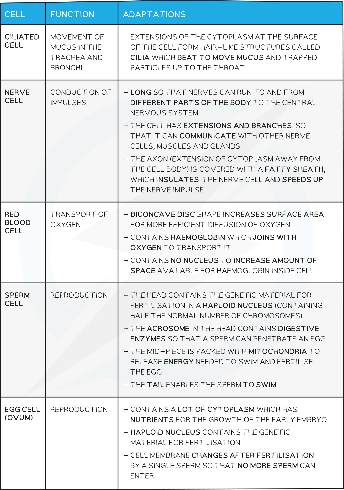
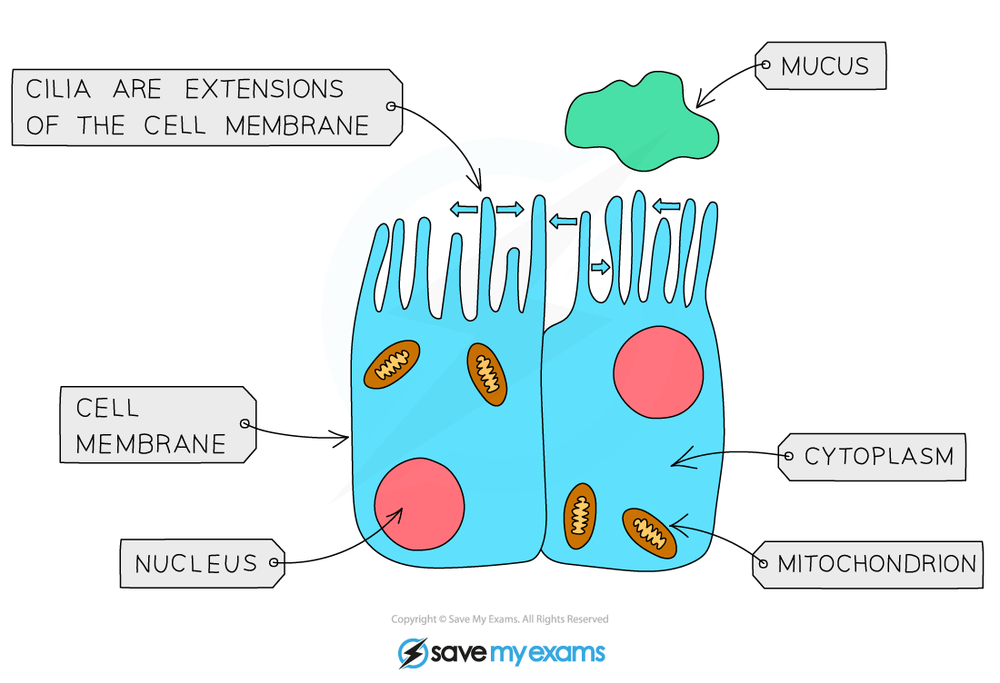
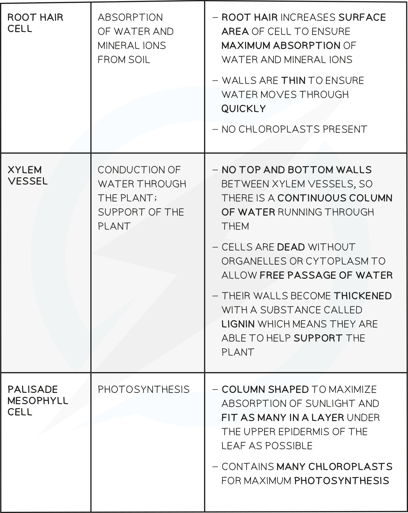
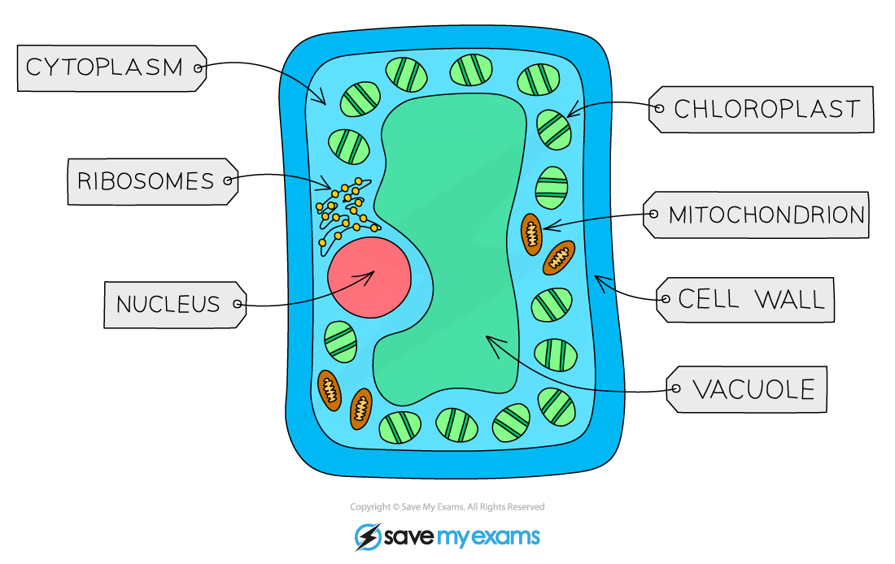
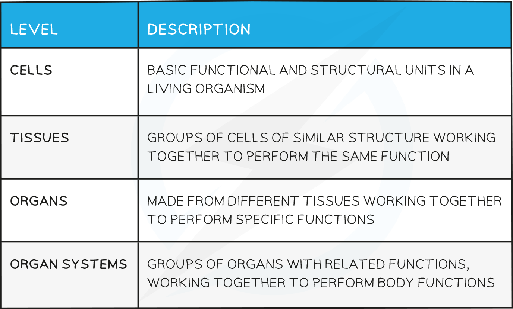
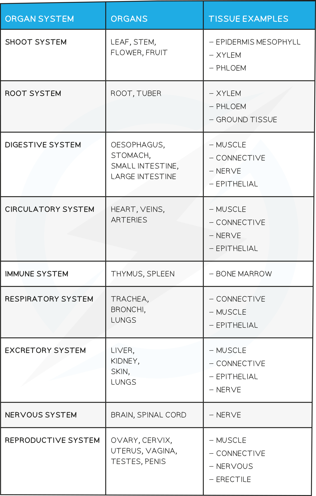

# Organisation of Cells

## Producing New Cells

> **Spec point** — `spcpt_HyFTMkCxS2prdz3P`

## Producing New Cells

- The body need to produce new cells in order to** grow** and **repair** itself
- New cells are produced from **existing cells** when they **divide**; this is known as cell division
- The new cells can then become specialised in order to carry out particular functions within the body

## Specialised Cells

> **Spec point** — `spcpt_VHY4RtxjHSJm6ZbJ`

## Specialised Cells

- Specialised cells are cells that are **adapted** to carry out **specific functions** within the body
- The **structure** of each specialised cell type aids cell **function**

### Examples of specialised cells

**Specialised cells in animals table**

#### Ciliated epithelial cell diagram

***Ciliated cells are adapted to aid movement of mucus in the airways***

#### Nerve cell diagram

***Nerve cells are adapted to carry nerve impulses around the body***

#### Red blood cell diagram

***Red blood cells are adapted to carry oxygen***

#### Sperm cell diagram

***Sperm cells are adapted to carry genetic information to egg cells***

#### Egg cell diagram

***Egg cells are adapted to aid fertilisation and support the developing embryo***

#### Specialised cells in plants table

#### Root hair cell diagram

***Root hair cells are adapted to aid absorption from the soil***

#### Palisade mesophyll cell diagram

***Palisade mesophyll cells are adapted to maximise photosynthesis***

> **Exam Hint**
> Note that the specification does not require detailed knowledge of the specialised features of xylem cells.

## Levels of Organisation in an Organism

> **Spec point** — `spcpt_bT3zBwCsBqRRNBpg`

## Levels of Organisation in an Organism

- Cells are **organised at different levels** within *multicellular* organisms
- This means that cells form tissues, which together form the organs, making up organ systems which carry out different functions to aid survival

#### Levels of organisation table

#### Levels of organisation example diagram

***Cells are organised at different levels to aid survival in multicellular organisms***

#### Levels of organisation examples table

> **Worked Example**
> 
> 
> **Answer:**
> 
> **Step 1: determine the level of organisation of structure 1**
> 
> Structure 1 is a leaf, and contains multiple tissues which all work together to carry out photosynthesis
> 
> Tissues working together to perform a specific function make up organs
> 
> Structure 1 is an **organ**
> 
> **Step 2: determine the** **level of organisation of structure 2**
> 
> Structure 2 is a palisade mesophyll cell, adapted to perform photosynthesis
> 
> Structure 2 is a **cell**
> 
> **Step 3:** **determine the** **level of organisation of structure 3**
> 
> Structure 3 is made up of several spongy mesophyll cells
> 
> Similar cells working together to carry out a function make up a tissue
> 
> Structure 3 is a **tissue**
> 
> **Step 4: determine which answer option is correct**
> 
> Answer option **B** gives organ, cell and tissue in the correct sequence

> **Exam Hint**
> Make sure that you know the definitions for the different levels of organisation.
