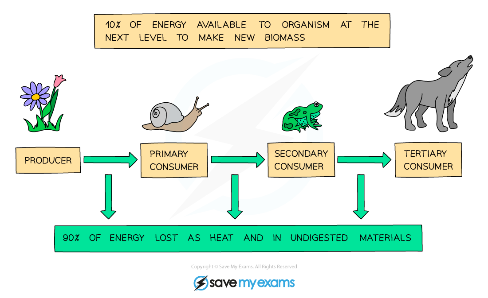

# Efficiency of Energy Transfer

## Efficiency of Energy Transfer: Extended

> **Spec point** — `spcpt_mdzFMx7DQz5thZBv`

## Efficiency of Energy Transfer: Extended

### Extended Tier Only

- Energy is transferred through food chains when organisms consume the tissues of other organisms
- The **transfer** of energy between trophic levels is** not efficient**

  - Not all of the energy **received by an organism** is transferred to stored energy in the tissues, but may instead be** lost to the environment**; energy lost in this way is not available to the next trophic level, e.g.
  
    - **Movement** requires energy
    - Respiration generates **heat** which is lost from the body to the environment
    - Processing and **excreting** metabolic waste, e.g. urea in urine, requires energy
  - Not all of the energy **stored in the tissues** of an organism is available to consumers at the next trophic level, e.g. because:
  
    - **Energy may be stored in body parts that are not eaten**, e.g. bones and fur of animals, or the roots of plants, so does not pass to the next trophic level
    - **Energy may be stored in parts of a consumed organism that cannot be easily digested**, so energy stored in undigested waste, i.e. faeces,** **does not pass to the next trophic level
- Energy loss at each trophic level explains why **food chains are rarely more than 5 organisms long**; at higher trophic levels organisms would need to eat an unrealistic volume of food to gain enough energy to survive

***Energy is lost at each trophic level***

### Energy transfer in a human food chain

- Humans are **omnivores**, obtaining energy from both plants and animals, and this gives us a **choice of what we eat**
- These choices, however, have an **impact on what we grow** and how we use ecosystems
- Think of the following food chains both involving humans:

wheat  →  cow   →   human

wheat  →   human

- Given what we know about **energy transfer in food chains**, it is clear that if humans eat wheat there is **much more energy available** to them than if they eat the cows that eat the wheat
- This is because **energy is lost from the cows**, so there is less available to pass on to humans
- Therefore, it is **more energy efficient for humans to be the herbivores** rather than the carnivores

  - In reality, we often feed animals on plants that we cannot eat, e.g. grass, or that are too widely distributed for us to collect, e.g. algae

> **Exam Hint**
> This is a complicated concept, so take your time getting to grips with the ideas explained here. It is a good idea to memorise a few different examples of ways in which energy is lost from food chains.
> 
> Make sure you read questions carefully and tailor your answer to the specific organism you are being asked about – e.g. plants do not produce urine or faeces so you could not give this as one of the ways in which they use energy that means it cannot be passed on!
