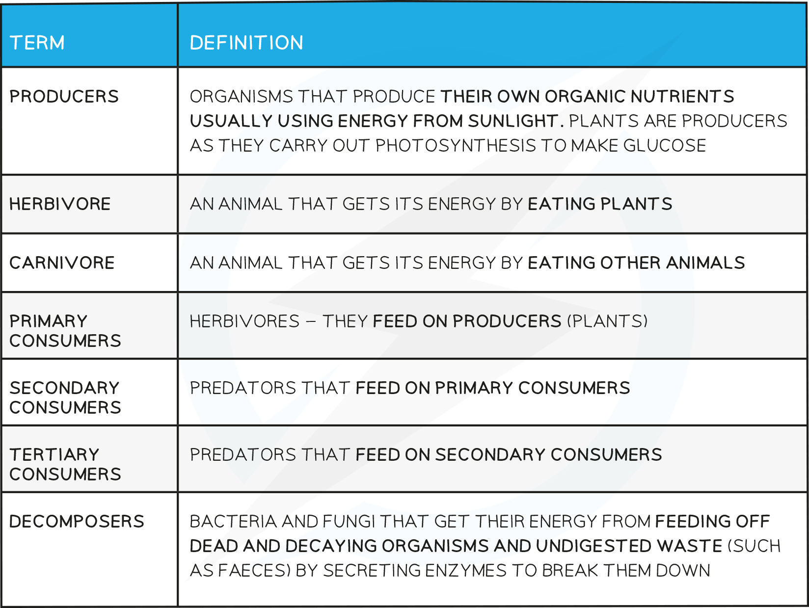
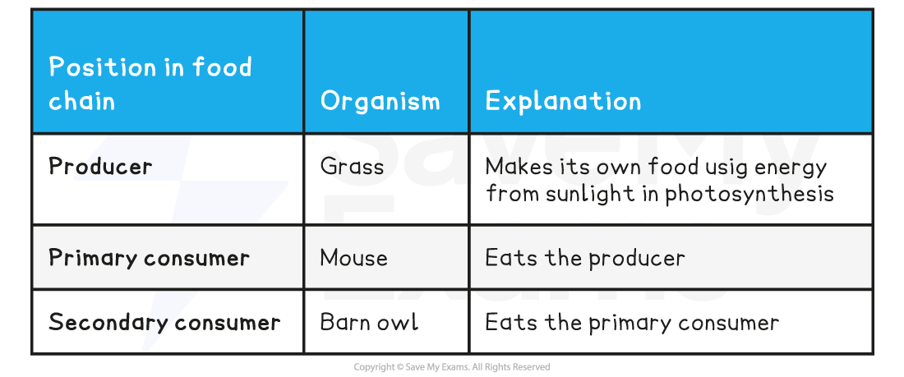
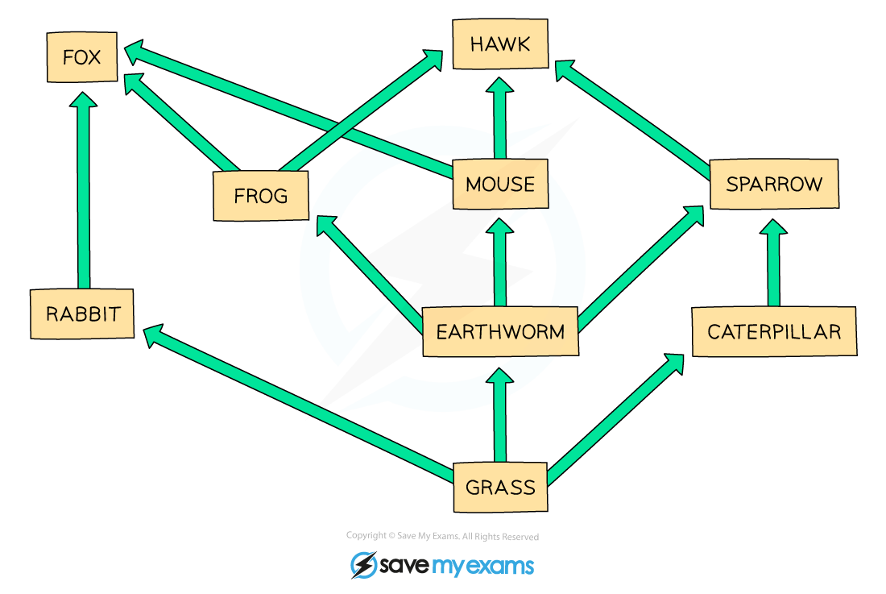

# Food Chains & Food Webs

## Food Chains & Food Webs

> **Spec point** — `spcpt_RX8zCrnsYxv6Nxzb`

## Food Chains & Food Webs

- A food chain shows the transfer of energy from one organism to the next, starting with a producer
- The source of all energy in a food chain is **light energy from the Sun**
- The arrows in a food chain show the **transfer of energy** from one trophic level to the next
- Energy is transferred from one organism to another by ingestion (eating)
- In the food chain above:

#### Food Webs

- A **food web** is a network of interconnected food chains
- Food webs are more realistic ways of showing connections between organisms within an ecosystem as **animals rarely exist on just one type of food source**

***A food web shows the interdependence of organisms***

- Food webs give us a lot more information about the transfer of energy in an ecosystem
- They also show **interdependence** - how the change in one population can affect others within the food web
- For example, in the food web above, if the **population of earthworms decreased**:

  - The population of **grass plants would increase** as there are now fewer species feeding off them
  - The populations of **frogs and mice would decrease significantly** as earthworms are their only food source
  - The population of **sparrows would decrease slightly** as they eat earthworms but also have another food source to rely on (caterpillars)
- Most of the changes in populations of animals and plants happen as a result of **human impact** - either by **overharvesting of food species** or by the **introduction of foreign species to a habitat**
- Due to interdependence, these can have **long-lasting knock-on effects** to organisms throughout a food chain or web

> **Exam Hint**
> Questions about interdependence in food webs are common and easy to gain marks on if you answer them fully and correctly.
> 
> Do not say an animal or plant would ‘die out’ as this is unlikely to happen – stick to using the words decrease or increase. If in doubt, always give your reason for the increase or decrease in population.
