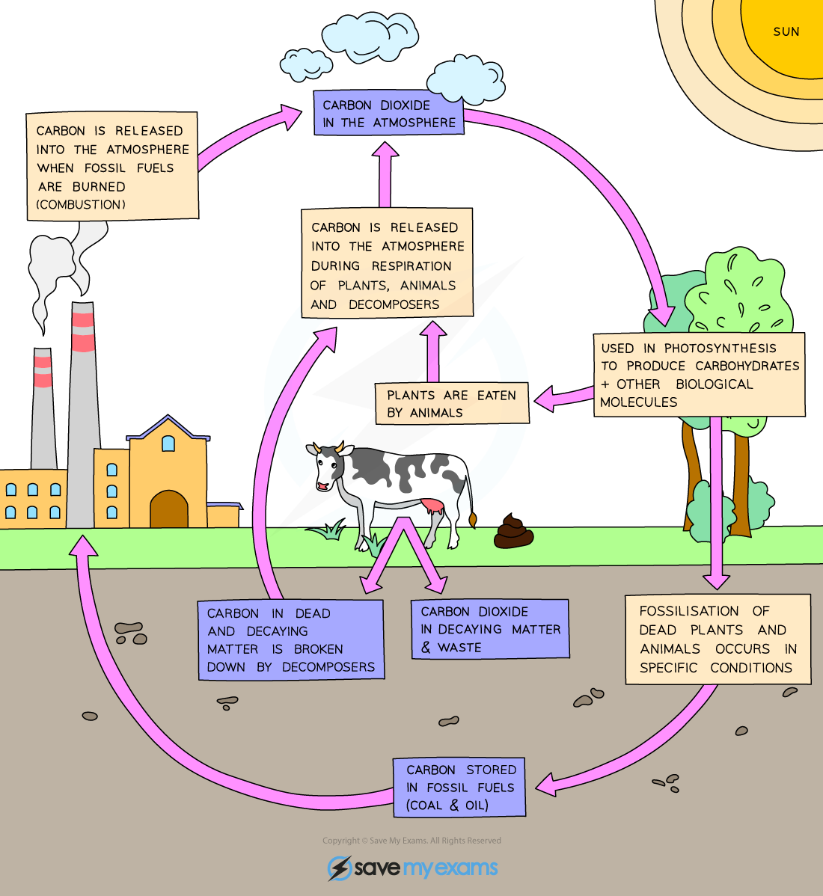

# Nutrient Cycles

## The Carbon Cycle

> **Spec point** — `spcpt_RdqGv7BkyDFX9b4J`

## The Carbon Cycle

- Nutrients such as carbon and nitrogen are not endless resources
- There is a finite amount of each element on the planet and as such, they need to be **recycled** in order to allow new organisms to be made and grow
- **Carbon** is taken out of the atmosphere in the form of **carbon dioxide** by plants to be used for photosynthesis
- It is passed on to animals (and microorganisms) by **feeding**
- It is returned to the atmosphere in the form of **carbon dioxide **by plants, animals and microorganisms as a result of **respiration**
- If animals and plants die in conditions where decomposing microorganisms are not present the carbon in their bodies can be converted, over millions of years and significant pressure, into **fossil fuels**
- When fossil fuels are burned (the process is known as **combustion**), the carbon combines with oxygen and **carbon dioxide is released** into the atmosphere
- **Increased use of fossil fuels** is contributing to an increase in the carbon dioxide content of the atmosphere
- In addition, **mass deforestation** is **reducing the amount of producers** available to take carbon dioxide out of the atmosphere by photosynthesis
- This problem is exacerbated by the fact that in many areas of the world, deforestation is taking place for land rather than for the trees themselves, and as such they are **burnt down, releasing yet more carbon dioxide into the atmosphere**

***The Carbon Cycle***

> **Exam Hint**
> The carbon cycle is simple:
> 
> - Carbon is taken out of the atmosphere by photosynthesis
> - It is passed on to animals and decomposers by feeding
> - It is returned by respiration; in plants, in animals and in decomposing
> - microorganisms In addition, it is returned (in increasing amounts) by combustion of fossil fuels
> 
> You should be able to identify what each arrow represents in any diagram of the carbon cycle.
