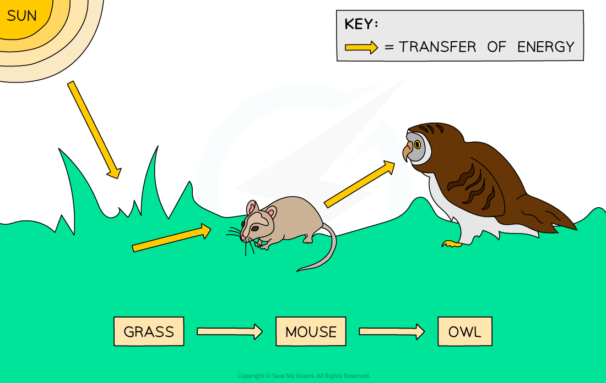

# Transfer of Energy

## Transfer of Energy

> **Spec point** — `spcpt_QFxVrWG2M3QZZVJj`

## Transfer of Energy

#### Transfer of Energy

- The Sun is the principal source of energy input to biological systems
- Energy flows through living organisms

  - Including light energy from the Sun and chemical energy in organisms
  - Energy is eventually transferred to the environment eg. as heat

***Energy is transferred from the sun and through the food chain***
