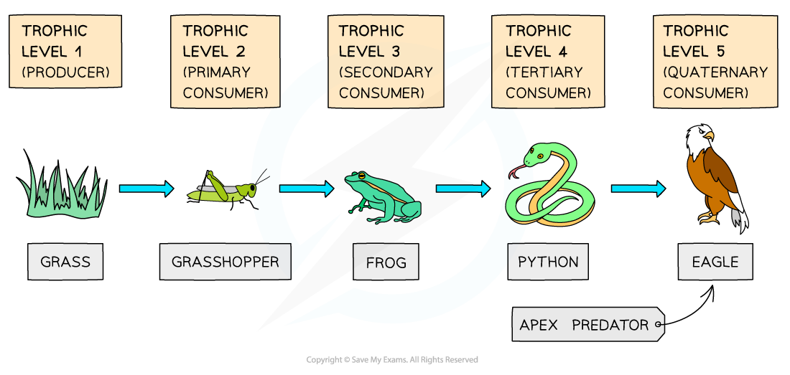

# Trophic Levels

## Trophic Levels: Extended

> **Spec point** — `spcpt_ZNxJCryKcsQHjSqc`

## Trophic Levels: Extended

### Extended Tier Only

- A trophic level is the **position of an organism** in a food chain or food web
- Examples of trophic levels include:

  - **Producers** are the **first trophic level** in all food chains
  - **Primary consumers** are at the **second trophic level**
  - **Secondary consumers** are at the **third trophic level**
  - **Tertiary consumers** are at the **fourth trophic level**
  - **Quaternary consumers** are at the **fifth trophic level**

***Trophic levels describe the position of organisms in a food chain***
