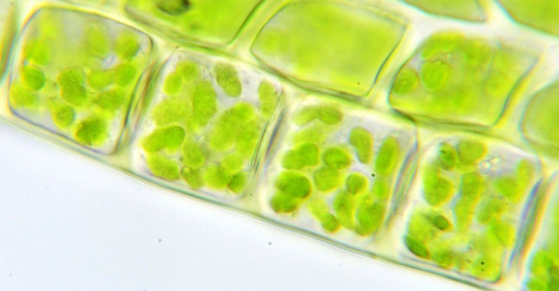

# Chlorophyll

## Chlorophyll in Photosynthesis

> **Spec point** — `spcpt_SjR5d57tgQyk4CB2`

## Chlorophyll in Photosynthesis

- Chlorophyll is a **green pigment** that is present inside plant cells

  - Chlorophyll reflects green light and so gives plants their characteristic green colour
- Chlorophyll is found within **chloroplasts**

*Kelvinsong, CC BY 3.0, via **[Wikimedia Commons](https://commons.wikimedia.org/wiki/File:Moss_chloroplasts_100%C3%97_objective.jpg)*

***Chlorophyll can be seen within chloroplasts under a light microscope***

## Chlorophyll in Photosynthesis: Extended

> **Spec point** — `spcpt_Y5B3KYcxbh34tR49`

## Chlorophyll in Photosynthesis: Extended

### Extended Tier Only

- The role of chlorophyll in photosynthesis is to absorb light energy
- Chlorophyll **transfers this light energy into chemical energy** during the synthesis of **carbohydrates**

  - Glucose is an example of a carbohydrate that contains stored chemical energy
