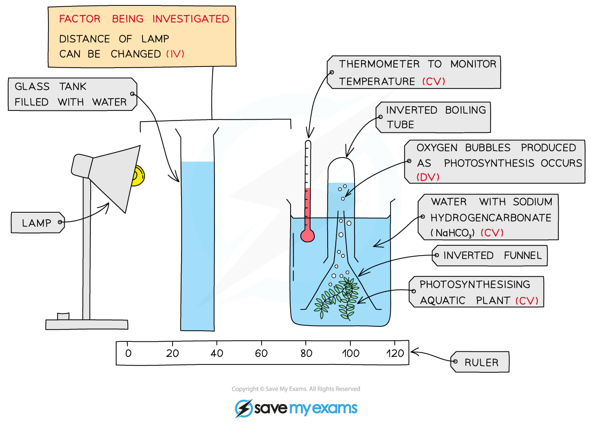
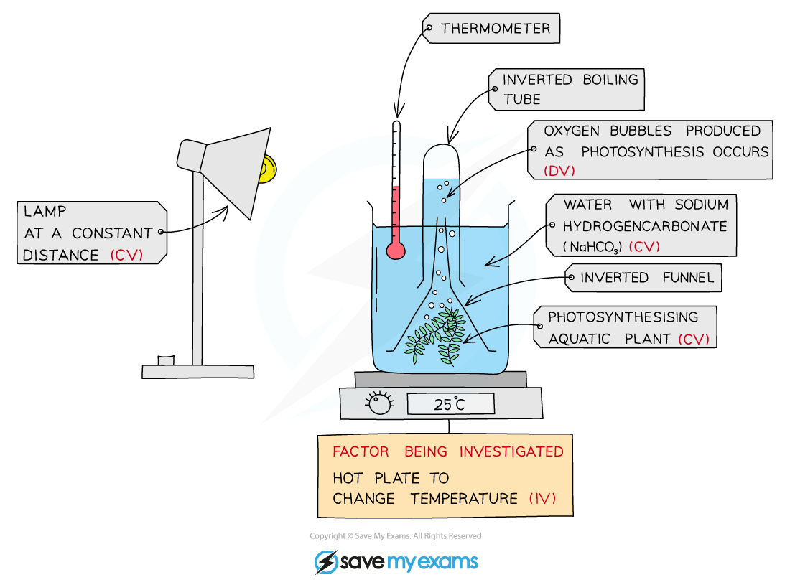
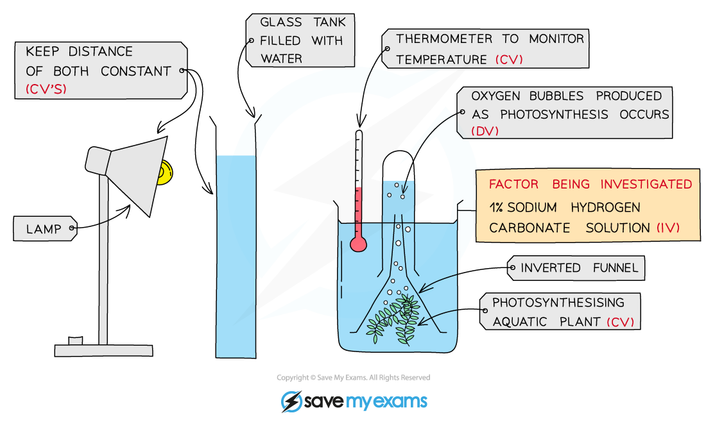

# Environmental Factors & the Rate of Photosynthesis

## Environmental Factors & the Rate of Photosynthesis

> **Spec point** — `spcpt_x7h68tb5mMhWWy4h`

## Environmental Factors & the Rate of Photosynthesis

- The rate of photosynthesis is affected by factors in the environment, e.g.

  - **Light intensity**
  
    - Photosynthesis involves the conversion of light energy into chemical energy, so an **increase in light intensity** will **increase the rate of photosynthesis**
  - **Carbon dioxide concentration**
  
    - Carbon dioxide is one of the raw materials for photosynthesis, so an **increase in carbon dioxide concentration** will **increase the rate of photosynthesis**
  - **Temperature**
  
    - Temperature affects the rate of enzyme-controlled reactions, of which photosynthesis is an example
    
      - As **temperature increases** molecules have more energy, so collide with each other more often, **increasing the rate of photosynthesis**
      - If **temperature increases too far** then enzymes may *denature*, resulting in a **decreased rate of photosynthesis**

### Investigating the effect of environmental factors on the rate of photosynthesis

- It is possible to use plant shoots to investigate the effect of environmental factors on the rate of photosynthesis
- **Aquatic plants** such as *Elodea* or *Cabomba**** ***can be used; this is because the oxygen that they produce during photosynthesis forms **bubbles** in the water
- The **number of bubbles produced per unit time**, e.g. per minute, gives a measure of the rate of photosynthesis

  - The more bubbles produced per minute, the faster the rate of photosynthesis
- A more accurate version of this experiment is to collect the oxygen released in a tube inverted over the top of the pondweed over a longer period of time and then measure the **volume of oxygen** collected using a gas syringe

#### Investigating the effect of light intensity on the rate of photosynthesis

- Light intensity can be varied by positioning a lamp at different distances from a beaker containing pondweed

***The effect of light intensity on the rate of photosynthesis can be investigated by placing a lamp at different distances and measuring oxygen production in an aquatic plant***

#### Investigating the effect of temperature on the rate of photosynthesis

- Temperature can be varied by altering the temperature of the water in the beaker, e.g. using a water bath

***The effect of temperature on the rate of photosynthesis can be investigated by changing the temperature of a water bath and measuring oxygen production in an aquatic plant***

#### Investigating the effect of carbon dioxide concentration on the rate of photosynthesis

- The carbon dioxide concentration of the water in a beaker can be controlled by dissolving different amounts of **sodium hydrogen carbonate** in the water

***The effect of carbon dioxide concentration on the rate of photosynthesis can be investigated by changing the sodium hydrogen carbonate concentration and measuring oxygen production in an aquatic plant***

- Care must be taken when investigating a condition to **keep all other variables constant **in order to ensure a **fair test**
- For example, when investigating changing light intensity, a **glass tank** should be placed in between the lamp and the beaker to **absorb heat** from the lamp and so avoid changing the temperature of the water as well as the light intensity
