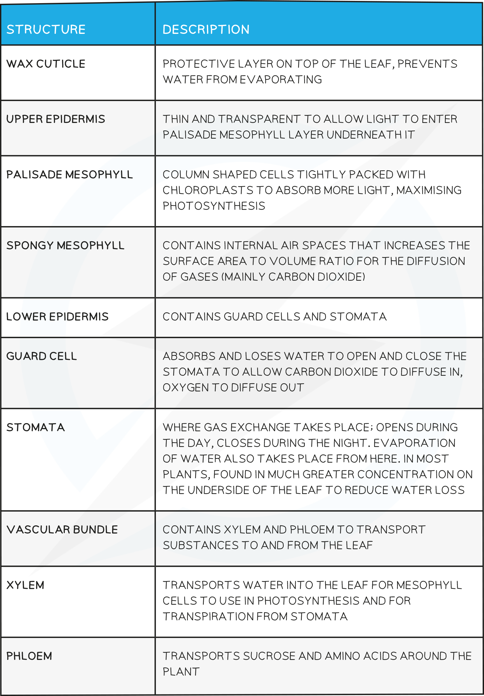

# Identifying Leaf Structures in a Dicotyledonous Plant

## Identifying Leaf Structures in a Dicotyledonous Plant

> **Spec point** — `spcpt_hRhXx25YTYmp3pNS`

## Identifying Leaf Structures in a Dicotyledonous Plant

- The leaves of dicotyledonous plants contain the following structures:

  - Chloroplasts
  - Cuticle
  - Guard cells
  - Stomata
  - Upper and lower epidermis
  - Palisade mesophyll
  - Spongy mesophyll
  - Air spaces
  - Vascular bundles containing xylem and phloem

#### Dicotyledonous plant leaf structure diagram

***Leaf structure is adapted to maximise the rate of photosynthesis***

## Identifying Leaf Structures in a Dicotyledonous Plant: Extended

> **Spec point** — `spcpt_PpYMQtvsB7Z2Yzrn`

## Identifying Leaf Structures in a Dicotyledonous Plant: Extended

### Extended Tier Only

- The structures within dicotyledonous leaves are all adaptations that aid photosynthesis:

#### Leaf structures and functions table

