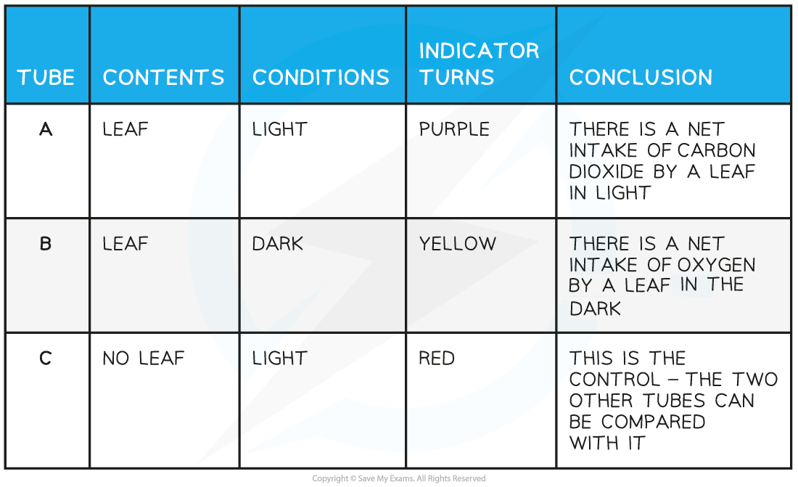

# Investigating Gas Exchange

## Investigating Gas Exchange: Extended

> **Spec point** — `spcpt_P8QVdWms8kDbkxdY`

## Investigating Gas Exchange: Extended

### Extended Tier Only

- In order to carry out respiration and photosynthesis plants must carry out gas exchange with their environment

  - Plants **respire all the time**; for this they need to **take in oxygen **and** release carbon dioxide**
  - Plants **photosynthesise during daylight** hours, for which they need to **take in carbon dioxide **and** release oxygen**

***Plants carry out respiration and photosynthesis***

- During the day **plants photosynthesise at a faster rate than they respire** so the overall direction of gas exchange is:

  - Carbon dioxide diffuses into the leaves
  - Oxygen diffuses out
- At night** plants respire at a faster rate than they photosynthesise **so the overall direction of gas exchange is different:

  - Oxygen diffuses into leaves
  - Carbon dioxide diffuses out
- The overall direction of movement of a gas is described as its **net** movement

### Investigating gas exchange in plants

- We can investigate the effect of light on the **net gas exchange** in an aquatic plant using a **pH indicator** such as **hydrogencarbonate**

  - This is possible because carbon dioxide is an acidic gas when dissolved in water
- Hydrogencarbonate indicator shows the **carbon dioxide concentration** in solution: 

- Several leaves from the same plant are placed in stoppered boiling tubes containing **hydrogencarbonate indicator**
- The effect of light can then be investigated over a period of a few hours
- Results from a typical experiment are shown in the table below:

