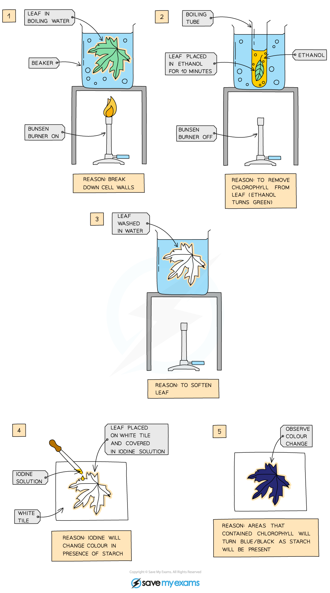

# Investigating the Need for Chlorophyll, Light & Carbon Dioxide

## Investigating the Need for Chlorophyll

> **Spec point** — `spcpt_M6hkXJ3RCqYsJq7H`

## Investigating the Need for Chlorophyll

### Testing leaves for starch

- Although plants make glucose in photosynthesis, leaves cannot be tested for its presence as the glucose is quickly used, converted into other substances and transported or **stored as starch**
- Starch is stored in chloroplasts so **testing a leaf for starch** is a reliable indicator of photosynthesis
- Leaves can be tested for starch using the following procedure:

  - A leaf is dropped in **boiling water** to **kill the leaf**
  - The leaf is left for 5-10 minutes in hot **ethanol** in a boiling tube
  
    - This **removes the chlorophyll** so colour change due to iodine can be seen more clearly
  - The leaf is dipped in boiling water again to soften it
  - The leaf is spread out on a white tile and covered with **iodine solution**
  - Photosynthesising regions of the leaf will turn **blue-black** due to the presence of stored starch

### Demonstrating the need for chlorophyll

- This method can be used to **demonstrate that chlorophyll is needed** for photosynthesis by using *variegated* leaves

  - When the leaf is tested **only the areas that contain chlorophyll stain blue-black**
  - The areas that have no chlorophyll remain orange-brown as **no photosynthesis is occurring **here and so no starch is stored

***Leaves can be tested for starch as an indicator of photosynthesis***

- Care must be taken when carrying out this practical as **ethanol is extremely flammable, **so at that stage of the experiment the Bunsen burner should be turned off.
- The safest way to heat the ethanol is in an electric water bath rather than using a beaker over a Bunsen burner with an open flame

## Investigating the Need for Light

> **Spec point** — `spcpt_MmJWPZxTHs3RrFm7`

## Investigating the Need for Light

- The starch test can be used to demonstrate that light is needed for photosynthesis as follows:

  - The plant should be **destarched** by placing in a dark cupboard for 24 hours
  
    - This ensures that **any starch already present in the leaves will be used up** and will not affect the results of the experiment
  - Following destarching, a leaf of the plant can be **partially covered with aluminium foil** and the plant placed in sunlight for a day
  - The leaf can then be removed and tested for starch using iodine
- The area of the leaf that was covered with aluminium foil will **remain orange-brown** as it did not receive any sunlight and could not photosynthesise, while the area exposed to sunlight will turn **blue-black**
- This indicates that **light is necessary for photosynthesis**

## Investigating the Need for Carbon Dioxide

> **Spec point** — `spcpt_2X6GXm34zntcy7Ds`

## Investigating the Need for Carbon Dioxide

- The starch test can be used to demonstrate the need for carbon dioxide as follows:

  - Destarch two plants by placing in the dark for a prolonged period of time
  - Place one plant in a bell jar which contains a beaker of **sodium hydroxide**
  
    - Sodium hydroxide **absorbs carbon dioxide** from the surrounding air
  - Place the other plant in a bell jar containing a beaker of water, which will **not absorb carbon dioxide** from the surrounding air
  
    - This is an experimental control
  - Place both plants in bright light for several hours
  - Test both plants for starch using iodine
- The leaf from the plant placed near sodium hydroxide will **remain orange-brown** as it could not photosynthesise due to lack of carbon dioxide
- The leaf from the plant placed near water should turn blue-black as it had all necessary requirements for photosynthesis

***The need for carbon dioxide in photosynthesis can be demonstrated using sodium hydroxide***
