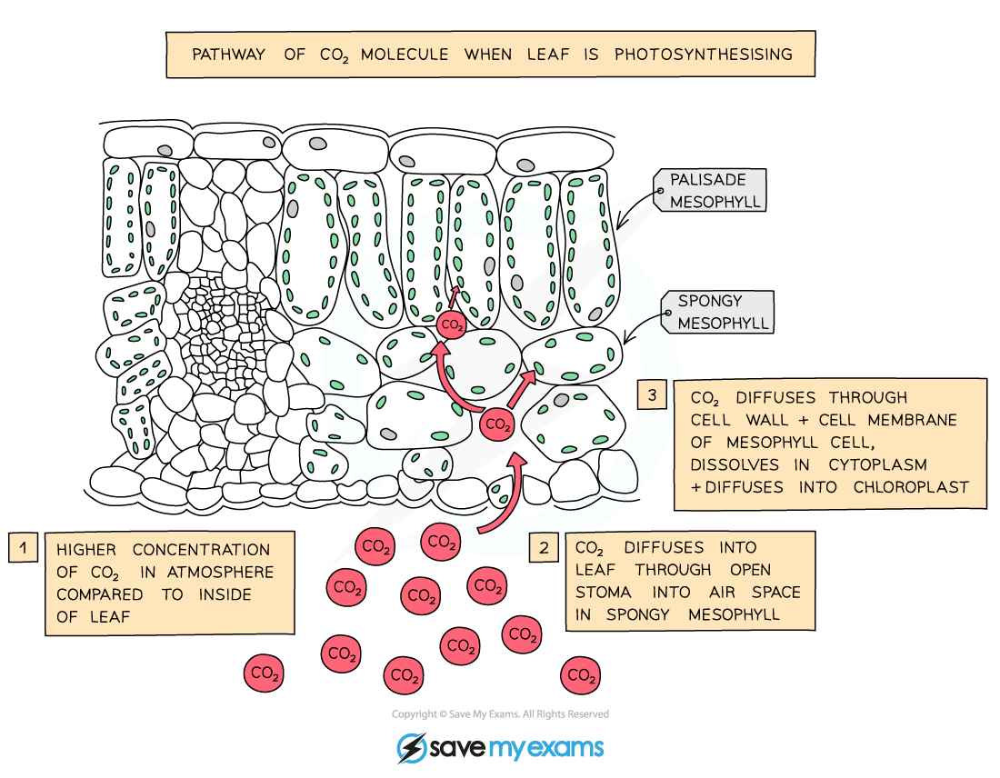

# Leaf Adaptations

## Leaf Adaptations for Photosynthesis

> **Spec point** — `spcpt_Fw8G5pkpDJqmdG3z`

## Leaf Adaptations for Photosynthesis

- Leaves are the plant organs that carry out **photosynthesis**
- Their structure is adapted to maximise photosynthesis, e.g.

  - They have a **large surface area** to maximise light absorption
  - They are **thin** to allow efficient movement of gases between leaf cells and the surrounding air

#### Leaf structure diagram

***Leaves are adapted to carry out photosynthesis by being thin; this allows gases to diffuse quickly, e.g. carbon dioxide can diffuse quickly between the surrounding air and the photosynthesising cells of the leaf***
