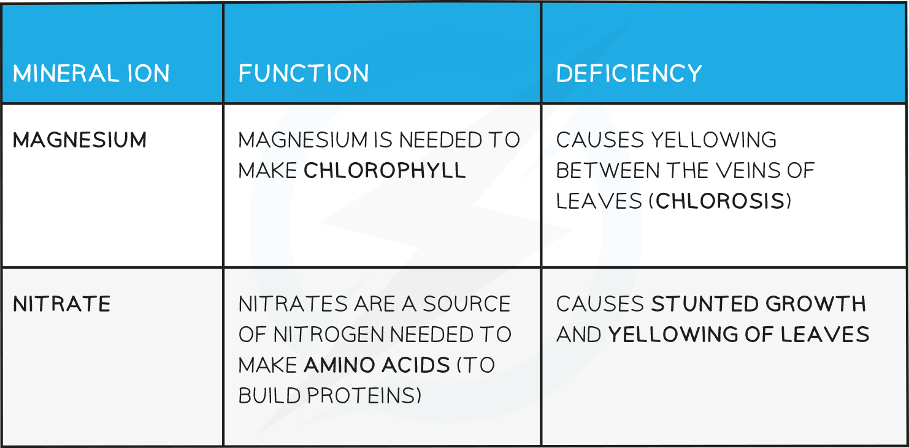

# Minerals in Plants

## Minerals in Plants: Extended

> **Spec point** — `spcpt_4bg2tjBWVQZDRZcN`

## Minerals in Plants: Extended

### Extended Tier Only

- Photosynthesis produces glucose, which contains the chemical elements carbon, hydrogen and oxygen; these chemical elements come from carbon dioxide in the air and water in the soil
- While glucose contains all of the chemical elements needed for the production of some molecules, e.g. starch and lipids, other molecules require **additional chemical elements**, so plants need **mineral ions** from the soil to provide these elements, e.g.

  - **Amino acids** in proteins contain nitrogen so plants need **nitrate ions**
  - **Chlorophyll** contains magnesium so plants need **magnesium ions**
- Root hair cells are specially adapted to aid the **absorption of mineral ions** from the** soil**
- Plants that are deficient in minerals may show deficiency symptoms, e.g.

  - Nitrate deficiency can result in stunted growth due to a lack of protein production
  - Magnesium deficiency can lead to yellow leaves due to a lack of chlorophyll

#### Plant minerals table

