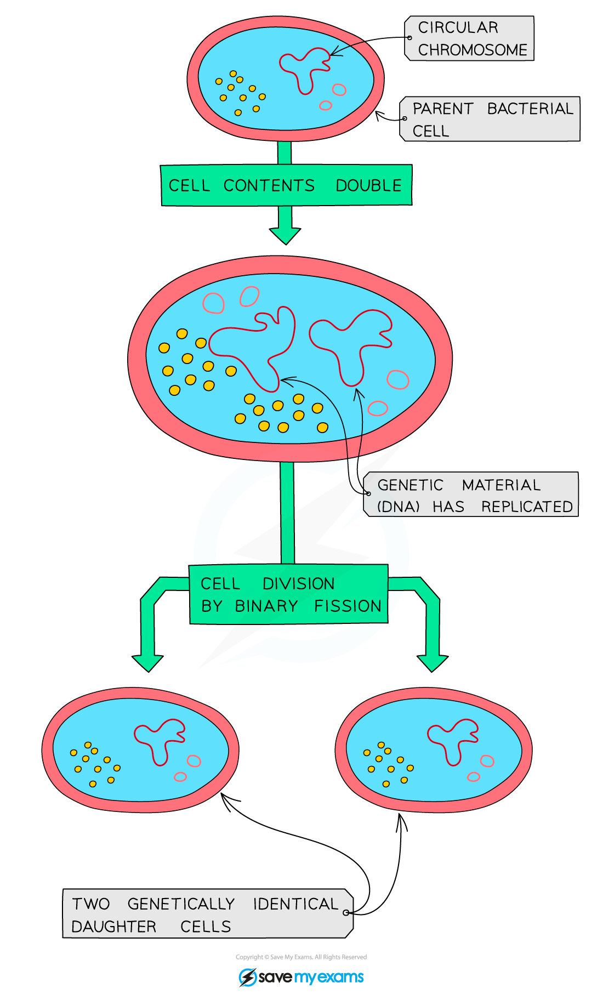
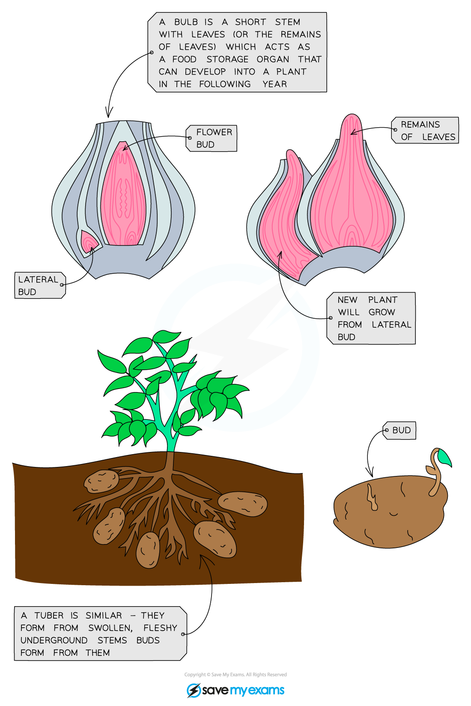
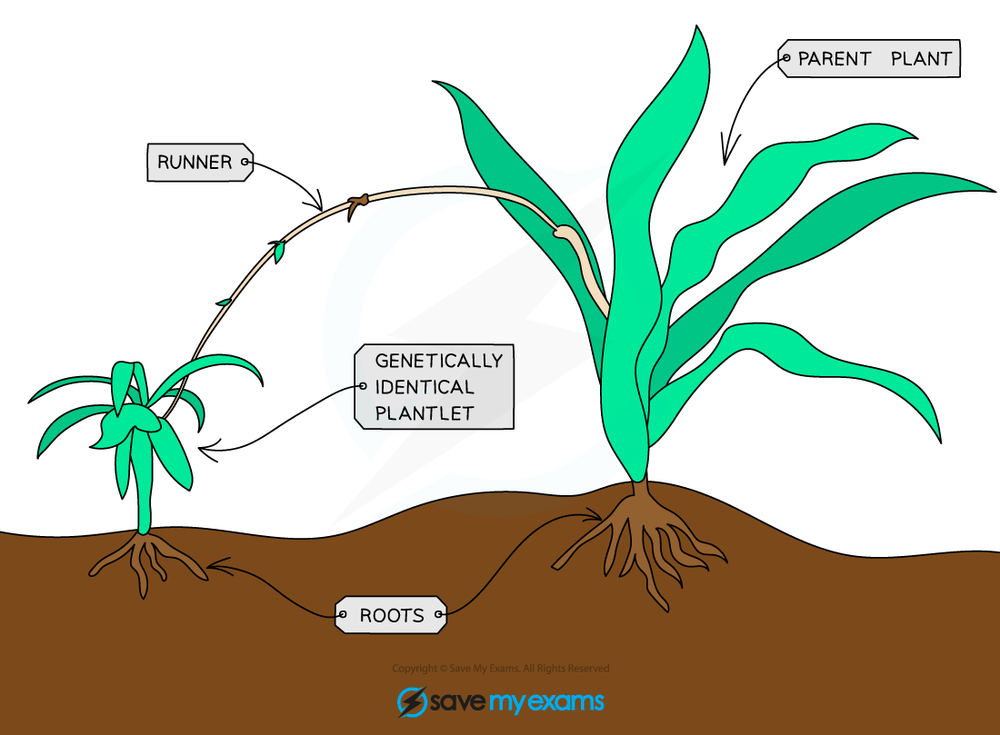
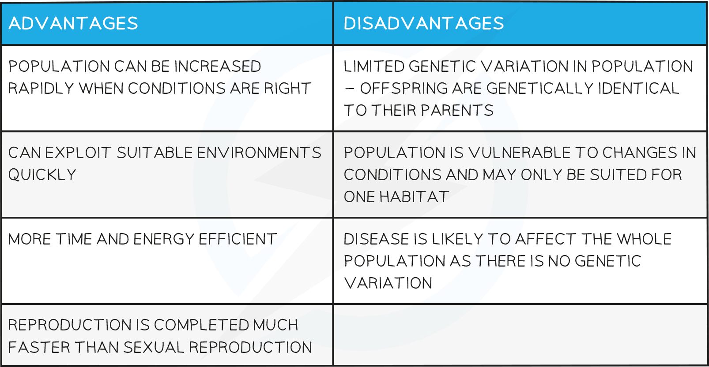

# Asexual Reproduction

## Asexual Reproduction

> **Spec point** — `spcpt_yRXpY3PmyZzbvGg3`

## Asexual Reproduction

- Asexual reproduction does not involve sex cells or fertilisation
- **Only one parent is required** so there is no fusion of gametes and no mixing of genetic information
- As a result, the offspring are **genetically identical to the parent and to each other** (clones)
- Asexual reproduction is defined as **a process resulting in genetically identical offspring from one parent**

## Examples of Asexual Reproduction

> **Spec point** — `spcpt_xv3vFw37jmcD4s8q`

## Examples of Asexual Reproduction

#### Bacteria

- Bacteria produce exact genetic copies of themselves in a type of asexual reproduction called **binary fission**:

***Bacteria produce exact genetic copies of themselves in a type of asexual reproduction called binary fission***

#### Plants

- Plants can reproduce asexually using **bulbs **and **tubers**; these are food storage organs from which budding can occur, producing new plants which are genetically identical to the parent plant:

***Some plants develop underground food storage organs that will develop into next years plants - they can take different forms, such as bulbs or tubers***

- Some plants grow side shoots called **runners **that contain tiny plantlets on them (a good example is strawberry plants). These will grow roots and develop into separate plants, again being genetically identical to the parent plant:

***Some plants grow side shoots called runners that contain tiny plantlets on them. These will grow roots and develop into separate plants.***

## Advantages & Disadvantages of Asexual Reproduction: Extended

> **Spec point** — `spcpt_dXk4vwCkRGwM34Gw`

## Advantages & Disadvantages of Asexual Reproduction: Extended

### Extended Tier Only

- Specifically in **crop plants**, asexual reproduction can be advantageous as it means that a plant that has good characteristics (high yield, disease-resistant, hardy) can be made to reproduce asexually and the **entire crop will show the same characteristics**
