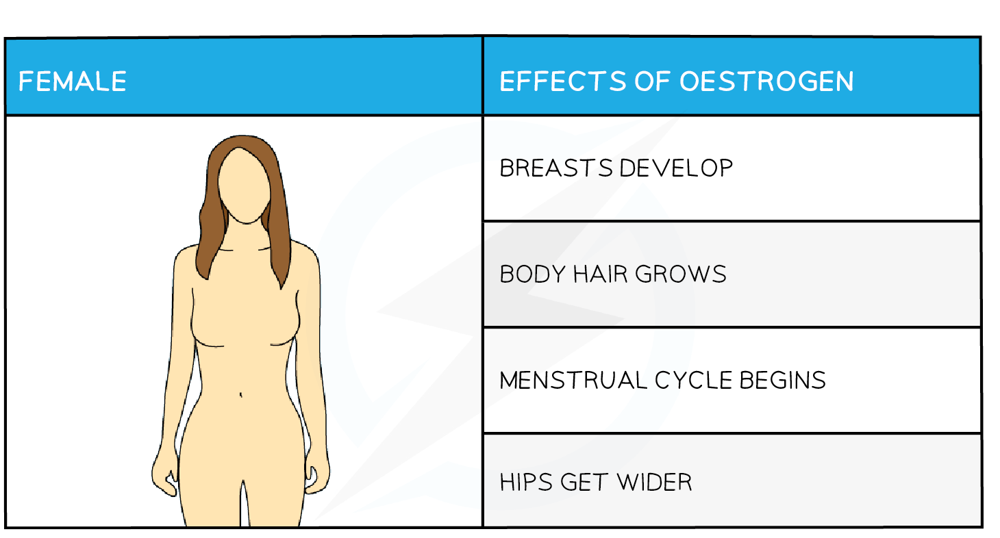
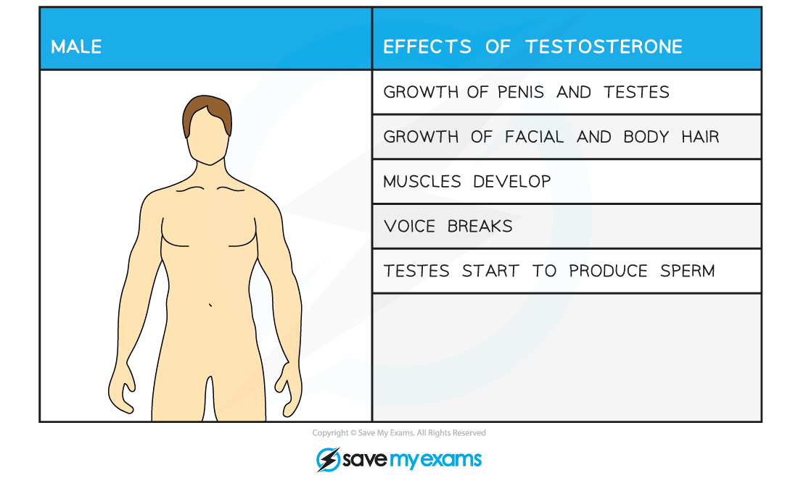
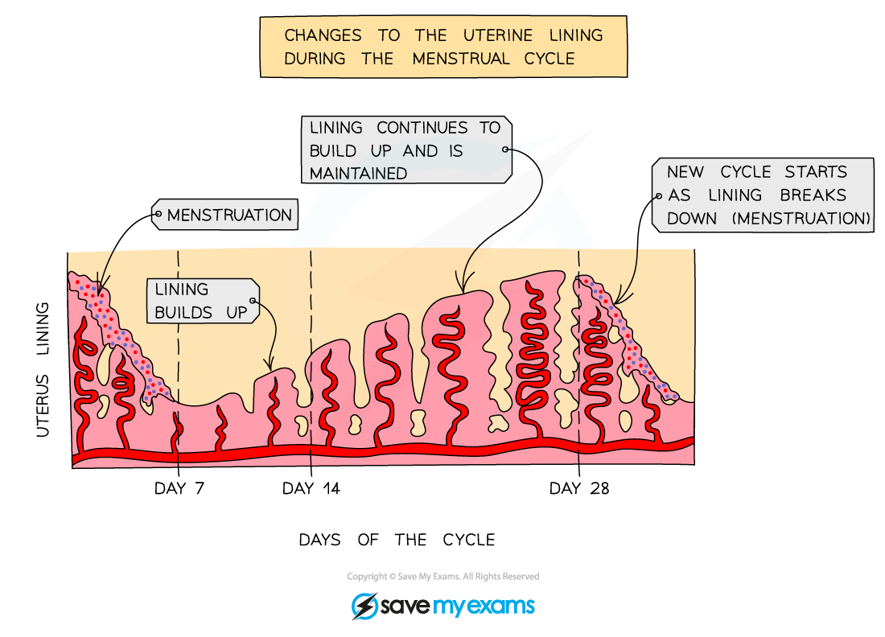

# Sexual Hormones in Humans

## Secondary Sexual Characteristics

> **Spec point** — `spcpt_rVhjJGsDsJ5JkMRR`

## Secondary Sexual Characteristics

- Primary sexual characteristics are present during development in the uterus and are the differences in reproductive organs etc between males and females
- **Secondary sexual characteristics** are the **changes that occur during puberty** as children become adolescents
- They are controlled by the release of **hormones:**

  - **oestrogen** in girls
  - **testosterone** in boys

#### Human secondary sexual characteristics

- Female secondary sexual characteristics:

- Male secondary sexual characteristics:

- Some changes occur to both boys and girls, including:

  - **growth of sexual organs**
  - **growth of body hair**
- **Emotional changes** also occur due to the increased levels of hormones in the body

  - These include more interest in sex and increased mood swings

## The Menstrual Cycle

> **Spec point** — `spcpt_m9hkNp8mB9RQs4rf`

## The Menstrual Cycle

- The menstrual cycle starts in early adolescence in girls (around age 12) and is controlled by **hormones**
- The average menstrual cycle is **28 days** long
- Key changes occur in the **ovaries** and the **lining of the uterus**
- *ovulation* occurs about **halfway** through the cycle (day **14**) and the egg then travels down the oviduct to the uterus
- Failure to fertilise the egg causes **menstruation** (commonly called a period) to occur

  - This is caused by the **breakdown of the thickened lining of the uterus**
- Menstruation lasts around **5 - 7 days** and signals the beginning of the next cycle
- After menstruation finishes, the lining of the uterus starts to thicken again in preparation for possible implantation in the next cycle

***Changes in the lining of the uterus during the menstrual cycle are represented graphically. The pink represents the lining getting thicker and thinner; the red lines represent blood vessels.***

> **Exam Hint**
> You do **not** need to know any details of sex hormones involved in the menstrual cycle.
