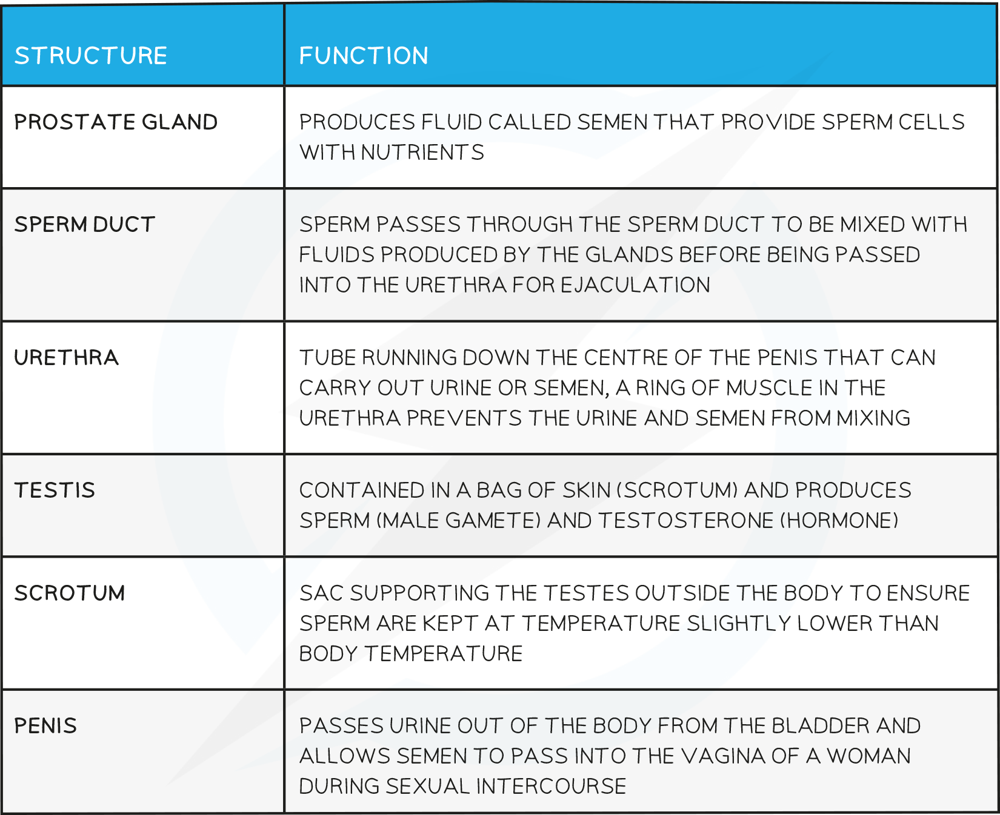
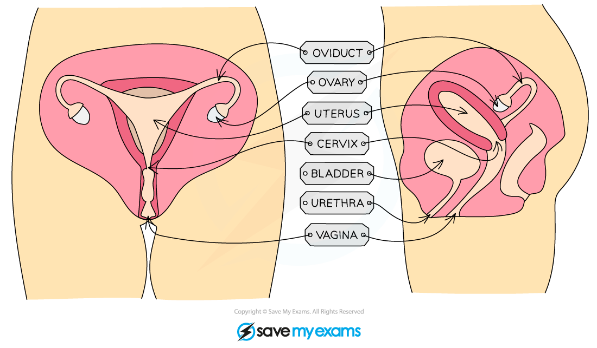
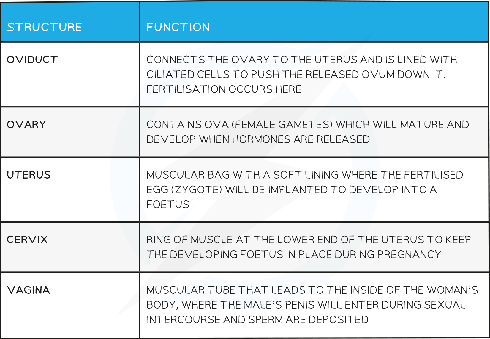
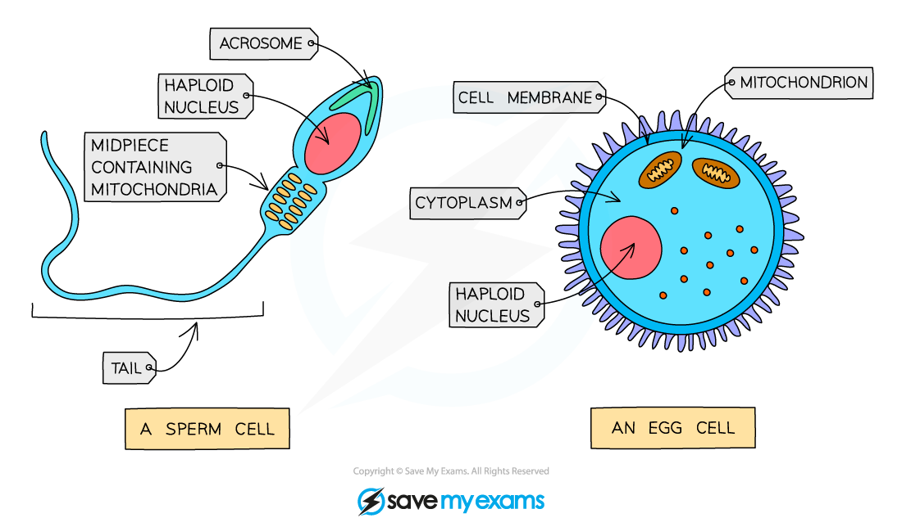
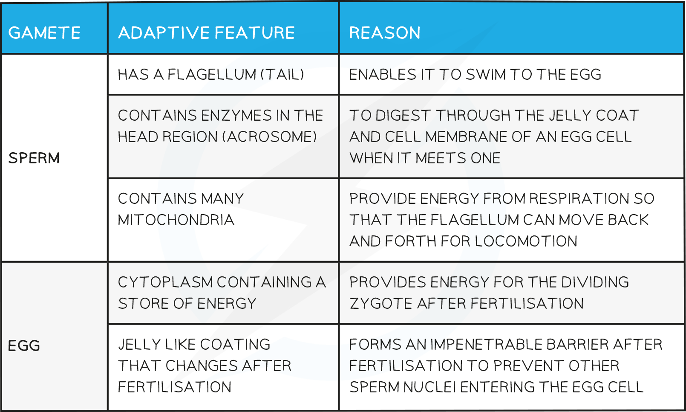
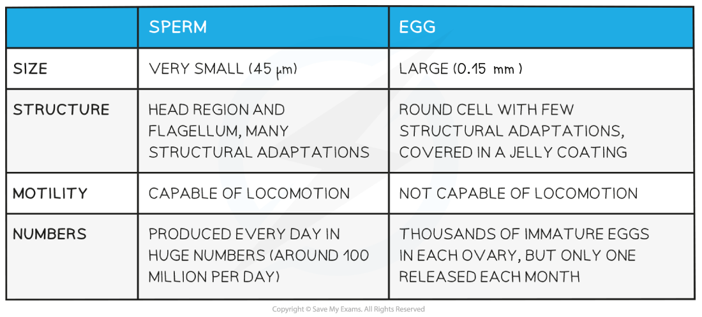

# Sexual Reproduction in Humans

## The Male Reproduction System

> **Spec point** — `spcpt_Ghy9xkGBXgSyykH7`

## The Male Reproduction System

***The male reproductive system***

- Male reproductive structures and their function:

## The Female Reproduction System

> **Spec point** — `spcpt_nPRpSmk4zFRyKjmS`

## The Female Reproduction System

***The female reproductive system***

- Female reproductive structures and their function:

## Gametes & Fertilisation

> **Spec point** — `spcpt_vGtTC3DvcdH5pxFj`

## Gametes & Fertilisation

- Fertilisation is the **fusion of the nuclei from a male gamete (sperm cell) and a female gamete (egg cell)**
- It occurs in the **oviducts**

***Human gametes: the sperm cell and egg cell***

## Adaptations of Gametes: Extended

> **Spec point** — `spcpt_TkcN6NYdpFPJMpvk`

## Adaptations of Gametes: Extended

### Extended Tier Only

### Extended Tier Only

#### Comparison of Male & Female Gametes

