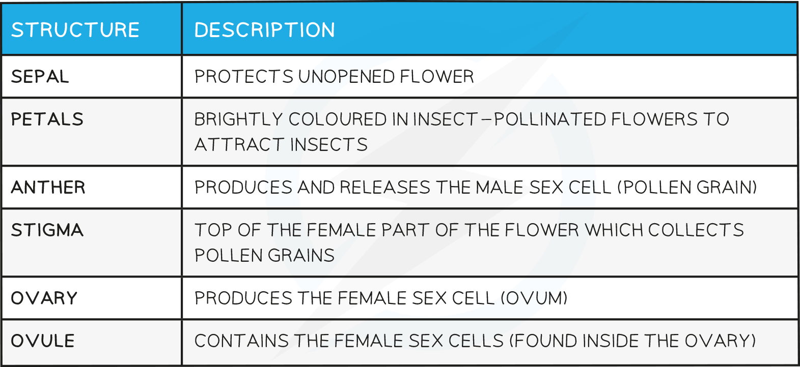
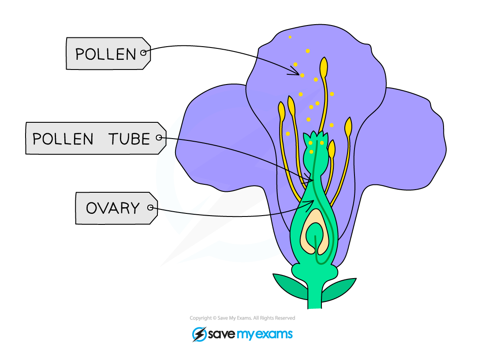
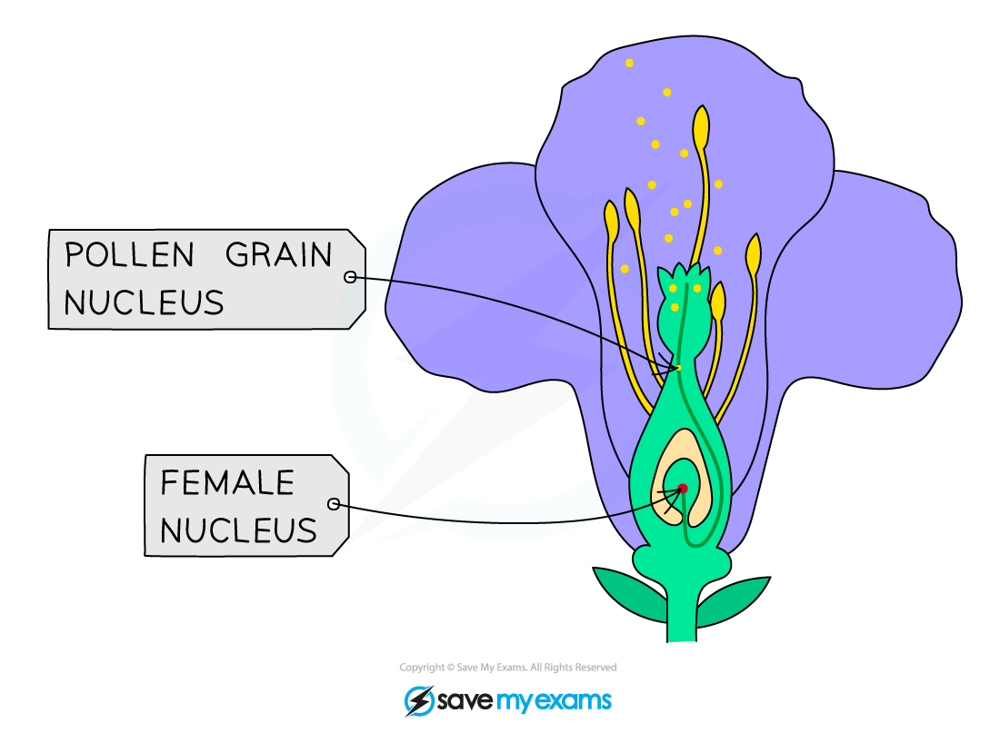
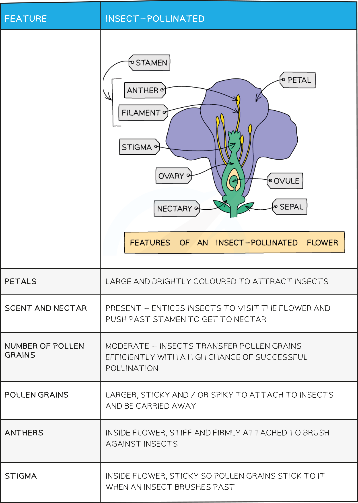
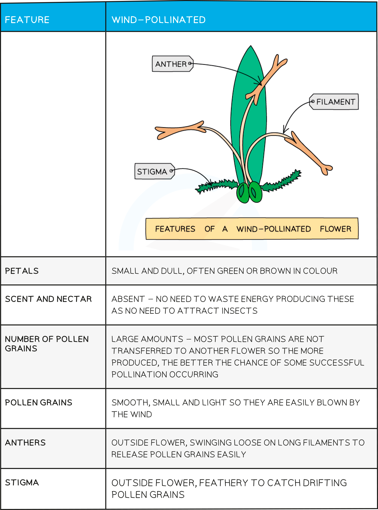
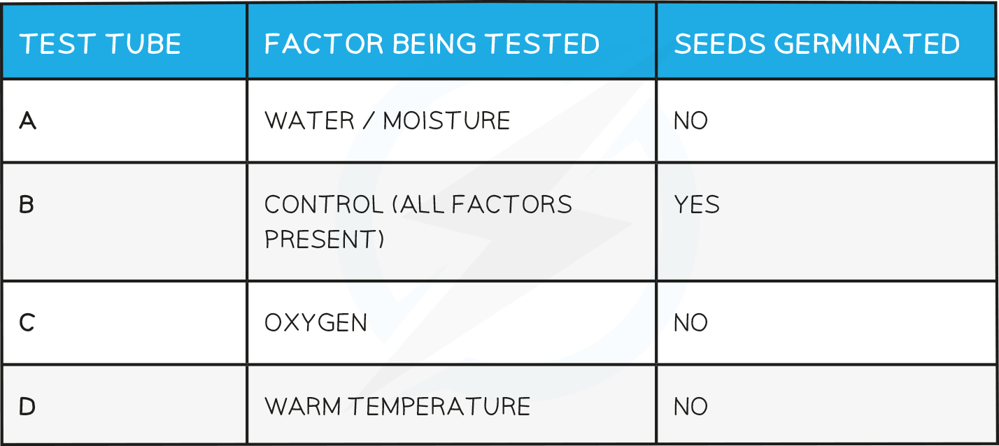

# Sexual Reproduction in Plants

## Insect-Pollinated Flowers

> **Spec point** — `spcpt_dXP2ZqCZsrBNPKwG`

## Insect-Pollinated Flowers

- Flowers are the **reproductive organs** of plants
- They can contain both male and female reproductive parts
- The male parts of flowers produce **pollen** grains; these contain a nucleus that functions as the **male gamete**

  - Unlike the male gamete in humans (sperm), pollen is **not capable of locomotion** (moving from one place to another)
- The female parts of flowers contain **ovules **that contain the **female** **gamete**
- During pollination pollen is transferred from the male to the female parts of the flower; this can occur due:

  - Insect pollination
  - Wind pollination

#### General flower structure diagram

***Flowers are the reproductive organs of plants***

#### Flower structures and functions table

> **Exam Hint**
> For the **core syllabus**, you need to be able to **identify**, **draw **and state the **functions **of the following parts of an **insect-pollinated flower:**
> 
> - Sepals
> - Petals
> - Stamens
> - Filaments
> - Anthers
> - Carpels
> - Style
> - Stigma
> - Ovary
> - Ovules

## Wind-Pollinated Flowers: Extended

> **Spec point** — `spcpt_bhK8BpDDKR53NhYZ`

## Wind-Pollinated Flowers: Extended

### Extended Tier Only

- The anthers and stigma of wind-pollinated flowers are arranged differently to those in an insect-pollinated flower

  - The **anthers** **hang outside the flower** on long filaments so that wind can catch the pollen
  - The **stigmas extend outside the flower** and are often feathery to allow them to catch wind-borne pollen easily

> **Exam Hint**
> Students studying the extended syllabus need to be able to identify and describe the **anthers** and **stigmas** of wind-pollinated flowers.
> 
> Note that students studying the core syllabus do still need to be able to describe the structural adaptations of wind-pollinated flowers; this is covered in the core content below.

## Pollination & Fertilisation

> **Spec point** — `spcpt_6NbPmZQ5HYbcwRbK`

## Pollination & Fertilisation

### Pollination and fertilisation

- Pollination can be defined as:

**The transfer of pollen grains from an anther to a stigma**

- Fertilisation occurs after pollination when a **pollen nucleus fuses with an ovule nucleus**
- The process of fertilisation in flowers involves:

  - The pollen grows a **pollen tube **down the style
  - The nucleus inside the pollen grain **moves down the tube** towards the ovule
- After fertilisation a **zygote** has been formed which will develop into a seed

***Fertilisation in a flowering plant involves fusion of a pollen nucleus with a nucleus inside an ovule***

> **Exam Hint**
> Students often get confused between pollination and fertilisation in plants; they are not the same thing!
> 
> - Pollination is **transfer of pollen** grains from anther to stigma
> - Fertilisation, as in animals, is the **fusion of gametes**

### Adaptations of flowers

- The features of insect and wind pollination flowers means that they are adapted to be pollinated by different mechanisms:

#### Adaptations of insect-pollinated flowers table

#### Adaptations of wind-pollinated flowers table

> **Worked Example**
> 
> 
> The answer is:
> 
> - B; **[1 mark]**
> 
> > *The pollen grains in image 1 are large and have spikes on their surface which will allow them to attach themselves to an insect so they can be transported to another flower/plant.*
> 
> > *The pollen grains in 2 and 3 are smaller and will be able to catch the wind easily for wind-pollination.*

## Factors Affecting Germination of Seeds

> **Spec point** — `spcpt_7XYt9rMRWMsr6qv3`

## Factors Affecting Germination of Seeds

- **Germination** is the **start of growth in the seed**
- Three factors are required for successful germination:

  - **Water** - allows the seed to swell up and the enzymes in the embryo to start working so that growth can occur
  - **Oxygen** - so that energy can be released for germination
  - **Temperature** - germination improves as temperature rises (up to a maximum) as the reactions which take place are controlled by enzymes
- As carbon dioxide is not necessary for germination but also does not inhibit it, it makes no difference whether it is present or not

#### Investigating Germination

- Set up 4 boiling tubes each containing 10 cress seeds on cotton wool
- Set each test tube as shown in diagram below
- Leave tubes in the set environment for a period of time:

  - A, B (control) and C incubated at 20°C;
  - D placed in a fridge at 4°C
- Compare results and see which tube has the greatest number of germinated seeds

***Conditions required for germination***

#### Conditions required for germination - results:

