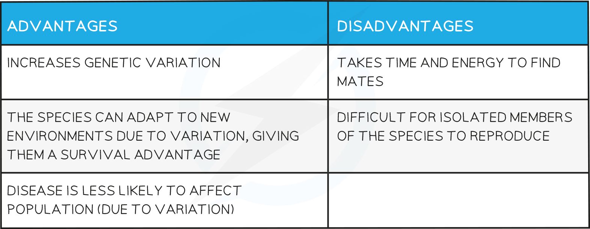

# Sexual Reproduction

## Sexual Reproduction

> **Spec point** — `spcpt_78sK3VJ7SPwhMtZT`

## Sexual Reproduction

- Sexual reproduction can be described as

**A process involving the fusion of the nuclei of two ***gametes*** to form a ***zygote*

- Sexual reproduction results in the production of offspring that are** genetically different** from each other

### Sexual reproduction and species

- Sexual reproduction can contribute to the success of a species in the wild as it increases the genetic variation present in a population
- A species is a group of organisms that can **reproduce** to produce** fertile offspring**

## Haploid & Diploid Cells: Extended

> **Spec point** — `spcpt_9gS6YKXdH8TFS4gv`

## Haploid & Diploid Cells: Extended

### Extended Tier Only

- The nuclei of **gametes **are **haploid**

  - They contain **half **the number of chromosomes of a normal body cell
  - In humans, this is **23 **chromosomes
- The nucleus of a **zygote **is **diploid**

  - It contains the **same **number of chromosomes as a normal body cell
  - In humans, this is **23 **<u>**pairs**</u> of chromosomes
  - The zygote continues to stay diploid as it grows into a fetus and embryo during pregnancy

***Gametes nuclei are haploid, zygote nuclei are diploid***

> **Exam Hint**
> It is important to note the use of the word "nucleus" when describing gametes and zygotes - it is their ***nucleus ***that is either haploid or diploid, so do be sure to sure to describe this in full.

## Advantages & Disadvantages of Sexual Reproduction: Extended

> **Spec point** — `spcpt_Hpx3DbrsRW6RnfVC`

## Advantages & Disadvantages of Sexual Reproduction: Extended

### Extended Tier Only

- Advantages and disadvantages of sexual reproduction to a **population in the wild **include:

