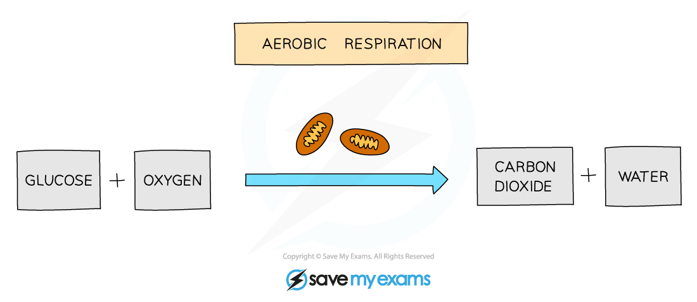
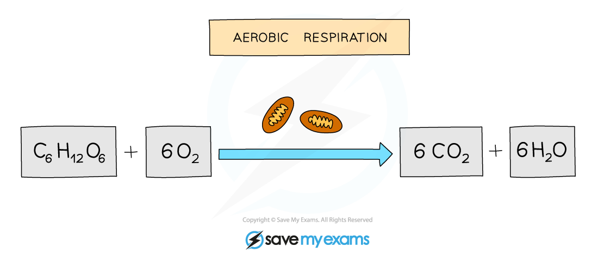

# Aerobic Respiration

## Respiration is a Chemical Reaction

> **Spec point** — `spcpt_PKVY9yJw83P6325q`

## Respiration is a Chemical Reaction

- **Aerobic** respiration requires **oxygen **and is defined as **the chemical reactions in cells that use oxygen to break down nutrient molecules to release energy**
- It is the **complete breakdown of glucose **to release a **relatively large amount of energy** for use in cell processes
- It **produces carbon dioxide and water** as well as releasing useful cellular energy

***Word equation for aerobic respiration***

> **Exam Hint**
> Remember this equation is the same as the photosynthesis equation, only the other way around, so if you know one, you know the other one too!

## Balanced Chemical Equation for Aerobic Respiration: Extended

> **Spec point** — `spcpt_yp8gRvpyPv7zGGck`

## Balanced Chemical Equation for Aerobic Respiration: Extended

***Balanced equation for aerobic respiration***

> **Exam Hint**
> There are usually **3 marks given for the aerobic respiration chemical equation** in an exam:
> 
> - one for getting the correct **formula for glucose and oxygen**
> - one for getting the correct **formula for carbon dioxide and water**
> - one for **balancing the equation** correctly
> 
> So make sure you can do all three to gain maximum marks!
