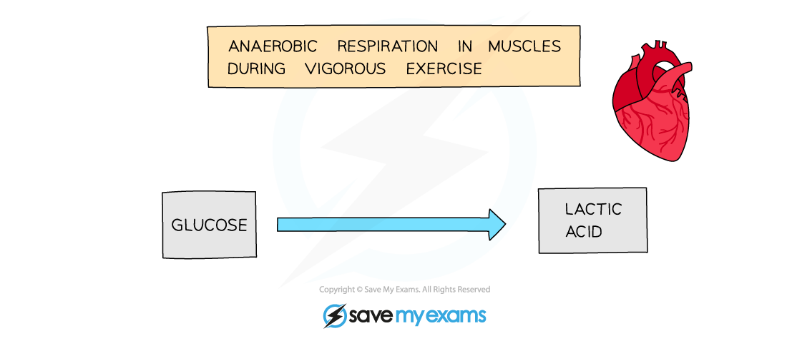
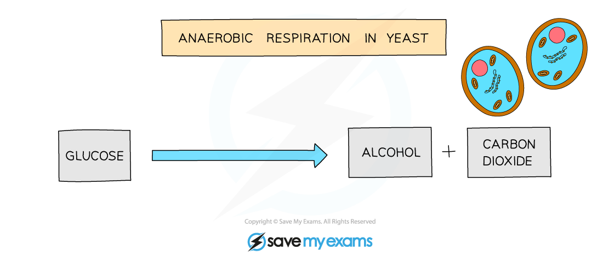
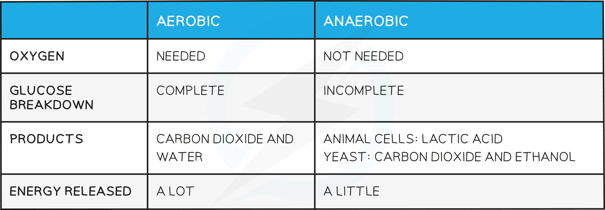

# Anaerobic Respiration

## Anaerobic Respiration - Respiration Without Oxygen: Extended

> **Spec point** — `spcpt_KWcBkVSy8yjbrR8F`

## Anaerobic Respiration - Respiration Without Oxygen: Extended

### Extended Tier Only

- **Anaerobic** respiration does **not require oxygen **and is defined as **the chemical reactions in cells that break down nutrient molecules to release energy without using oxygen**
- It is the **incomplete breakdown of glucose** and releases a **relatively small amount** of energy (compared to aerobic respiration) for use in cell processes
- It produces different breakdown products depending on the type of organism it is taking place in
- You need to know the equations for anaerobic respiration in **humans** (animals) and the microorganism **yeast**

#### Anaerobic Respiration in Animals

- Anaerobic respiration mainly takes place in muscle cells during vigorous exercise
- When we exercise vigorously, our muscles have a **higher demand for energy** than when we are resting or exercising normally. Our bodies can only deliver so much oxygen to our muscle cells for aerobic respiration
- In this instance, as much glucose as possible is broken down with **oxygen**, and some glucose is broken down without it, producing **lactic acid** instead
- There is still energy stored within the bonds of lactic acid molecules that the cell could use; for this reason, **less energy is released** when glucose is broken down anaerobically

* *

***Word equation for anaerobic respiration in animals***

#### Anaerobic Respiration in Yeast

- We take advantage of the products of anaerobic respiration in **yeast **by using it in **bread making**, where

  - The carbon dioxide produced causes dough to rise
- And in **brewing**, where

  - The ethanol produced gives the beer its alcoholic nature
  - The carbon dioxide produced gives beer its fizz

* *

***Word equation for anaerobic respiration in yeast***

## Anaerobic Respiration & Oxygen Debt: Extended

> **Spec point** — `spcpt_GfsndxxBpsJ29TX6`

## Anaerobic Respiration & Oxygen Debt: Extended

### Extended Tier Only

- **Lactic acid** builds up in muscle cells and **lowers the pH** of the cells (making them more acidic)
- This could **denature the enzymes in cells** so it needs to be removed
- Cells excrete lactic acid into the blood. When blood passes through the **liver**, lactic acid is taken up into liver cells where it is **oxidised, **producing carbon dioxide and water (Lactic acid reacts with oxygen - this is actually **aerobic respiration** with lactic acid as the nutrient molecule instead of glucose)
- So the waste products of lactic acid oxidation are carbon dioxide and water
- This is the reason we **continue to breath heavily** and our **heart rate remains high **even after finishing exercise - we need to transport the lactic acid from our muscles to the liver, and continue getting larger amounts of oxygen into the blood to oxidise the lactic acid
- This is known as **‘repaying the oxygen debt’**

> **Exam Hint**
> It's easy to get confused about the products of anaerobic respiration in animals: The ONLY product made is **lactic acid**. Carbon dioxide is NOT one of the products made in anaerobic respiration in animals: It is made in **aerobic** respiration!

#### Comparing anaerobic and aerobic respiration

