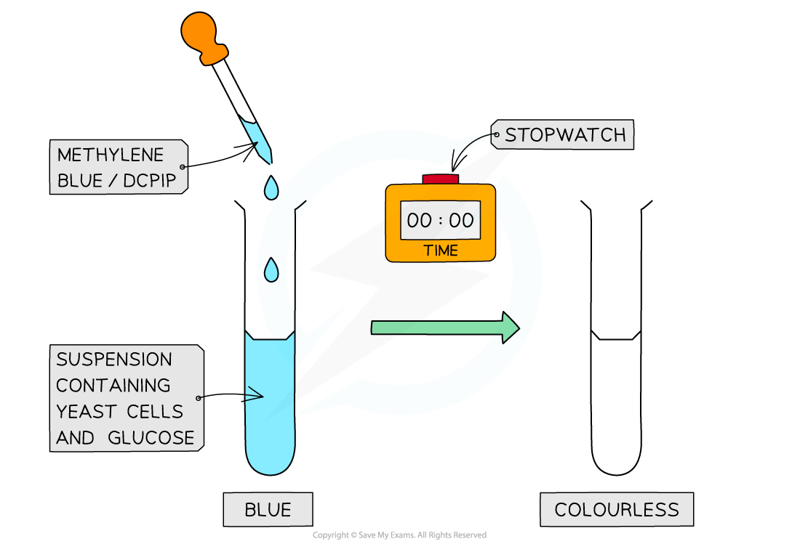

# Respiration in Cells

## Uses of Energy in Living Organisms

> **Spec point** — `spcpt_b6gr4yJcJZ4kZsfV`

## Uses of Energy in Living Organisms

- Respiration is a chemical process that involves the breakdown of nutrient molecules (specifically glucose) in order to **release the energy** stored within the bonds of these molecules

  - Respiration is** enzyme-controlled**
- Respiration can take place with oxygen (**aerobically**) or without oxygen (**anaerobically**).

  - Much less energy is released for each glucose molecule broken down anaerobically compared to the energy released when it is broken down aerobically
- Respiration occurs **in all living cells**; most of the chemical reactions in aerobic respiration take place in the mitochondria
- Humans need the energy released during respiration carry out many processes

  - Muscle contraction
  - Protein synthesis
  - Cell division (to make new cells)
  - Growth
  - Active transport across cell membranes
  - Generation of nerve impulses
  - Maintaining a constant internal body temperature

***The energy released during respiration is used to fuel many processes in the human body***

> **Exam Hint**
> Avoid the common misconception that respiration is breathing! Respiration is a series of **chemical reactions that** **release energy** from glucose inside cells. Be careful that you always state that energy is **released**, it is NEVER made, produce, or created.
> 
> The respiration reactions are all controlled by enzymes. You need to be able to state this in an exam!

## The Effect of Temperature on Respiration

> **Spec point** — `spcpt_7vQ6nkXrRc8sbWvt`

## The Effect of Temperature on Respiration

#### The Effect of Temperature on the Respiration of Yeast Cells

- There are several different experimental methods that can be used to investigate the rate of respiration in organisms
- Some methods, such as the experiment described below, involve the use of a coloured indicator
- An indicator can be used to investigate the effect of **temperature** on the **rate of aerobic respiration **in yeast
- **Methylene blue** dye is a suitable indicator
- This dye can be added to a suspension of living **yeast cells** because it doesn't damage cells
- Yeast can respire both aerobically and anaerobically, though in this experiment it is their rate of **aerobic respiration** that is being investigated
- The time taken for the methylene blue to discolour (lose its colour) is a measure of the rate of respiration of the yeast cells in the suspension

  - The faster the dye changes from blue to colourless, the faster the rate of respiration

#### Apparatus

- Yeast suspension
- Glucose solution
- Test tubes
- Stopwatch
- Methylene blue
- Temperature-controlled water bath(s)

***Methylene blue is added to a solution of aerobically respiring yeast cells in a glucose suspension. The rate at which the solution turns from blue to colourless gives a measure of the rate of aerobic respiration.***

#### Independent and dependent variables

- The** independent variable** is the variable that is **changed on purpose**

  - Here the investigation studies the **effect of temperature** on respiration rate in yeast, so the independent variable is **temperature**
  - Different temperatures are achieved using **water baths**
- The **dependent variable** is the variable that is **measured**, i.e. the variable that *depends* on the independent variable for its outcome

  - In an investigation into the effect of temperature on the **rate of respiration in yeast,** the **rate of respiration** is the dependent variable
  - The rate is measured here by recording the **time taken** for methylene blue dye to change from **blue to colourless**

#### Controlling other variables

- It is important when investigating the effect of one variable on another to ensure that any other variables that might influence the dependent variable are being controlled, e.g.

  - **Volume/concentration of dye added**: if there are more dye molecules present then the time taken for the colour change to occur may be longer
  - **Volume/concentration of yeast suspension**: if more yeast cells are present then more respiration will be occurring and the dye will change colour more quickly
  - **Concentration of glucose**: if there is limited glucose in one tube then the respiration of those yeast cells will be limited
  - **pH**: pH can influence enzyme activity, and enzymes are involved in the reactions of respiration, so pH can therefore influence the rate of respiration
  
    - A buffer solution can be used to control the pH level to ensure that no enzymes are denatured

#### Results

- A graph should be plotted that shows 'temperature' (x-axis) against 'time for colour change' (y-axis)

  - It is also possible to convert 'time for colour change' into a unit of reaction rate; this has been done in the graph shown below
- As the **temperature increases** **up to 40 °C**, the **rate of respiration increases** so the time taken for the solution to become colourless reduces

  - Raising the temperature of a solution gives the molecules in the solution more kinetic energy, so they move around more and the enzymes and substrates involved in respiration collide with each other more frequently
- As **temperature increases above 40 °C**, the **rate of respiration decreases** so the time taken for the solution to become colourless increases

  - Increasing the temperature above a certain point causes the enzymes involved in respiration to denature; the shape of their active site changes and they can no longer form enzyme-substrate complexes

***The time taken for methylene blue to change colour can be converted into 'rate of respiration' and plotted on a graph. Note that a graph of temperature against 'time for colour change' will look different to the graph shown here.***
