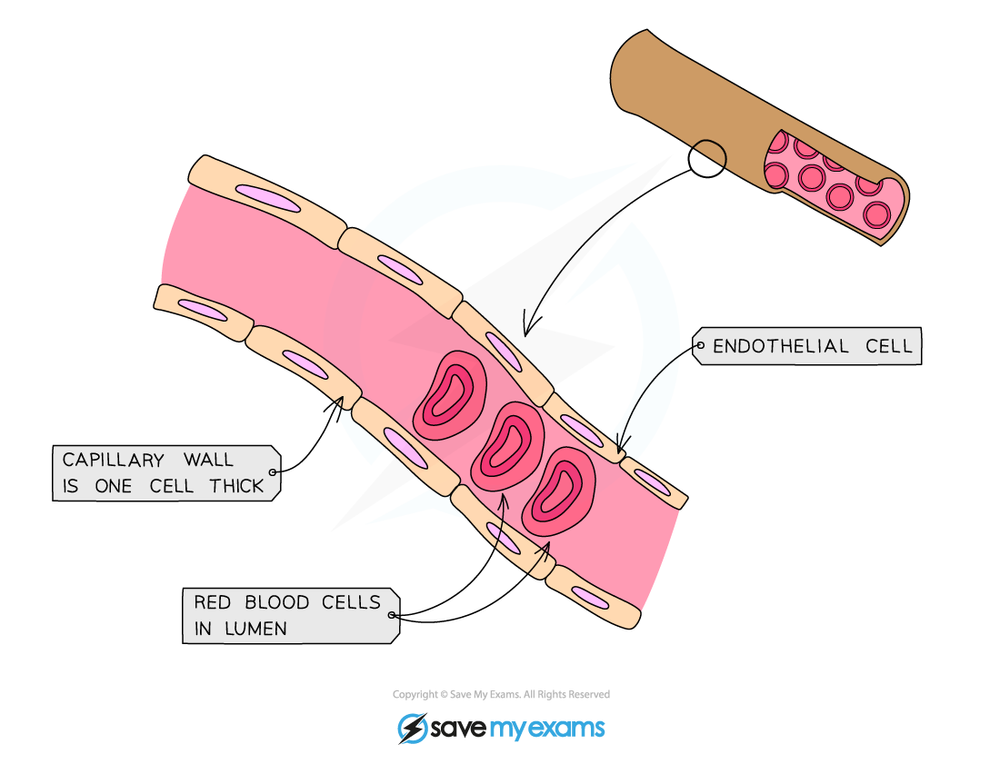

# Blood Vessels

## Arteries, Veins & Capillaries

> **Spec point** — `spcpt_qwgzbvWDJvwXQRPy`

## Arteries, Veins & Capillaries

#### Arteries

- Carry blood at **high pressure away from the heart**
- Carry **oxygenated** blood (other than the pulmonary artery)
- Have **thick muscular walls** containing elastic fibres
- Have a **narrow lumen**
- Speed of flow is **fast**

#### Veins

- Carry blood at **low pressure towards the heart**
- Carry **deoxygenated** blood (other than the pulmonary vein)
- Have **thin **walls
- Have a **large lumen**
- Contain **valves**
- Speed of flow is **slow**

***Comparing arteries and veins***

#### Capillaries

- Carry blood at **low pressure** within tissues
- Carry **both oxygenated and deoxygenated blood**
- Have walls that are **one cell thick**
- Have ‘leaky’ walls
- Speed of flow is **slow**

***Structure of a capillary***
