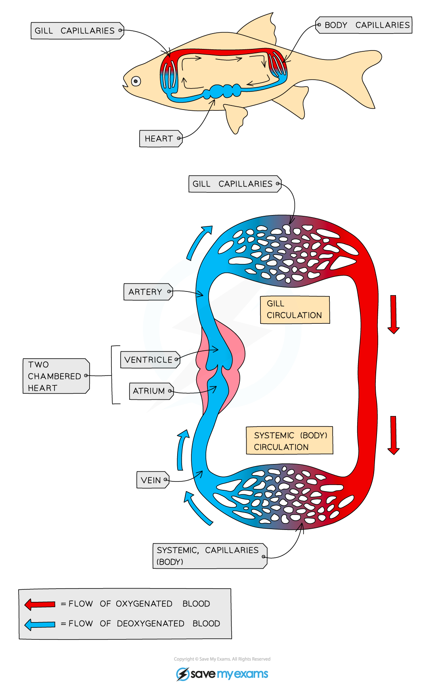

# Circulatory System Continued

## Circulatory Systems of Fish & Mammals: Extended

> **Spec point** — `spcpt_G4hYr5v2JNtZVq6n`

## Circulatory Systems of Fish & Mammals: Extended

### Extended Tier Only

#### Circulatory systems in Fish

- Fish have a **two-chambered heart** and a **single circulation**
- This means that **for every one circuit of the body, the blood passes through the heart once**

***The single circulatory system in fish***

#### Circulatory systems in Mammals

- Mammals have a **four-chambered heart** and a **double circulation**
- This means that **for every one circuit of the body, the blood passes through the heart twice**
- The right side of the heart receives **deoxygenated blood** from the body and **pumps it to the lungs** (the **pulmonary circulation**)
- The left side of the heart receives **oxygenated blood** from the lungs and **pumps it to the body** (the **systemic circulation**)

***The double circulatory system in mammals***

## Advantages of Double Circulation: Extended

> **Spec point** — `spcpt_Jyj7Nr4h3cbYQgQJ`

## Advantages of Double Circulation: Extended

### Extended Tier Only

- Blood travelling through the small capillaries in the lungs **loses a lot of pressure** that was given to it by the pumping of the heart, meaning it **cannot travel as fast**
- By returning the blood to the heart after going through the lungs its **pressure can be raised again** before sending it to the body, meaning **cells** can be supplied with the **oxygen and glucose** they need for respiration **faster and more frequently**
