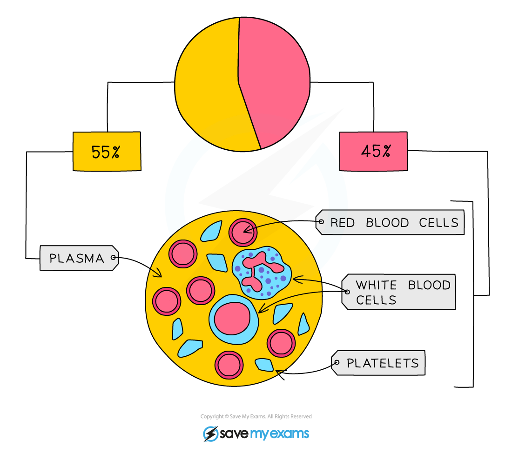
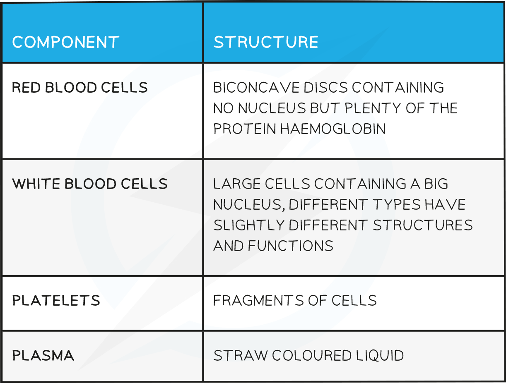
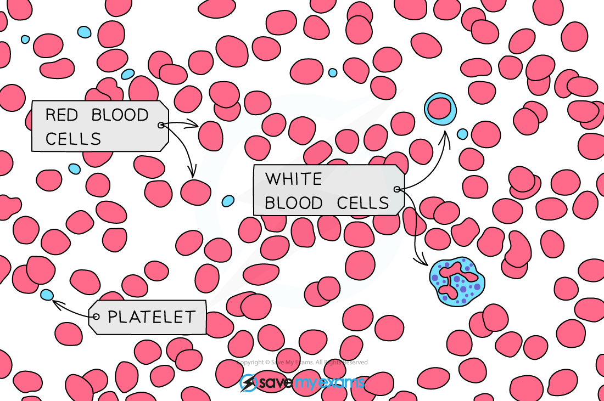

# Components of Blood

## Components of Blood

> **Spec point** — `spcpt_jb7r3tGdfjtvDH7z`

## Components of Blood

- Blood consists of **red blood cells, white blood cells, platelets and plasma**

***Composition of human blood***

**Components of the Blood Table**

## Identifying Red & White Blood Cells

> **Spec point** — `spcpt_rQMwYjyn75GpxtY7`

## Identifying Red & White Blood Cells

- You need to be able to identify red and white blood cells in photomicrographs and diagrams

  - Red blood cells have a concave disc shape with no nucleus
  - White blood cells are usually round in shape with a nucleus

***Blood micrograph***

## Components of Blood: Function

> **Spec point** — `spcpt_gsjnWZwqkPN53VFF`

## Components of Blood: Function

- Plasma is important for the **transport** of carbon dioxide, digested food (nutrients), urea, mineral ions, hormones and heat energy
- Red blood cells **transport oxygen** around the body from the lungs to cells which require it for aerobic respiration

  - They carry the oxygen in the form of oxyhaemoglobin
- White blood cells **defend** the body against infection by pathogens by carrying out **phagocytosis** and **antibody production**
- Platelets are involved in helping the **blood to clot**
