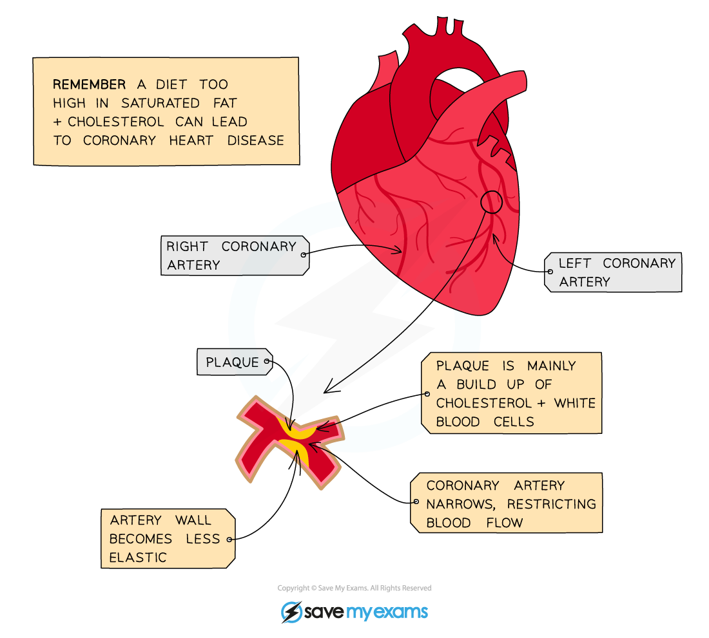
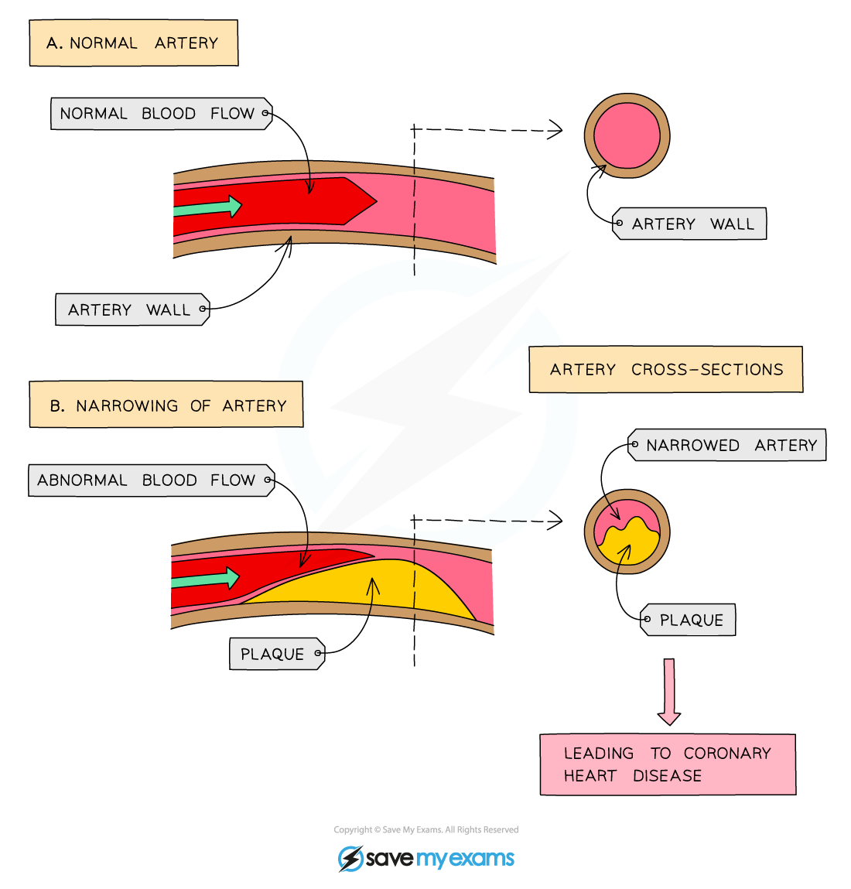
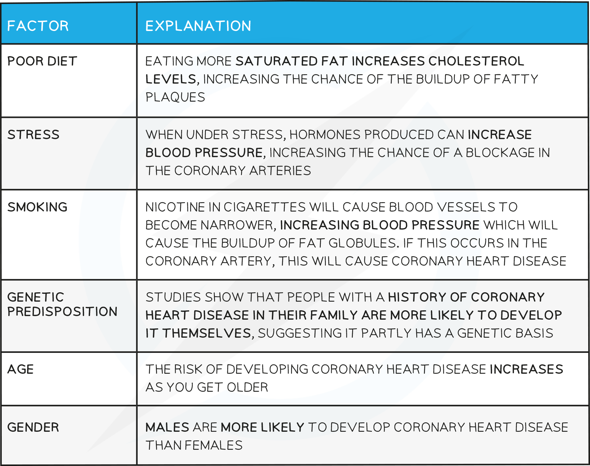

# Coronary Heart Disease

## Coronary Heart Disease

> **Spec point** — `spcpt_nQd5TWH3dHx2pmFx`

## Coronary Heart Disease

***The coronary arteries***

- The heart is made of **muscle cells** that need their own supply of blood to deliver oxygen, glucose and other nutrients and remove carbon dioxide and other waste products
- The blood is supplied by the **coronary arteries**
- If a coronary artery becomes partially or completely **blocked by fatty deposits called ‘plaques’** (mainly formed from **cholesterol**), the arteries are not as **elastic** as they should be and therefore cannot stretch to accommodate the blood which is being forced through them - leading to **coronary heart disease**
- **Partial blockage** of the coronary arteries creates a restricted blood flow to the cardiac muscle cells and results in severe chest pains called **angina**
- **Complete blockage** means cells in that area of the heart will not be able to respire and can no longer contract, leading to a **heart attack**

***Buildup of plaque in the coronary arteries***

***Effect of narrowing of arteries***

**Risk Factors for CHD Table**

## Diet, Exercise & Coronary Heart Disease

> **Spec point** — `spcpt_tDpgJzGYz3QYbPh9`

## Diet, Exercise & Coronary Heart Disease

#### Reducing the risks of developing coronary heart disease

- **Quit smoking**
- **Diet - reduce animal fats** and eat more fruits and vegetables - this will reduce cholesterol levels in the blood and help with weight loss if overweight
- **Exercise regularly** - again, this will help with weight loss, decrease blood pressure and cholesterol levels and help reduce stress
