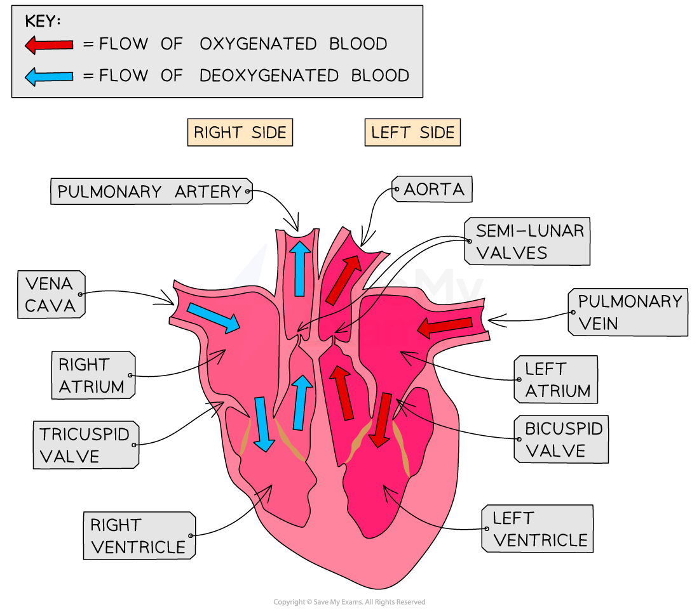

# Functioning of the Heart

## Functioning of the Heart: Extended

> **Spec point** — `spcpt_bjcs5T4KrrT3xZfy`

## Functioning of the Heart: Extended

### Extended Tier Only

- **Deoxygenated blood** coming from the body flows into the **right atrium** via the **vena cava**
- Once the right atrium has filled with blood the heart gives a little beat and the blood is pushed through the **tricuspid (atrioventricular) valve** into the **right ventricle**
- The walls of the ventricle **contract** and the blood is pushed into the **pulmonary artery** through the **semilunar valve** which prevents blood flowing backwards into the heart
- The blood travels to the lungs and moves through the capillaries past the alveoli where gas exchange takes place (this is why there has to be low pressure on this side of the heart – blood is going directly to capillaries which would burst under higher pressure)
- **Oxygen-rich blood** returns to the **left atrium** via the **pulmonary vein**
- It passes through the **bicuspid (atrioventricular) valve** into the **left ventricle**
- The thicker muscle walls of the ventricle contract strongly to push the blood forcefully into the **aorta** and all the way around the body
- The **semilunar valve** in the aorta prevents the blood flowing back down into the heart

***The heart has atria and ventricles which contract to push blood through in the right directions with valves present to prevent backflow***
