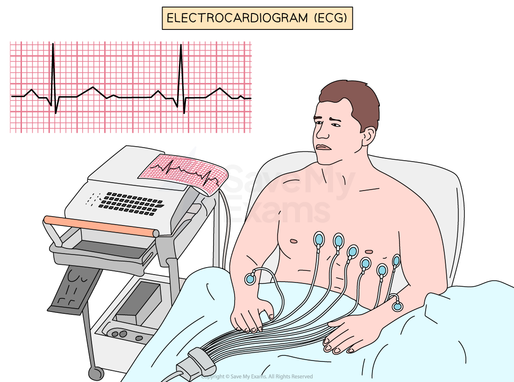

# Monitoring Activity of the Heart

## Monitoring Activity of the Heart

> **Spec point** — `spcpt_G95wgdmNV4XhyXCR`

## Monitoring Activity of the Heart

- Heart activity can be monitored by using an **ECG**, measuring **pulse rate** or **listening to the sounds of valves closing** using a stethoscope
- Heart rate (and pulse rate) is measured in beats per minute (bpm)
- To investigate the effects of exercise on heart rate, record the pulse rate at rest for a minute
- Immediately after they do some exercise, record the pulse rate every minute until it returns to the resting rate
- This experiment will show that during exercise the heart rate increases and may take several minutes to return to normal

***An electrocardiogram is one method which can be used to monitor heart rate in bpm***
