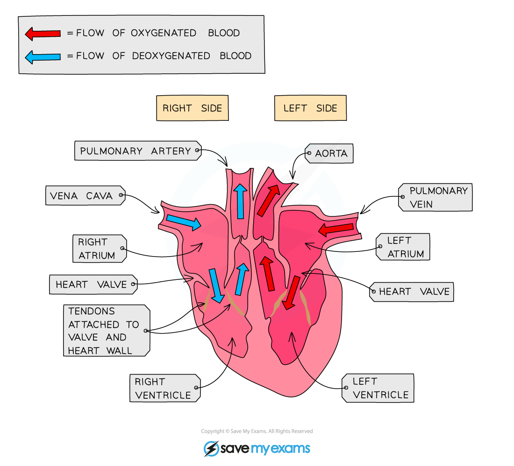

# The Mammalian Heart

## The Mammalian Heart

> **Spec point** — `spcpt_cF2cxDGTdHJfPB9p`

## The Mammalian Heart

- The heart is** labelled as if it was in the chest** so what is your left on a diagram is actually the right hand side and vice versa
- The right side of the heart receives **deoxygenated blood** from the body and pumps it **to the lungs**
- The left side of the heart receives **oxygenated blood** from the lungs and pumps it **to the body**
- Blood is pumped **towards** the heart in **veins** and **away** from the heart in **arteries**
- The two sides of the heart are separated by a muscle wall called the **septum**
- The heart is made of **muscle tissue** which are supplied with blood by the **coronary arteries**

***Structure of the heart***

> **Exam Hint**
> Remember A-A: **A**rteries carry blood **A**way from the heart
