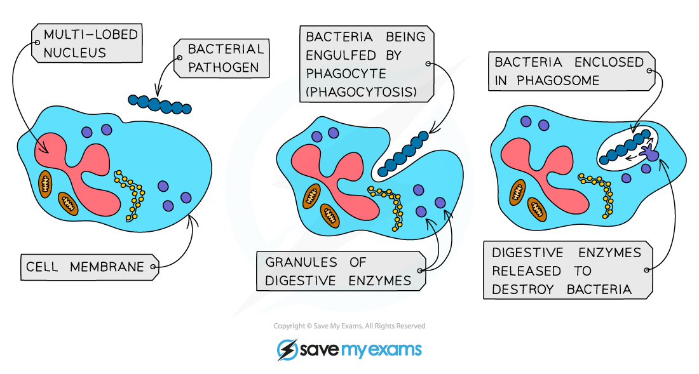
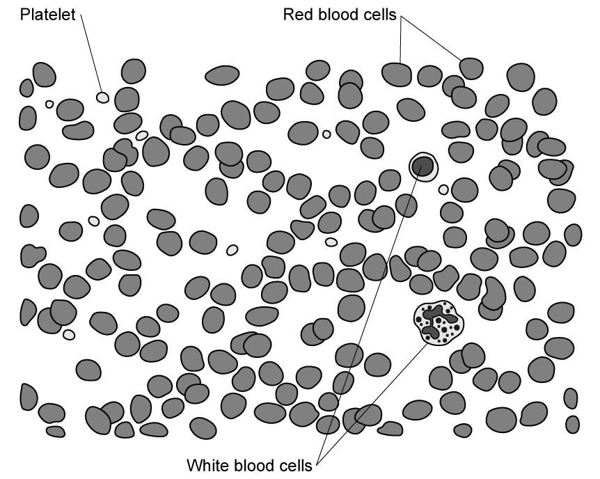

# White Blood Cells

## Lymphocytes & Phagocytes: Extended

> **Spec point** — `spcpt_gGDz2m6k6t7GDBJT`

## Lymphocytes & Phagocytes: Extended

### Extended Tier Only

- White blood cells are part of the body’s **immune system**, defending against infection by pathogenic microorganisms
- There are two main types, **phagocytes and lymphocytes**

#### Phagocytes

- Carry out **phagocytosis** by **engulfing and digesting pathogens**

***Phagocytosis***

- Phagocytes have a sensitive cell surface membrane that can detect chemicals produced by pathogenic cells
- Once they encounter the pathogenic cell, they will engulf it and **release digestive enzymes** to digest it
- They can be easily recognised under the microscope by their **multi-lobed nucleus** and their **granular cytoplasm**

#### Lymphocytes

- Produce **antibodies** to destroy pathogenic cells and **antitoxins** to neutralise toxins released by pathogens
- They can easily be recognised under the microscope by their **large round nucleus** which takes up nearly the whole cell and their **clear, non-granular cytoplasm**

***Lymphocytes and phagocytes can be identified on a micrograph image***
