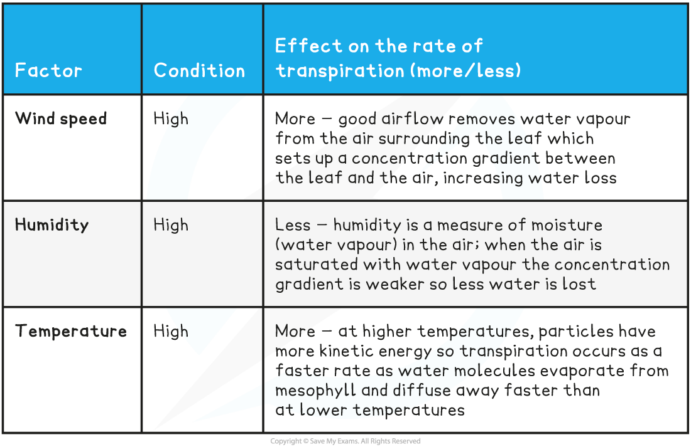

# Explaining the Effects of Temperature, Wind Speed & Humidity

## Explaining the Effects of Temperature, Wind Speed & Humidity: Extended

> **Spec point** — `spcpt_hZBxHtYq8pqMCrMV`

## Explaining the Effects of Temperature, Wind Speed & Humidity: Extended

### Extended Tier Only

- Wind speed, humidity and temperature all have an effect on the rate at which transpiration occurs
- The table below explains how these factors affect the rate of transpiration when they are all high; the opposite effect would be observed if they were low

**Transpiration Rate Factors Table**

## Wilting: Extended

> **Spec point** — `spcpt_JhMnts7CMWb9j9S2`

## Wilting: Extended

### Extended Tier Only

- If more water evaporates from the leaves of a plant than is available in the soil to move into the root by osmosis, then **wilting** will occur
- This is when all the cells of the plant are not full of water, so the strength of the **cell walls cannot support the plant** and it starts to collapse

***A wilted plant cannot support itself and starts to collapse***
