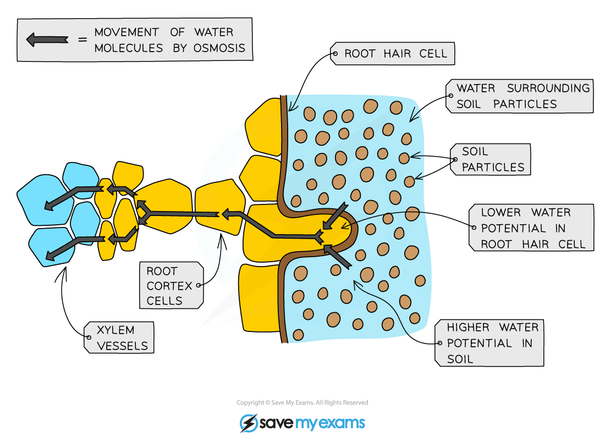

# Pathway Taken by Water

## Pathway Taken by Water

> **Spec point** — `spcpt_3w29W2TPTW2Q9JBZ`

## Pathway Taken by Water

- Osmosis causes water to pass into the **root hair cells**, through the **root cortex** and into the **xylem vessels**:
- Once the water gets into the xylem, it is carried up to the leaves where it enters **mesophyll cells**
- So the pathway is:

**root hair cell → root cortex cells → xylem → leaf mesophyll cells**

***Pathway of water into and across a root***
