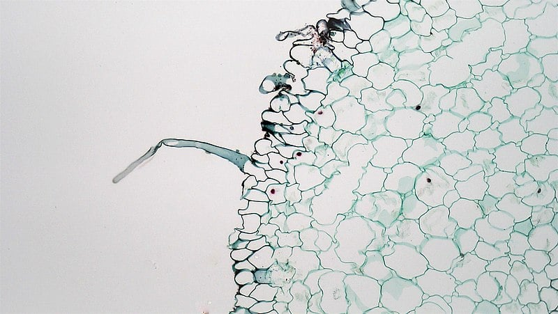

# Root Hair Cells

## Root Hair Cells

> **Spec point** — `spcpt_K7cRy27N88hsSxJS`

## Root Hair Cells

- Root hairs cells are found in the epidermis of plant roots
- These specialised cells have extensions known as **root hairs** that grow in between soil particles
- Root hairs** increase the surface area** of the epidermal cells, **aiding absorption of water and mineral ions** from the soil

***Root hair cells are found around the outside of plant roots where they aid absorption of water and minerals from the soil***

### Identifying root hair cells

- Root hair cells can be **identified **by their root hairs which extend from the surface of the root epidermis

*Berkshire Community College, CC0, via **[Wikimedia Commons](https://commons.wikimedia.org/wiki/File:Monocot_Root_Epidermal_Root_Hair_in_Lilium_%2836045152715%29.jpg)*

***Root hair cells can be identified by the presence of root hairs***
