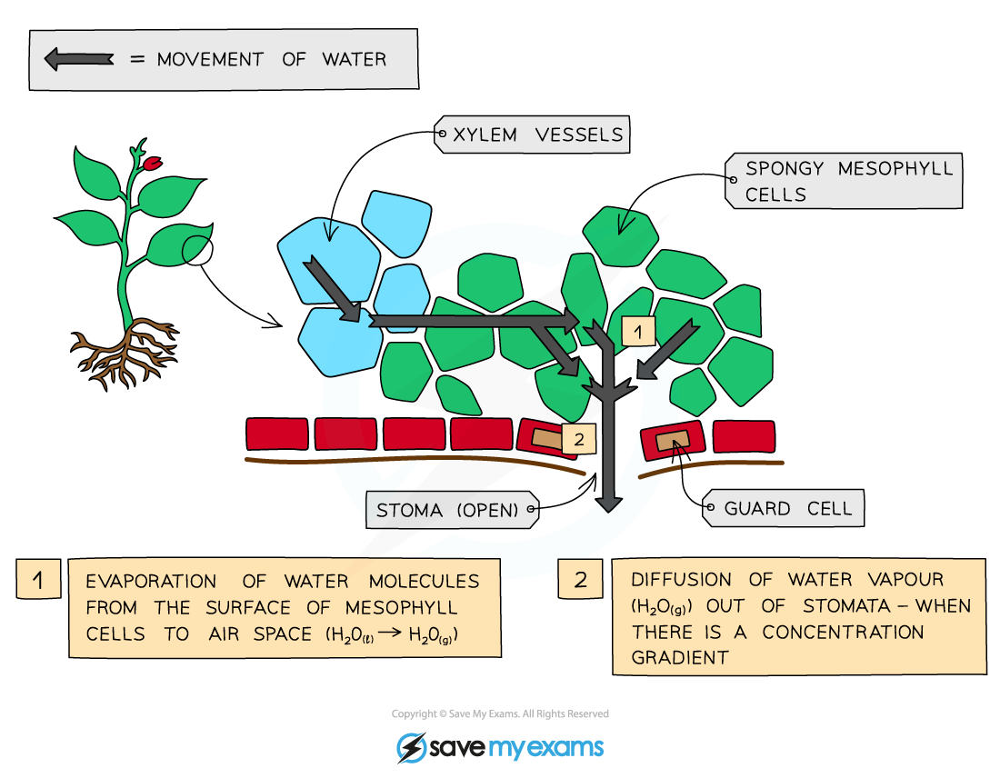

# Transpiration

## Transpiration

> **Spec point** — `spcpt_85fqQ6pzf7HVsX2R`

## Transpiration

- Transpiration is defined as:

**The** **loss of water vapour from the leaves of plants**

- Water travels from the roots to the leaves in the xylem vessels; when it reaches the cells of the spongy mesophyll layer in the leaves it **evaporates from the surface of the spongy mesophyll cells **into the **air spaces**
- Water vapour then **diffuses** out of the air spaces into the surrounding environment via the stomata

***Transpiration is the loss of water vapour from the leaves of plants due to evaporation from the surfaces of spongy mesophyll cells***
