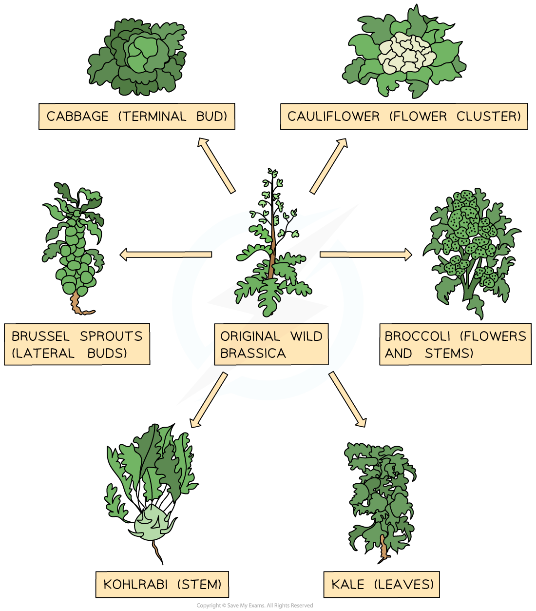

# Artificial Selection

## Selective Breeding

> **Spec point** — `spcpt_JWnF6wTmZCRSsSRS`

## Selective Breeding

- Selective breeding, also known as artificial selection involves the following process

  - **Selection by humans** of individuals with desirable characteristics
  - **Crossing** the individuals with desirable characteristics together
  - **Choosing offspring** from the cross which also **show the desirable characteristics** and breeding them together
  - Repetition of this process** over many generations**
- Selective breeding over many generations eventually results in **crop** and **domestic animal** varieties which all show characteristics chosen by humans, e.g.

  - Dog breeds with calm and friendly temperaments and attractive visible traits
  - Crop varieties that are resistant to pests and that produce a high yield

#### Selective breeding in dogs diagram

***Selective breeding in dogs has given rise to a wide variety of domestic breeds that are all descended from wild wolf ancestors***

#### Selective breeding in crops diagram

***Selective breeding in plants has resulted in a wide range of closely related crop varieties***

> **Exam Hint**
> You could be asked to apply the principles of selective breeding to unfamiliar examples in an exam, so make sure that you have a good understanding of the steps involved:
> 
> - **Humans** select individuals with **desired characteristics**
> - Individuals are** bred together**
> - **Offspring** with desired characteristics are chosen
> - Repeat over **many generations**
