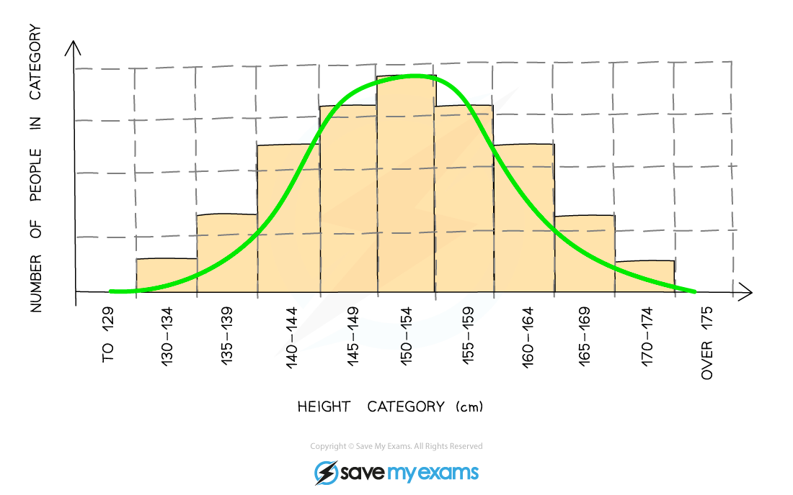
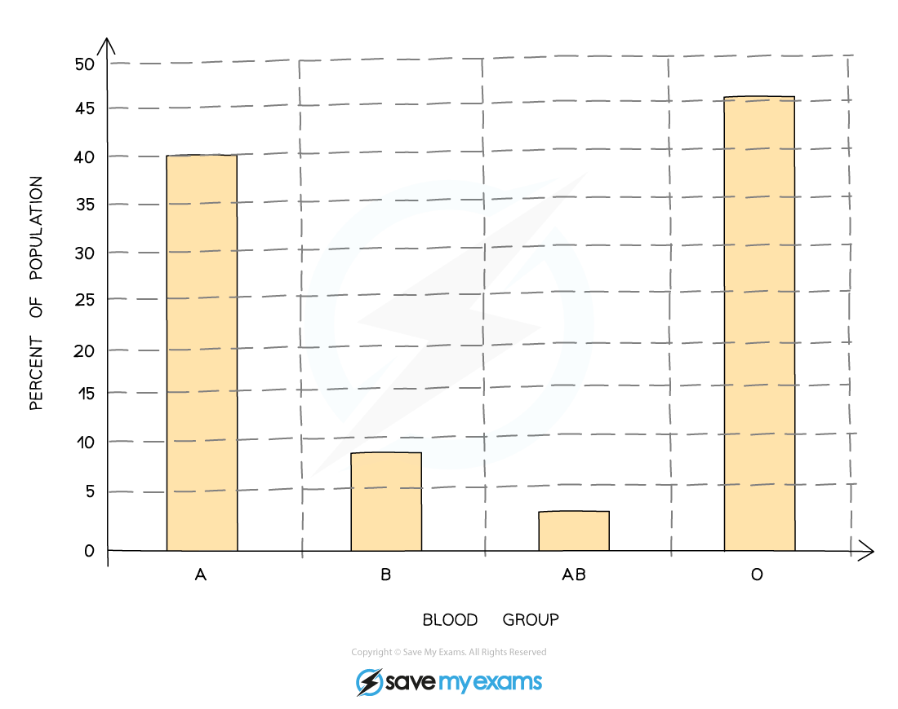

# Variation

## Types of Variation

> **Spec point** — `spcpt_p992ynJ6ZzqNmQFT`

## Types of Variation

- Variation can be defined as:

**Differences between individuals of the same species**

- Variation gives rise to different *phenotypes*
- Variation can be either **continuous** or **discontinuous**

### Continuous Variation

- Variation that shows a** range of phenotypes**
- Phenotypes fall in between extremes
- Examples include:

  - Body length
  - Body mass

***Height is an example of continuous variation; it gives rise to a smooth bell-shaped curve when plotted as a frequency histogram***

### Discontinuous Variation

- Variation that results in a **limited number of phenotypes**
- There are no phenotypes that fall in between groups
- For example:

  - People are either blood group A, B, AB or O
  - Pea seeds are either round or wrinkled
  - Pea seeds are either yellow or green

***Blood group is an example of discontinuous variation; it gives rise to a step-shaped bar graph***

## Mutation

> **Spec point** — `spcpt_wmpdkyDrWxqRGBNw`

## Mutation

- Mutations are** genetic changes**

  - These changes involve alterations to the DNA
- Mutation results in the formation of **new** *alleles*
- Changes to an organism's alleles can give rise to phenotypic variation
