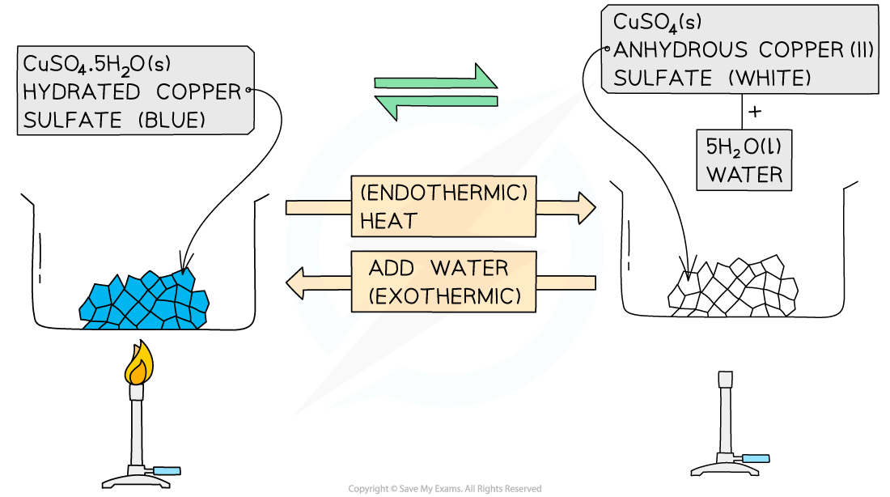

# Hydrated & Anhydrous Salts

## Hydrated & anhydrous salts

> **Spec point** — `spcpt_YCjf9mpQ2ZTS8sRB`

## Hydrated & anhydrous salts

- When salts are being prepared, some water can be retained within the structure of the salt during the crystallisation process
- Salts that contain water within their structure are called ***hydrated*** salts
- ***Anhydrous*** salts are those that contain no water in their structure
- A common example is copper(II) sulfate which crystallises forming the salt hydrated copper(II) sulfate, which is blue
- When it is heated, the water from its structure is removed, forming anhydrous copper(II) sulfate, which is white
- The hydrated salt has been **dehydrated **to form the anhydrous salt
- This reaction can be reversed by adding water to anhydrous copper(II) sulfate

**hydrated copper(II) sulfate ⇌ anhydrous copper(II) sulfate + water**

#### Hydrated copper(II) sulfate and anhydrous copper(II) sulfate

***Diagram showing the dehydration of hydrated copper(II) sulfate***
