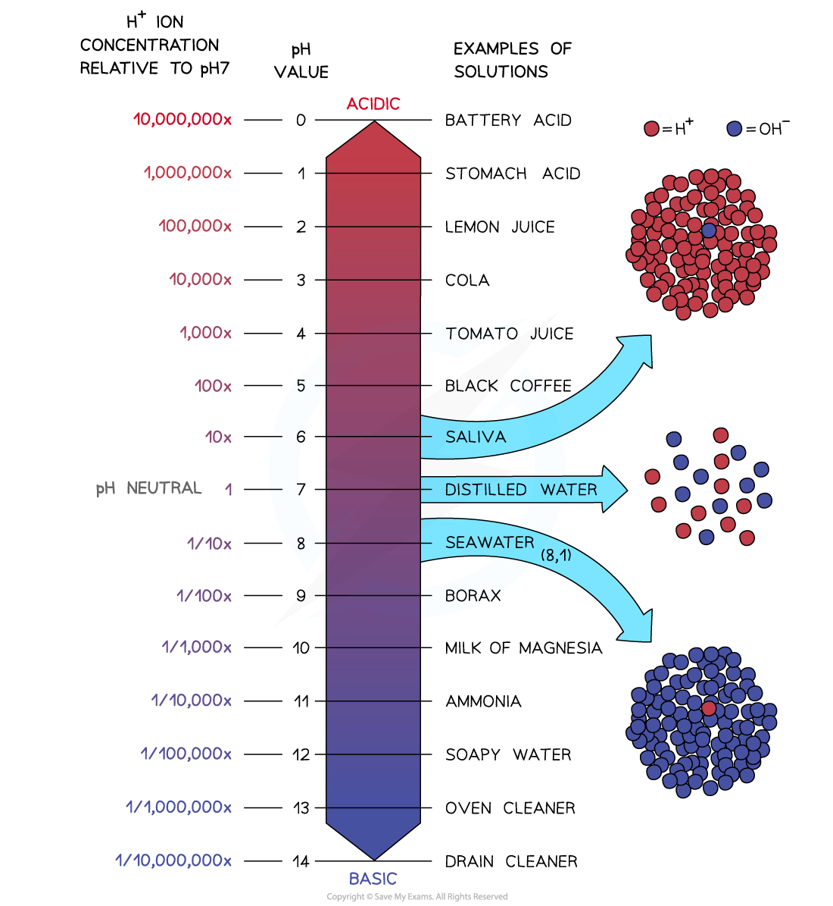

# The Ions in Acids & Alkalis

## Neutralisation reactions

> **Spec point** — `spcpt_626HMbkmsgmHbKsN` · State that aqueous solutions of acids contain H+ ions and aqueous solutions of alkalis contain OH– ions
Describe the neutralisation reaction between an acid and an alkali to produce water, H+ (aq) + OH– (aq) → H2O(l)

## Neutralisation reactions

### What is a neutralisation reaction?

- Acids are a source of hydrogen ions,** H****+**
- Bases (or alkalis) are a sources of  hydroxide ions, **OH****–**
- When they react together in a neutralisation reaction, the H+ ions react with the OH– ions to produce **water**
- This is the **net ionic equation** of all acid-base neutralisations and is what leads to a neutral solution, since water has a pH of 7:

**H****+  ****(aq) + OH****– ****(aq)⟶ H****2****O (l)**

- Not all reactions of acids are neutralisations:

  - For example when a metal reacts with an acid, although a salt is produced there is no water formed so it does not fit the definition of neutralisation

> **Exam Hint**
> Not all reactions of acids are neutralisations. For example, when a metal reacts with an acid, although a salt is produced there is no water formed so it does not fit the definition of neutralisation.

## Hydrogen ion concentration & pH

> **Spec point** — `spcpt_bVMTBprCm95v9zGJ` · Describe how to compare hydrogen ion concentration, neutrality, relative acidity and relative alkalinity in terms of colour and pH using universal indicator paper

## Hydrogen ion concentration & pH

### What is the pH scale?

- The pH scale goes from 1 – 14
- All acids have pH values of **below** 7, all alkalis have pH values of **above** 7
- The** lower** the pH then the **more acidic** the solution is:

  - pH 0-2 = typically strong acids (e.g. hydrochloric acid, sulfuric acid)
  
    - Extremely acidic substances can have values of below 1
  - pH 3-6 = typically weak acids (e.g. ethanoic acid, citric acid)
- The **higher** the pH then the **more alkaline** the solution is:

  - pH 8-11 = typically weak alkalis (e.g. ammonia solution, sodium hydrogencarbonate)
  - pH 12-14 = typically strong alkalis (e.g. sodium hydroxide, potassium hydroxide)
- A solution of pH 7 is described as being **neutral**

#### The pH scale

***The pH scale showing acidity, neutrality and alkalinity***

> **Exam Hint**
> The terms strong and weak refer to the degree of dissociation of the acid or alkali in solution, not to the pH alone.
> 
> A dilute strong acid can have the same pH as a concentrated weak acid.

### The pH scale and hydrogen ions

- We have already seen that acids are substances that contain hydrogen ions in solution
- The more hydrogen ions the stronger the acid, but the lower the pH
- The higher the concentration of hydroxide ions in a solution the higher the pH
- So pH is a measure of the concentration of H+ ions in solution, but they have an inverse relationship
- The pH scale is **logarithmic**, meaning that each change of 1 on the scale represents a change in concentration by a** factor** of** 10**

#### Concentration of hydrogen ions and pH

***An acid with a pH of 3 has ten times the concentration of H******+****** ions than an acid of pH 4. An acid with a pH of 2 has 10 x 10 = 100 times the concentration of H******+****** ions than an acid with a pH of 4***

> **Exam Hint**
> Acid strength is reflected in how many hydrogen ions are in solution. The more hydrogen ions the lower the pH and vice-versa.

### How is universal indicator used?

- Universal indicator is a mixture of different **indicators** which is used to measure the pH
- A drop is added to the solution and the colour is matched with a colour chart which indicates the pH which matches specific colours

***The pH scale with the Universal Indicator colours which can be used to determine the pH of a solution***
