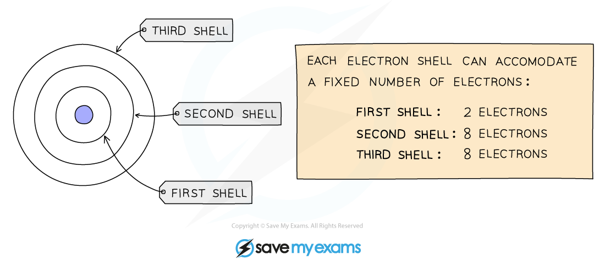
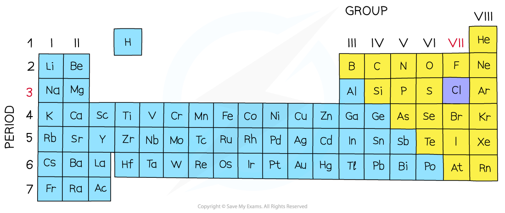
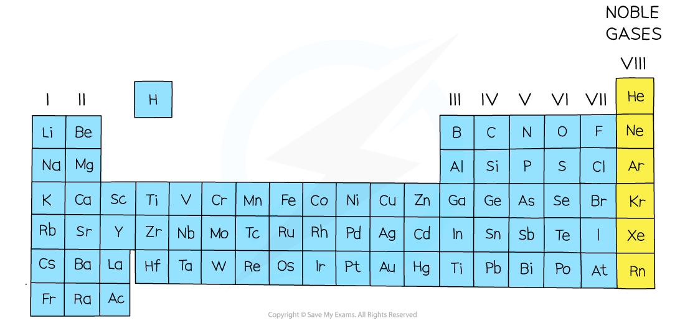

# Electronic Configuration

## What is electronic configuration?

> **Spec point** — `spcpt_bypWFTf7ksK84tC2` · nan

## What is electronic configuration?

#### Electronic configuration

- We can represent the structure of the atom in two ways: using diagrams called **electron** **shell** **diagrams** or by writing out a special notation called the **electronic** **configuration **(or electronic structure or electron distribution)

#### Electron shell diagrams

- Electrons orbit the nucleus in **shells** (or **energy** **levels**) and each shell has a different amount of energy associated with it
- The further away from the nucleus, the more energy a shell has
- Electrons fill the shell closest to the nucleus
- When a shell becomes full of electrons, additional electrons have to be added to the next shell

  - The first shell can hold 2 electrons
  - The second shell can hold 8 electrons
  - The third shell can hold 8 electrons
  - Then the fourth shell starts to fill

> **Exam Hint**
> The third shell can actually hold up to 18 electrons but a simplified 8 electron model is used at this level

- The outermost shell of an atom is called the **valence** shell and an atom is much more stable if it can manage to completely fill this shell with electrons

***A simplified model showing the electron shells***

- The arrangement of electrons in shells can also be explained using numbers
- Instead of drawing electron shell diagrams, the number of electrons in each electron shell can be written down, separated by commas
- This notation is called the electronic configuration (or electronic structure)

  - E.g. Carbon has 6 electrons, 2 in the 1st shell and 4 in the 2nd shell
  
    - Its electronic configuration is 2,4
- Electronic configurations can also be written for ions

  - E.g. A sodium atom has 11 electrons, a sodium ion has lost one electron, therefore has 10 electrons; 2 in the first shell and 8 in the 2nd shell
  
    - Its electronic configuration is 2,8

#### The electronic configuration of the first twenty elements

| **Element** | **Atomic Number ** | **Electronic Configuration** |
|---|---|---|
| hydrogen | 1 | 1 |
| helium | 2 | 2 |
| lithium | 3 | 2,1 |
| beryllium | 4 | 2,2 |
| boron | 5 | 2,3 |
| carbon | 6 | 2,4 |
| nitrogen | 7 | 2,5 |
| oxygen | 8 | 2,6 |
| fluorine | 9 | 2,7 |
| neon | 10 | 2,8 |
| sodium | 11 | 2,8,1 |
| magnesium | 12 | 2,8,2 |
| aluminium | 13 | 2,8,3 |
| silicon | 14 | 2,8,4 |
| phosphorus | 15 | 2,8,5 |
| sulfur | 16 | 2,8,6 |
| chlorine | 17 | 2,8,7 |
| argon | 18 | 2,8,8 |
| potassium | 19 | 2,8,8,1 |
| calcium | 20 | 2,8,8,2 |

**Note: **although the third shell can hold up to 18 electrons, the filling of the shells follows a more complicated pattern after potassium and calcium. For these two elements, the third shell holds 8 and the remaining electrons (for reasons of stability) occupy the fourth shell first before filling the third shell.

> **Worked Example**
> Draw and write the electronic structure of magnesium.
> 
> **Answer:**
> 
> - Magnesium has 12 electrons in total.
> - A maximum of two can fit in the first shell and eight in the second shell.
> - The remaining two will occupy the third shell.
> 
> 
> 
> - The written form of this electronic structure is 2,8,2

> **Exam Hint**
> You need to be able to write the electronic configuration of the first twenty elements and their ions. You may see electronic configurations using full stops or '+' signs instead of commas. You would not be penalised for using full stops.

## Electron shells & The Periodic Table

> **Spec point** — `spcpt_NZTyfSzyQrHGTXWP` · State that: 
Group VIII noble gases have a full outer shell; 
the number of outer shell electrons is equal to the group number in Groups I to VII; 
the number of occupied shells is equal to the period number

## Electron shells & the Periodic Table

### How does the electronic structure of an element relate to its location in the Periodic Table?

- There is a clear **relationship** between the electronic configuration and how the Periodic Table is designed
- The number of notations in the electronic configuration will show the number of occupied shells of electrons the atom has, showing the** period **in which that element is in
- The last notation shows the number of outer electrons the atom has, showing the** group **that element is in (for elements in Groups I to VII)
- Elements in the **same** **group** have the **same** number of outer **shell** **electrons**

#### Diagram showing the relationship between the electronic configurations

***The electronic configuration for chlorine***

- **Period: **The red numbers at the bottom show the number of notations

  - The number of notations is 3
  - Therefore chlorine has 3 occupied shells
- **Group: **The last notation, in this case 7

  - This means that chlorine has 7 electrons in its outer shell
  - Chlorine is therefore in Group 7

#### The Periodic Table showing the location of chlorine

***The position of chlorine on the Periodic Table***

#### The noble gases

- In most atoms, the outermost shell is not full
- These atoms react with other atoms in order to achieve a full outer shell of electrons making them more stable
- In some cases, atoms lose electrons to entirely empty this shell so that the next shell below becomes a (full) outer shell

  - They then have the electronic structure of a noble gas (Group VIII)
- All of the noble gases are **unreactive** as they have full outer shells and are thus very stable

#### The Periodic Table showing the location of the noble gases

***The noble gases are on the Periodic Table in Group 8/0***** **

> **Exam Hint**
> The electrons in the outer shell are also known as valency electrons.
