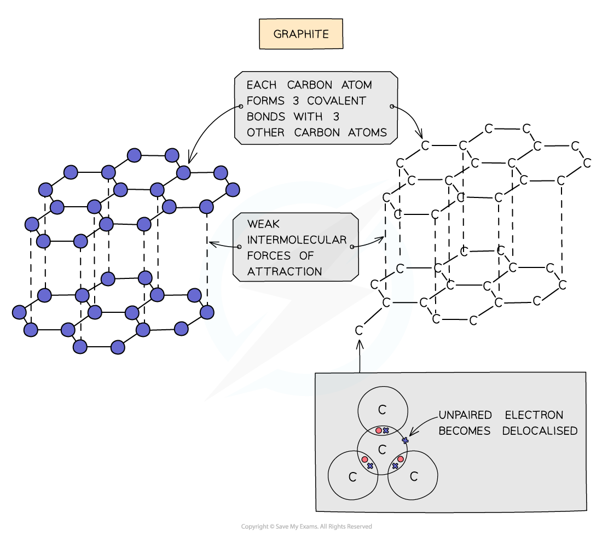
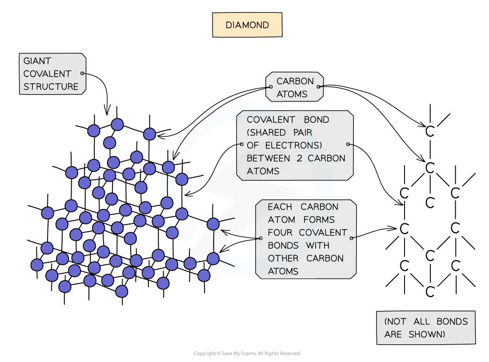

# Diamond & Graphite

## Structure of graphite & diamond

> **Spec point** — `spcpt_WsC2GGszjNGzThhR`

## Structure of graphite & diamond

### What is the structure of graphite?

- Each carbon atom in graphite is bonded to **three** others forming **layers** of **hexagons**, leaving one free electron per carbon atom which becomes delocalised
- The covalent bonds within the layers are very strong, but the layers are attracted to each other by weak** intermolecular forces**

#### Diagram to show the bonding and structure in graphite

***The structure and bonding in graphite***

- Diamond and graphite are ***allotropes*** of carbon which have **giant** **covalent** **structures**
- Both substances contain only carbon atoms but due to the differences in bonding arrangements they are physically completely different
- Giant covalent structures contain billions of non-metal atoms, each joined to adjacent atoms by covalent bonds forming a giant lattice structure

### What is the structure of diamond?

- In diamond, each carbon atom bonds with four other carbons, forming a **tetrahedron**
- All the covalent bonds are identical, very strong and there are no** intermolecular forces**

#### Diagram to show the formation of a covalent bond

***Diagram showing the structure and bonding arrangement in diamond***

## Uses of graphite & diamond

> **Spec point** — `spcpt_z9tsRTZ2KFhjVTXD`

## Uses of graphite & diamond

### What are the properties and uses of graphite?

- Graphite **conducts electricity**

  - Each carbon atom is bonded to three others leaving one free electron per carbon atom
  - These free (delocalised) electrons exist in between the layers
  - They are free to move through the structure and carry charge
- Graphite has a **high melting point**

  - Graphite has a giant covalent structure
  - There are strong covalent bonds between the carbon atoms
  - These need lots of energy to break
- Graphite is **slippery **

  - Graphite is arranged in layers
  - Although the atoms within the layers are joined by strong covalent bonds, the layers have only weak intermolecular forces between them
  - As a result the layers can slide over each other
  - This property allows graphite to be used in pencils and as an industrial lubricant

> **Exam Hint**
> Don’t confuse pencil lead with the metal lead – they have nothing in common. Pencil lead is actually graphite, and historical research suggests that in the past, lead miners sometimes confused the mineral galena (lead sulfide) with graphite; since the two looked similar they termed both minerals ‘lead’. The word graphite derives from the Latin word ‘grapho’ meaning ‘I write’, so it is a well named mineral!

### What are the properties and uses of diamond?

- Diamond does **not conduct electricity**

  - All the outer shell electrons in carbon are held in the four covalent bonds around each carbon atom
  - As a result, there are no freely moving particles to carry a charge

- Diamond has a very **high melting point**

  - Diamond has a giant covalent structure
  - There are strong covalent bonds between the carbon atoms
  - These need lots of energy to break
- It is extremely** hard **and **dense**

  - It has strong covalent bonds and each carbon atom is bonded to four other carbon atoms
  - Diamond's hardness makes it very useful in cutting tools like drills

- Diamond has the following physical properties:

  - It does not conduct electricity
  - It has a very high melting point
  - It is extremely hard and dense

> **Exam Hint**
> Diamond is the hardest naturally occurring mineral, but it is by no means the strongest. Students often confuse **hard** with **strong**, thinking it is the opposites of weak. Diamonds are hard, but brittle – that is, they can be smashed fairly easily with a hammer. The opposite of saying a material is hard is to describe it as **soft**.
