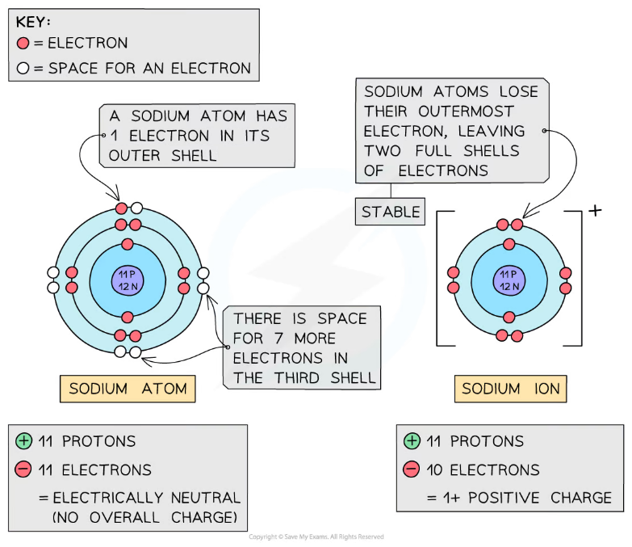
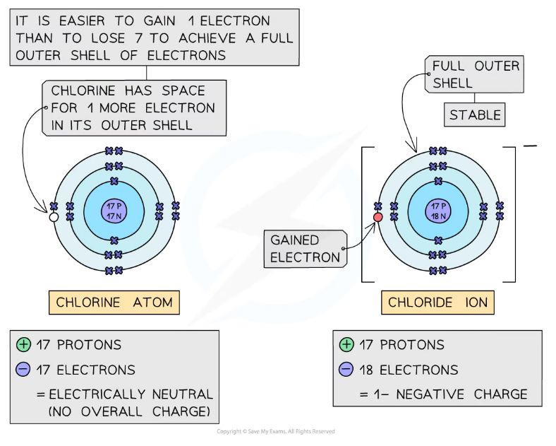
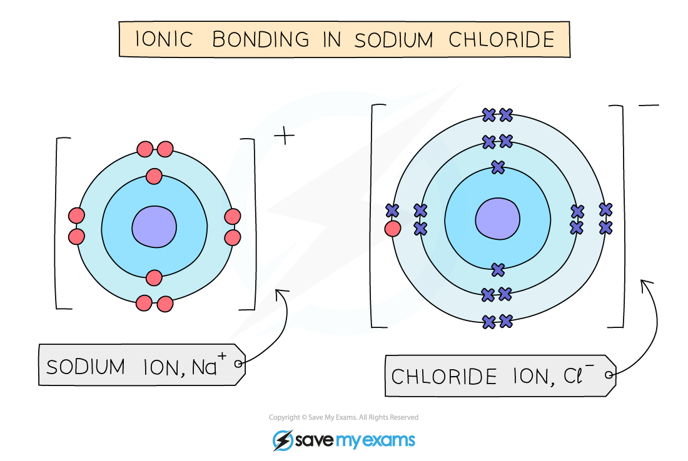
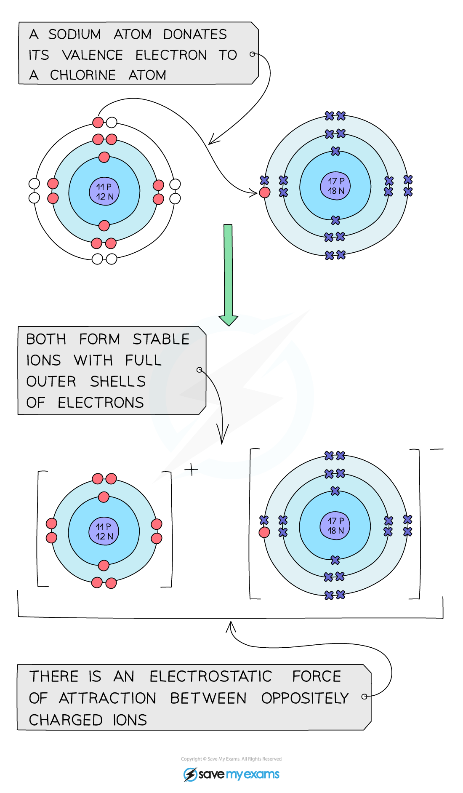

# Ions & Ionic Bonds

## The formation of ions

> **Spec point** — `spcpt_FVWXC4rNywfsjCN8` · Describe the formation of positive ions, known as cations, and negative ions, known as anions

## The formation of ions

### How are ions formed?

- An** ion **is an electrically charged atom or group of atoms formed by the** loss or gain of electrons**
- This loss or gain of electrons takes place to obtain a **full** **outer** **shell** of electrons
- The electronic structure of ions of elements in Groups 1, 2, 6 and 7 will be the same as that of a noble gas - such as helium, neon, and argon
- Negative ions are called **anions** and form when atoms **gain** electrons, meaning they have more electrons than protons
- Positive ions are called **cations** and form when atoms **lose** electrons, meaning they have more protons than electrons
- All metals **lose** electrons to other atoms to become positively charged ions
- All non-metals **gain** electrons from other atoms to become negatively charged ions

#### Formation of a cation

*** ***

***Formation of positively charged sodium ion***

#### Formation of an Anion

***Formation of negatively charged chloride ion***

> **Exam Hint**
> - We can determine the charge an ion will have from the group the element is found in:
> 
>   - Elements in Group 1 form ions with a 1+ charge
>   - Elements in Group 2 form ions with a 2+ charge
>   - Elements in Group 6 form ions with a 2- charge
>   - Elements in Group 7 form ions with a 1- charge

## The Formation of Ionic Bonds

> **Spec point** — `spcpt_Cv54SzSKvnxKKyBQ` · nan

## What is ionic bonding?

### The Formation of Ionic Bonds

- Ionic compounds are formed when metal atoms react with non-metal atoms
- Metal atoms **lose **their outer electrons which the non-metal atoms **gain **to form positive and negative ions
- The positive and negative ions are held together by strong **electrostatic forces of** **attraction** between **opposite** charges
- This force of attraction is known as an **ionic bond** and they hold ionic compounds together

### Dot-and-cross diagrams

- **Dot and cross diagrams **are diagrams that show the arrangement of the outer-shell electrons in an **ionic **or **covalent **compound or element
- The electrons are shown as dots and crosses
- In a dot and cross diagram:

  - Often only the outer electrons are shown
  - The charge of the ion is spread evenly which is shown by using brackets
  - The charge on each ion is written at the top right-hand corner

*** Electrostatic forces between the positive Na ion and negative Cl ion***

## Ionic bonds between Group I & Group VII elements

> **Spec point** — `spcpt_n4Qb7DYqQc2qGJj3` · Describe the formation of ionic bonds between elements from Group I and Group VII, including the use of dot-and-cross diagrams

## Ionic bonds between Group I & Group VII elements

### Group I & Group VII Ions

- Sodium is a Group 1 metal so **loses** one outer electron to another atom to gain a full outer shell of electrons
- A positive sodium ion with the charge 1+ is formed, Na+
- Chlorine is a Group 7 non-metal so gains one electron to have a full outer shell of electrons
- A negative chloride ion with a charge of 1– is formed, Cl–
- The ions are then attracted to one another and held together by **electrostatic forces**
- The formula of the ionic compound is thus NaCl
- The large square brackets should encompass each atom and the charge should be in superscript and on the right-hand side, outside the brackets

#### Diagram representing the formation of the ionic bond in sodium chloride

*Sodium loses one electron and chlorine gains an electron*
