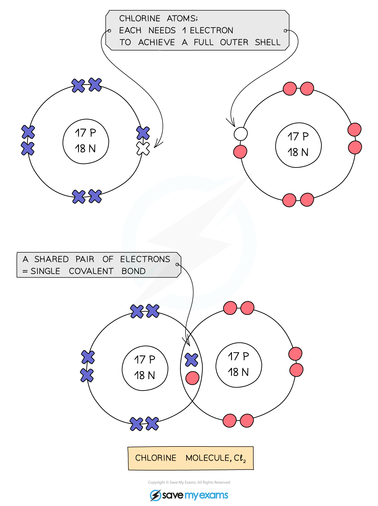
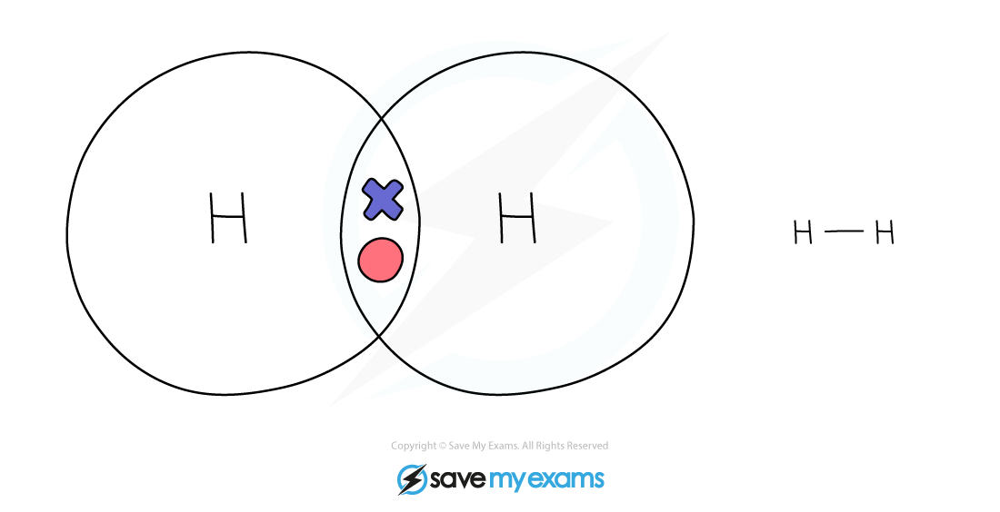
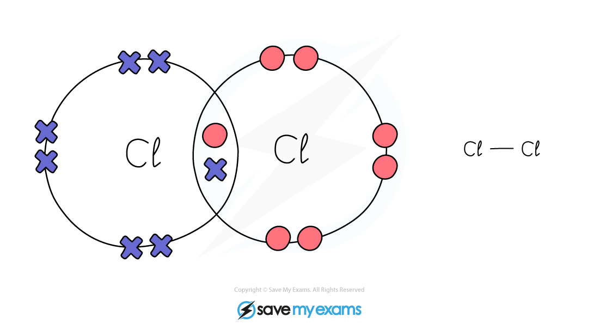
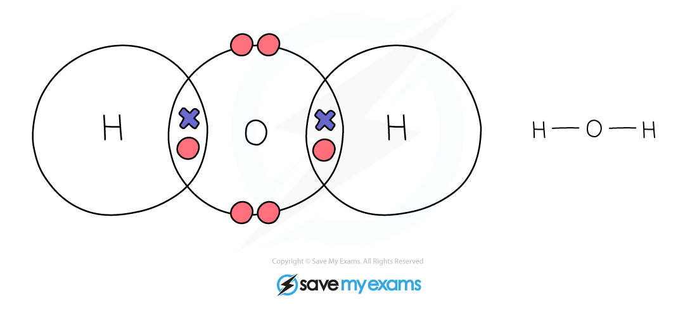
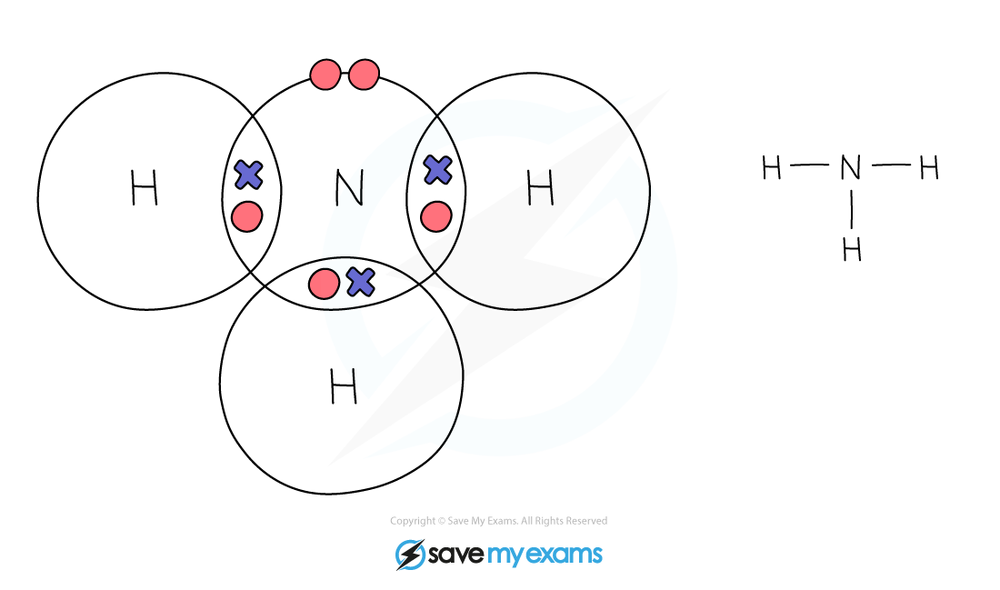
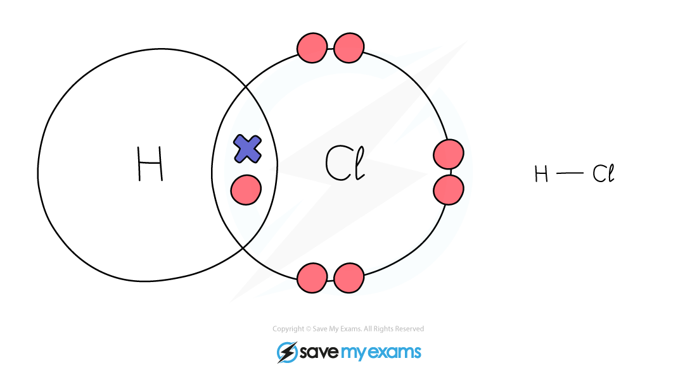

# Covalent Bonds

## The formation of covalent bonds

> **Spec point** — `spcpt_FwqczjZVdzMr626B` · State that a covalent bond is formed when a pair of electrons is shared between two atoms leading to noble gas electronic configurations

## The formation of covalent bonds

### Covalent compounds

- Covalent compounds are formed when **pairs **of electrons are **shared** between atoms
- Only **non-metal** **elements** participate in covalent bonding
- As in ionic bonding, each atom gains a** full** **outer** **shell** of electrons, giving them a noble gas electronic configuration
- Covalently bonded substances may consist of small molecules or giant molecules
- When two or more atoms are **covalently **bonded together, we describe them as ‘**molecules**’
- **Dot-and-cross** diagrams can be used to show the electronic configurations in simple molecules

  - Electrons from one atom are represented by a dot, and the electrons of the other atom are represented by a cross
  - The electron shells of each atom in the molecule overlap and the shared electrons are shown in the area of overlap
  - The dot-and-cross diagram of the molecule shows clearly which atom each electron originated from

#### Diagram to show the formation of a covalent bond

***Diagram showing how a covalent bond forms between two chlorine atoms***

> **Exam Hint**
> When drawing dot-and-cross diagrams for covalent compounds, make sure that the electron shell for each atom is full (remember that the 1st shell can only hold 2 electrons).

## Single covalent bonds

> **Spec point** — `spcpt_BCZxs97nRJgfmqWb` · Describe the formation of covalent bonds in simple molecules, including H2, Cl 2, H2O, CH4, NH3 and HCl. Use dot-and-cross diagrams to show the electronic configurations in these and similar molecules

## Single covalent bonds

- Many simple molecules exist in which two adjacent atoms share one pair of electrons, also known as a single covalent bond (or single bond)

#### Common Examples of Simple Molecules

**Hydrogen:**

** ** **Chlorine:**

** Water:**

**Methane:**

**Ammonia:**

**Hydrogen chloride:**

