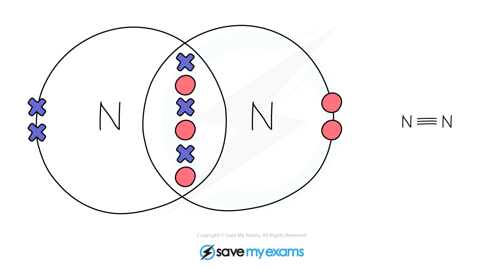
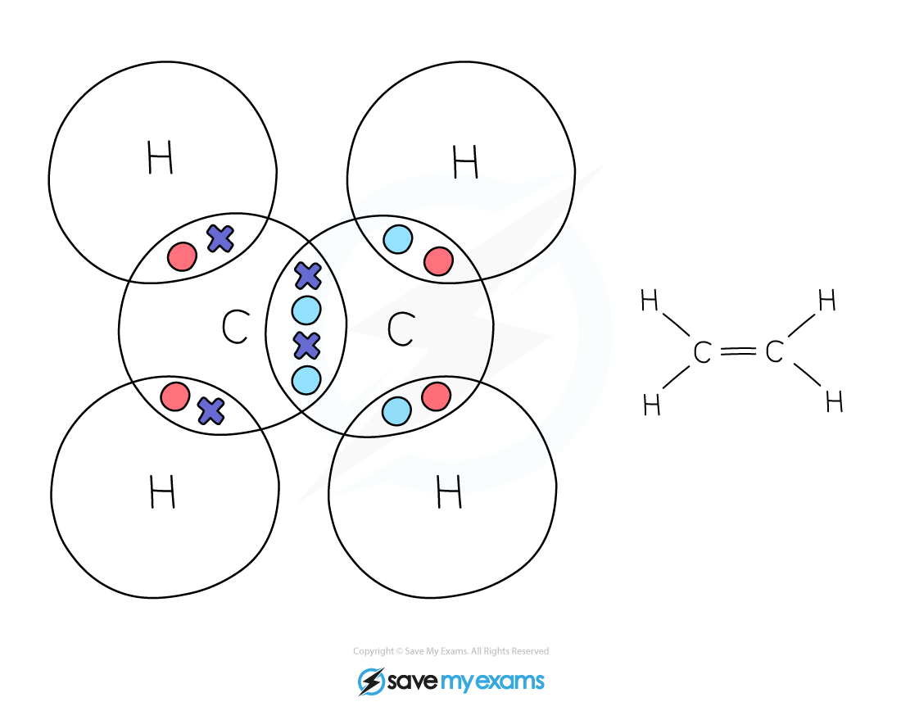
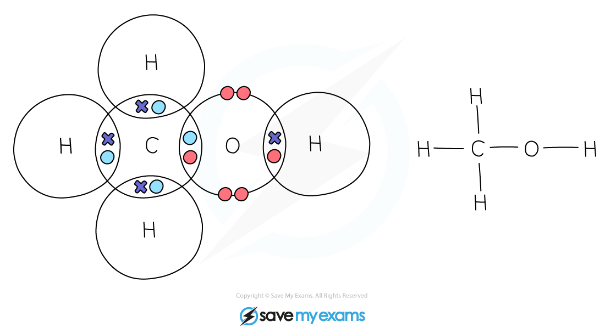

# Molecules & Compounds

## Covalent bonds in complex covalent molecules

> **Spec point** — `spcpt_7QFDs7HdjVHz3hh3` · Describe the formation of covalent bonds in simple molecules, including CH3OH, C2H4, O2, CO2 and N2. Use dot-and-cross diagrams to show the electronic configurations in these and similar molecules

## Covalent bonds in complex covalent molecules

### Extended Tier Only

- Some atoms need to share more than one pair of electrons to gain a full outer shell of electrons
- If two adjacent atoms share two pairs of electrons, two covalent bonds are formed, also known as a **double bond**
- If two adjacent atoms share three pairs of electrons, three covalent bonds are formed, also known as a **triple bond**

**Oxygen:**

When 2 oxygen atoms react, they share 2 pairs of electrons to form a double bond

**Nitrogen:**

- When 2 nitrogen atoms react, they share 3 pairs of electrons to form a triple bond

**Ethene:**

- In ethene, the 2 carbon atoms share 2 pairs of electrons
- This is known as a double bond

**Methanol:**

**Carbon Dioxide:**

> **Exam Hint**
> Be careful when drawing dot-and-cross diagrams, it is a common mistake for students to draw the wrong type of diagram.
> 
> Remember, if the compound contains **metal** and **non-metal**, it is an **ionic **compound and you need to draw the ions separated, with square brackets around each ion, together with a charge.
> 
> If the compound contains **non-metal** atoms only, it is a **covalent** compound, the shells should overlap and contain one or more pairs of electrons.
