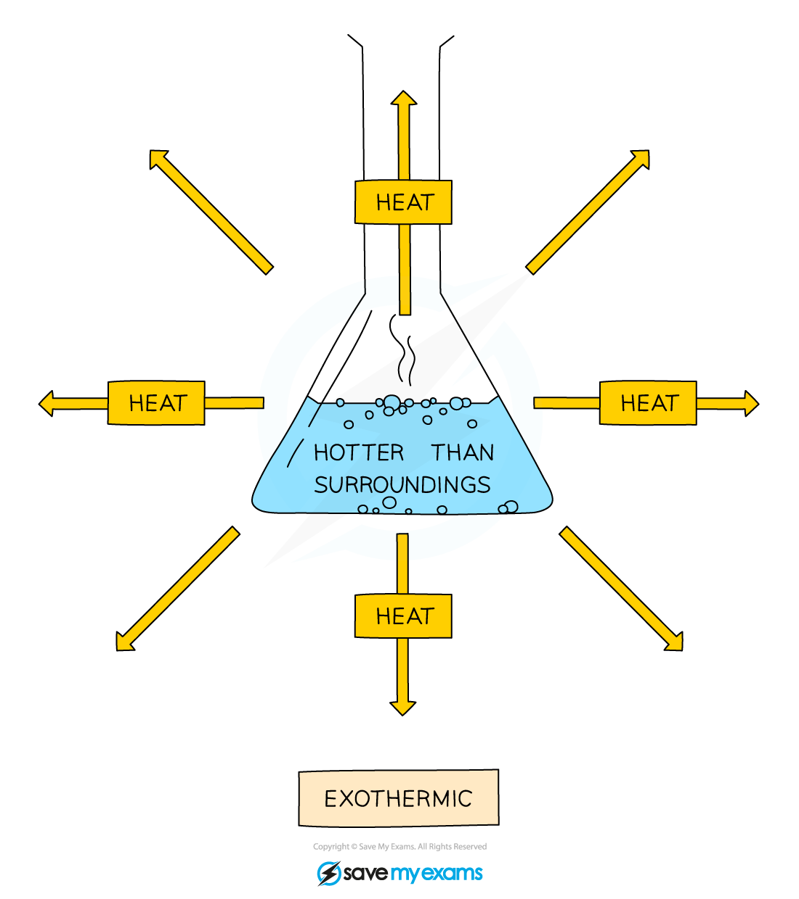
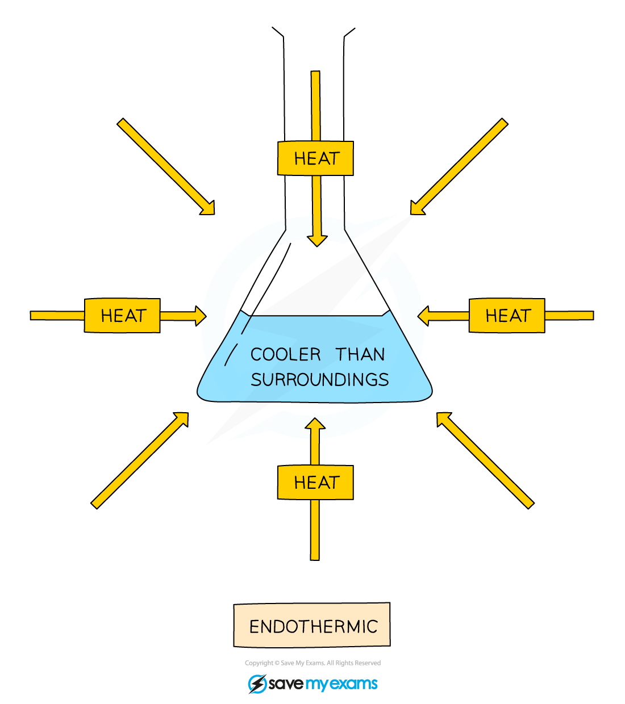

# Endothermic & Exothermic Reactions

## Exothermic & endothermic reactions

> **Spec point** — `spcpt_rdv25J6n73Gsk9DG` · State that an exothermic reaction transfers thermal energy to the surroundings leading to an increase in the temperature of the surroundings
State that an endothermic reaction takes in thermal energy from the surroundings leading to a decrease in the  temperature of the surroundings

## Exothermic & endothermic reactions

### Heat exchange in reactions

- Chemical reactions occur so that elements can achieve a more stable energy state by gaining a full outer shell of electrons

  - This is done by **chemical bonding**
- This process involves the **transfer of thermal energy** into and out of reaction mixtures
- The terms used to describe this are:

  - **System:** the reacting chemicals
  - **Surroundings:** anything other than the chemicals reacting
- The energy within the system comes from the **chemical bonds** themselves which could be considered as tiny stores of chemical energy

### Exothermic reactions

- In exothermic reactions, thermal energy is **transferred **from the system to the surroundings

  - The energy of the system decreases, which means that the energy change is **negative**
  - The temperature of the surroundings increases because thermal energy is **given out / released**
- The overall transfer is from the system to the surroundings

***Diagram showing the transfer of heat energy outwards from an exothermic reaction***

- Typical examples of exothermic reactions include:

  - **Combustion**
  - **Oxidation**
  - **Neutralisation **
- **Hand warmers **used in the wintertime are based on the release of heat from an exothermic reaction
- **Self-heating cans **of food and drinks such as coffee and hot chocolate also use exothermic reactions in the bases of the containers

### Endothermic reactions

- In endothermic reactions, thermal energy is **transferred **from the surroundings to the system

  - The energy of the system increases, which means that the energy change is **positive**
  - The temperature of the surroundings decreases because thermal energy is **taken in / absorbed**
- The overall transfer is from the surroundings to the system

***Diagram showing the transfer of heat energy from the surroundings into an endothermic reaction***

- Endothermic reactions are less common than exothermic reactions
- Typical examples of endothermic reactions include:

  - Electrolysis
  - Thermal decomposition
  - The first stages of photosynthesis
- **Cold packs **for sports injuries are based on endothermic reactions, designed to take heat away from a recently injured area to prevent swelling

> **Worked Example**
> A student was investigating the temperature change for four different chemical reactions. The table shows the chemicals that the student combined for each reaction along with the initial and final temperatures of the reaction.
> 
> | **Experiment** | **Chemicals** | **Initial temperature** **(****o****C)** | **Final temperature** **(****o****C)** |   |
> |---|---|---|---|---|
> | **1** | 10 cm3 NaOH | 10 cm3 HCl | 19 | 21 |
> | **2** | 10 cm3 NaHCO3 | 2 g citric acid | 20 | 16 |
> | **3** | 10 cm3 CuSO4 | 0.5 g Mg powder | 20 | 26 |
> | **4** | 10 cm3 H2SO4 | 3 cm Mg ribbon | 19 | 31 |
> 
> Explain whether each reaction is endothermic or exothermic.
> 
> **Answers:**
> 
> - Reactions 1, 3 and 4 are exothermic reactions because they show a temperature increase
> - Reaction 2 is an endothermic reaction because it shows a temperature decrease

> **Exam Hint**
> - To help you remember whether a chemical system is exothermic or endothermic:
> 
>   - In **EX**othermic reactions heat **Ex**its the system and in **EN**dothermic reactions heat **EN**ters the system.
>   - Exothermic reactions always give off heat and they feel hot
>   - Endothermic reactions always take heat in and they feel cold.
