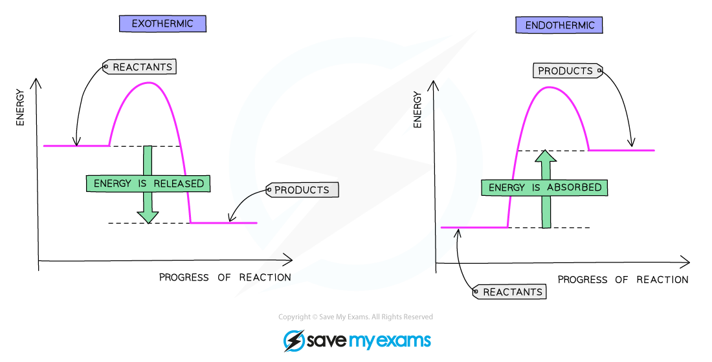

# Enthalpy Change & Activation Energy

## Enthalpy change & activation energy

> **Spec point** — `spcpt_N7d3pwKSDxWPJnHQ` · State that the transfer of thermal energy during a reaction is called the enthalpy change, ∆H, of the reaction. ∆H is  negative for exothermic reactions and positive for endothermic reactions
Define activation energy, Ea, as the minimum energy that colliding particles must have to react 

## Enthalpy change & activation energy

### Extended Tier Only

- For atoms or particles to react with each other in a chemical system they must **collide **together
- A number of factors affect the success of a collision:

  - **Energy**
  - **Orientation**
  - **Number of collisions per second** - the **frequency** of collisions

### What is activation energy?

- In terms of the energy of collisions, there is a **minimum amount of energy** required for a successful collision

  - A successful collision is where the particles in the reactant(s) are rearranged to form the products
- This minimum amount of energy is called the **activation energy, *****E*****a**** **
- Different reactions have different activation energies, depending on the chemical identities involved
- Reactions with higher activation energies require more energy to start than those with lower activation energies

### What is enthalpy change?

- The** transfer of thermal energy **during a reaction is called the **enthalpy change, Δ*****H***, of the reaction.
- Δ*H* is:

  - Positive for an endothermic reaction
  - Negative for an exothermic reaction

## Reaction pathway diagrams

> **Spec point** — `spcpt_PdmtbHpPHdKY7Bfn` · Interpret reaction pathway diagrams showing exothermic and endothermic reactions
Draw and label reaction pathway diagrams for exothermic and endothermic reactions using information provided, to include: 
reactants (b) products 
enthalpy change of the reaction, ∆H 
activation energy, Ea

## Reaction pathway diagrams

### Extended Tier Only

- **Reaction pathway diagrams **are graphical representations of the relative energies of the reactants and products in chemical reactions
- On a reaction pathway diagram:

  - Progress of the reaction is shown on the x-axis
  - Energy is shown on the y-axis
  - The difference in energy between the energy of reactants and products is the **overall enthalpy change **of a reaction

***Reaction pathway diagram of an exothermic reaction and an endothermic reaction***

### Exothermic reactions

- Energy is given out to the surroundings
- The energy of the products will therefore be **lower **than the energy of the reactants
- The enthalpy change is **negative**
- This is represented on the reaction profile with a downwards-arrow as the energy of the products is lower than the reactants
- The activation energy is the energy difference between the **reactants** and the **highest point on the curve**
- The reaction pathway diagram for an exothermic reaction is:

***The reaction pathway diagram for exothermic reactions***

### Endothermic reactions

- Energy is taken in from the surroundings
- The energy of the products will be **higher** than the energy of the reactants
- The enthalpy change is **positive**
- This is represented on the reaction profile with an upwards-arrow** **as the energy of the products is higher than the reactants
- The activation energy is the energy difference between the **reactants** and the **highest point on the curve**
- The reaction pathway diagram for an endothermic reaction is:

***The reaction pathway diagram for endothermic reactions.***

> **Exam Hint**
> You **must** be able to draw these pathway diagrams and label the following parts:
> 
> - Reactants
> - Products
> - Enthalpy change of the reaction, Δ*H*
> - Activation energy, *E*a
