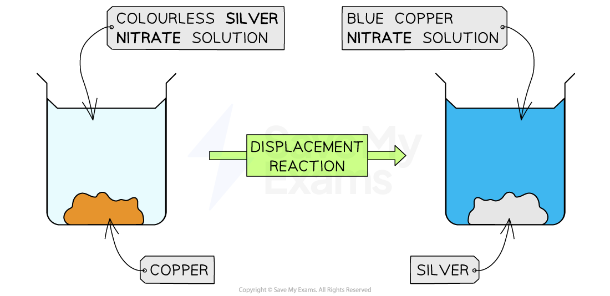

# Physical & Chemical Changes

## Physical & chemical changes

> **Spec point** — `spcpt_rftBFb5WpWwmfzXP`

## Physical & chemical changes

### Physical changes

- Physical changes do not produce any new chemical substances
- These changes are often:

  - **Easy to reverse**
  - Relatively **easy to separate**
- Examples of physical changes include:

  - [Changing state](https://www.savemyexams.com/igcse/science/cie/co-ordinated-sciences-double-award/23/chemistry/revision-notes/states-of-matter/solids-liquids-and-gases/states-of-matter/), e.g. melting / solid → liquid
  - Making a mixture from 2 or more substances
  - Dissolving a solute in a solvent

### Chemical changes

- During chemical changes / reactions, **new** **chemical** substances are formed that have very different **properties** to the reactants
- Most chemical changes are **difficult to reverse**
- There may be signs that a new substance has formed, such as:

  - Colour changes
  - Temperature changes
  - Effervescence (fizzing)

#### Colour change

- One example of a reaction that shows a colour change is the [metal displacement reaction](https://www.savemyexams.com/igcse/science/cie/co-ordinated-sciences-double-award/23/chemistry/revision-notes/metals/reactivity-series-and-corrosion-of-metals/explaining-reactivity/) of silver and copper

  - Orange-brown copper metal is added to a colourless solution of silver nitrate
  - As the reaction proceeds the copper displaces the silver from the solution
  - This causes two colour changes:
  
    1. The solid inside the beaker changes from orange-brown to silver
    2. The solution changes from colourless to blue

#### The metal displacement reaction of silver and copper

***The reaction shows two colour changes; one in the colour of the solution and one in the colour of the solid***

- Another reaction, from the syllabus, that shows a clear colour change is the [halide ion test](https://www.savemyexams.com/igcse/science/cie/co-ordinated-sciences-double-award/23/chemistry/revision-notes/experimental-techniques-and-chemical-analysis/identification-of-ions-and-gases/identification-of-anions/)

  - From colourless to cream / white / yellow depending on the halide ion
  - This also includes a change of state as a solid / precipitate is formed

#### Temperature change

- Chemical reactions that give a **temperature change** can be grouped into two categories:

  - Those that give out heat / thermal energy - **exothermic**
  - Those that take in heat / thermal energy - **endothermic**

**Exothermic reactions**

- Some examples of reactions that cause an **increase in temperature** are:

  - The reaction of calcium oxide with water to form calcium hydroxide is highly exothermic
  - The [reaction of sodium with water](https://www.savemyexams.com/igcse/chemistry/cie/23/revision-notes/8-the-periodic-table/8-2-group-properties-and-trends/8-2-1-group-i-properties/) is exothermic and effervesces

**Endothermic reactions**

- Reactions that cause a **decrease in temperature** are less commonly talked about than exothermic reactions
- Examples include:

  - Photosynthesis
  
    - Light energy is absorbed during the process of converting carbon dioxide and water into glucose and oxygen
  - When solid ammonium chloride is dissolved in water
  
    - Heat / thermal energy is absorbed from the surroundings, causing the temperature to decrease
    - This reaction is commonly used in cold packs

#### Effervescence

- Effervescence, or fizzing, is another sign of a chemical reaction
- Chemical reactions that cause effervescence often involve acids:

  - The [reaction of alkali metals with water](https://www.savemyexams.com/igcse/chemistry/cie/23/revision-notes/8-the-periodic-table/8-2-group-properties-and-trends/8-2-1-group-i-properties/)
  
    - The reaction of the alkali metals, such as sodium, with water releases hydrogen gas
    - Metal + water → metal hydroxide + hydrogen

- There are other signs of a chemical reaction including:

  - A change of physical state, e.g. liquid → solid
  - Light being produced
  - A smell being produced
  - A change in pH
