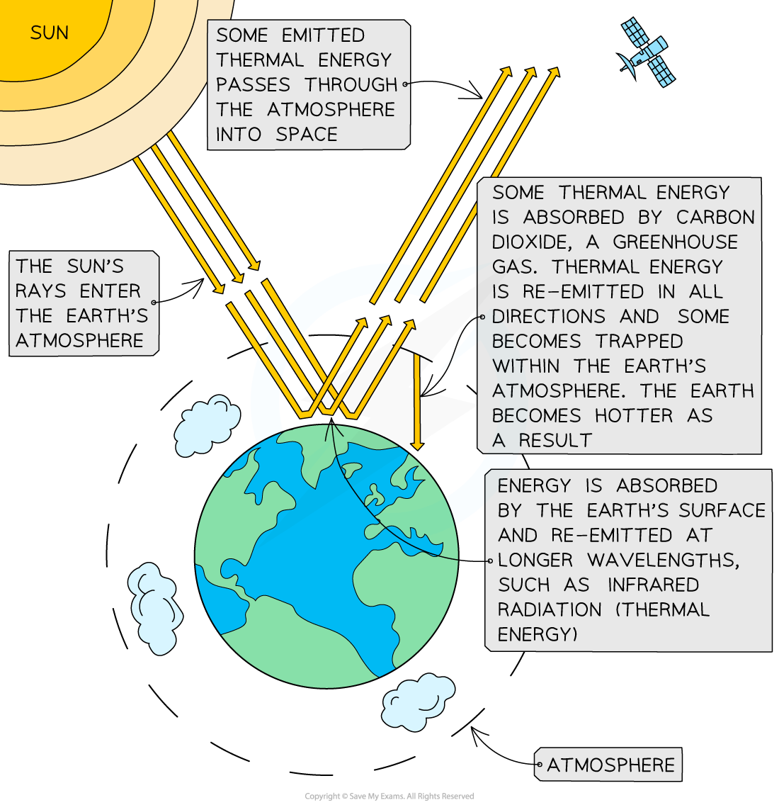

# Effects of Greenhouse Gases

## Effects of greenhouse gases

> **Spec point** — `spcpt_b8kXGMmB5sMPg7Tw` · Describe how the greenhouse gases carbon dioxide and methane cause global warming, limited to: 
the absorption,  reflection and emission of thermal energy 
reducing thermal energy loss to space

## Effects of greenhouse gases

**Extended Tier Only**

- The Sun emits energy in the form of radiation that enters the Earth’s atmosphere
- Some of this energy is **reflected **from the Earth's surface
- The Earth’s surface **absorbs **energy and then **re-emits** it as thermal energy (infrared radiation)
- Some energy passes through the atmosphere and is **emitted **into space
- Greenhouse gases, such as **carbon dioxide **and **methane**, absorb some of the thermal energy
- These greenhouse gases then re-emit thermal energy in all directions
- This reduces the thermal energy lost to space and traps more thermal energy in the Earth’s atmosphere, keeping the Earth warm

  - This process is known as the **greenhouse effect**

***Diagram showing how the greenhouse effect occurs***

- As the concentration of greenhouse gases in the atmosphere increases due to human activity, more thermal energy is trapped
- This causes the Earth’s average temperature to rise, which is called ***global warming***

  - This process is called the **enhanced** **greenhouse effect**

### Consequences of global warming

- Climate change due to the increase in Earth’s temperature
- Water levels will rise as glaciers melt because of high temperatures, causing flooding in low-lying countries
- Extinction of species due to the destruction of natural habitats
- Migration of species as they will move to areas that are more habitable (no droughts)
- Spread of diseases caused by warmer climate
- Loss of habitat due to climate change (animals that live on glaciers or in low-lying countries)
