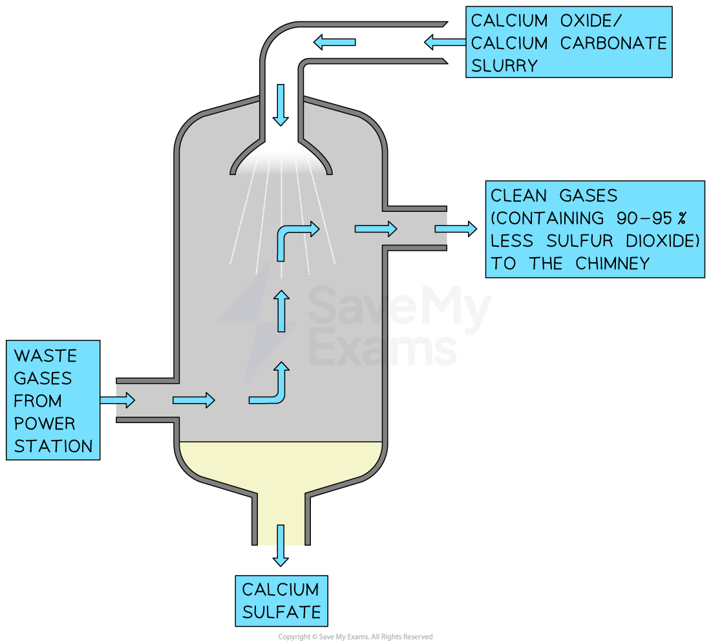
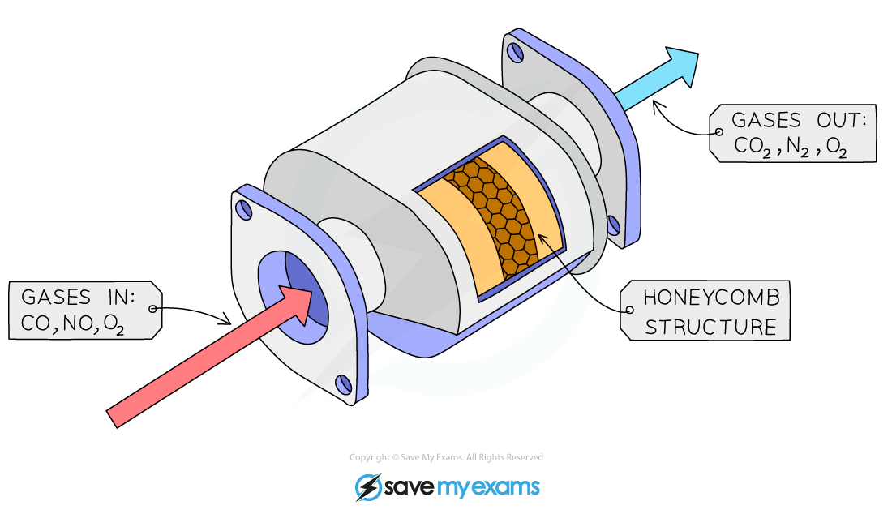

# Reducing the Effects of Environmental Issues

## Reducing the effects of environmental issues

> **Spec point** — `spcpt_JxgFqX3gSH8tmzmh`

## Reducing the effects of environmental issues

- Two of the main environmental issues are climate change and acid rain
- There are strategies that can be used to reduce the impact of these issues

### Strategies to reduce climate change

- The production of greenhouse gases, specifically carbon dioxide and methane, needs to be reduced drastically to reduce climate change

#### Reducing carbon dioxide emissions

- Some measures that can be taken include:

  - Being more ‘responsible consumers’ of energy by:
  
    - Using **hydrogen** and **renewable** energy supplies such as **solar** or **wind** energy instead of burning fossil fuels
    - Using more fuel-efficient vehicles, e.g. electric and hybrid cars
    - Reducing the number of vehicles on the road, e.g. using public transport, car-sharing
    - Recycling or reusing products made from crude oil and its derivatives
    - Reducing household energy consumption, e.g. turning lights out, using more efficient appliances
  - Reducing deforestation and / or re-forestation
  
    - Planting more trees, can help reduce the amount of atmospheric carbon dioxide through photosynthesis

#### Reducing methane emissions

- Reduce the amount of livestock farming

  - Methane is produced during digestion in animals

### Strategies to reduce acid rain

- Acid rain is caused by oxides of nitrogen and sulfur dioxide
- The effects of acid rain can be reduced by decreasing the amount of oxides of nitrogen and sulfur dioxide that are produced
- Catalytic convertors in vehicles can be used to remove oxides of nitrogen

#### Reducing sulfur dioxide emissions

- Using fuels which contain low levels of sulfur
- Flue gas desulfurisation

  - This is the main way to reduce sulfur dioxide emissions
  - Waste gases from coal fired power stations are passed into a scrubbing chamber
  - They are sprayed with a wet slurry of calcium oxide and calcium carbonate
  - The calcium compounds react with sulfur dioxide to produce calcium sulfate

#### Sulfur dioxide scrubber

***The scrubber sprays a lime slurry over the waste gases to remove 90 - 95% of the sulfur dioxide***

> **Exam Hint**
> There are many other ways that carbon dioxide, methane, oxides of nitrogen and sulfur dioxide can be reduced, e.g. by reducing energy usage to reduce CO2 emissions but it is only the examples stated above that you need to know.

## Oxides of nitrogen in car engines

> **Spec point** — `spcpt_DxTTjYGDKY8wPz6B`

## Oxides of nitrogen in car engines

**Extended tier only**

### Oxides of nitrogen

- These compounds (NO and NO2) are formed when nitrogen and oxygen react in the **high pressure** and **temperature** conditions of ***internal combustion engines*** and [blast furnaces](https://www.savemyexams.com/igcse/science/cie/co-ordinated-sciences-double-award/23/chemistry/revision-notes/metals/extraction-of-metals/extraction-of-iron-from-hematite/)
- Exhaust gases also contain unburned hydrocarbons and carbon monoxide
- Cars are fitted with catalytic converters which form a part of their exhaust systems
- Their function is to render these exhaust gases harmless

### Catalytic converters

- They contain a series of **transition metal catalysts** including platinum and rhodium
- The metal catalysts are in a **honeycomb** within the converter to increase the surface area available for reaction
- A series of redox reactions occurs which neutralises the pollutant gases
- Carbon monoxide is oxidised to carbon dioxide:

**2CO + O****2**** → 2CO****2**

- Oxides of nitrogen are reduced to N2 gas:

**2NO → N****2**** + O****2**

**2NO****2**** → N****2**** + 2O****2**

- A single reaction can summarise the reaction of nitrogen monoxide and carbon monoxide within a catalytic convertor:

**2NO + 2CO → N****2**** + 2CO****2**

***Catalytic converters are designed to reduce the polluting gases produced in car exhausts***

- Unburned hydrocarbons can also be oxidised to carbon dioxide and water:

**C****8****H****18**** + 12½O****2**** → 8CO****2**** + 9H****2****O**
