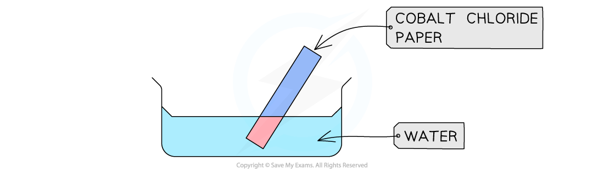
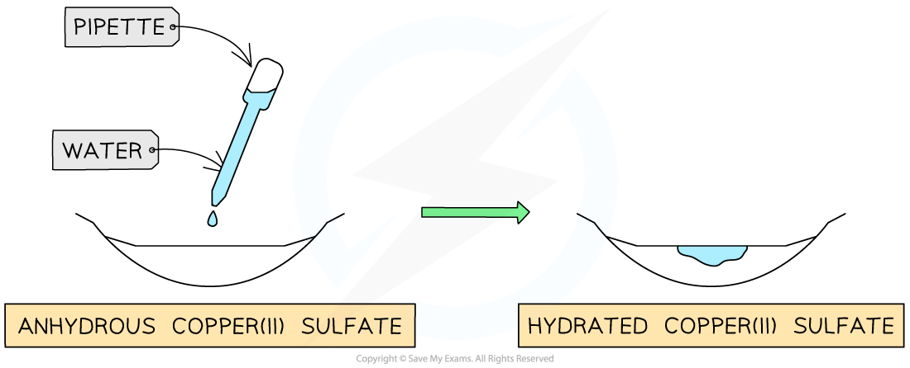

# Water: Chemical Tests

## Chemical tests for water

> **Spec point** — `spcpt_Mgdr4WSsvsJWtVNR` · Describe chemical tests for the presence of water using anhydrous cobalt(II) chloride and anhydrous copper(II)  sulfate

## Chemical tests for water

- The presence of water is commonly tested for using anhydrous cobalt(II) chloride or anhydrous copper(II) sulfate

#### Cobalt(II) chloride

- ***Anhydrous*** cobalt(II) chloride, CoCl2, is blue
- Hydrated cobalt(II) chloride, CoCl2•6H2O is pink
- So, anhydrous cobalt(II) chloride can be used to test for water

  - This test is usually done with cobalt chloride paper

**anhydrous cobalt(II) chloride + water **$\rightleftharpoons$** hydrated cobalt(II) chloride**

**CoCl****2 ****(s) + 6H****2****O (l) **$\rightleftharpoons$** CoCl****2****•6H****2****O (s)**

- The presence of water causes a colour change from **blue** to **pink **

***Cobalt chloride paper changes from blue to pink in the presence of water***

#### Copper(II) sulfate

- ***Anhydrous*** copper(II) sulfate, CuSO4 is white
- Hydrated copper(II) sulfate, CuSO4•5H2O, is blue
- So, anhydrous copper(II) sulfate can be used to test for water

**anhydrous copper(II) sulfate + water **$\rightleftharpoons$** hydrated copper(II) sulfate**

**CuSO****4 ****(s) + 5H****2****O (l) **$\rightleftharpoons$** CuSO****4****•5H****2****O (s)**

- The presence of water causes a colour change from **white **to **blue **

***Anhydrous copper(II) sulfate changes from white to blue in the presence of water***

> **Exam Hint**
> Core students do **not** need to know the symbol equations.

## Purity of water

> **Spec point** — `spcpt_xFJ4W77byXTyX9g2` · Describe how to test for the purity of water using melting point and boiling point 
Explain that distilled water is used in practical chemistry rather than tap water because it contains fewer chemical impurities

## Purity of water

### Testing for purity

- Pure substances boil and melt at specific and sharp temperatures

  - Water has a boiling point of 100 °C and a melting point of 0 °C
- Mixtures have a range of boiling and melting points as they consist of different substances that melt or boil at different temperatures
- Therefore, boiling and melting point data can be used to determine the purity of water
- Impurities tend to **increase the boiling point** of water

  - So, impure water will boil at temperatures above 100 oC
- Impurities tend to **decrease the melting point** of water

  - So, impure water will melt at temperatures **below 0 ****o****C**

### What is distilled water?

- Distilled water is used in practical chemistry rather than tap water because it contains fewer chemical impurities
- Tap water contains dissolved ions and other impurities

  - These impurities could interfere with chemical reactions and affect results
- Distilled water is made by heating water to form vapour and then condensing it back to a liquid

  - This removes most dissolved impurities
