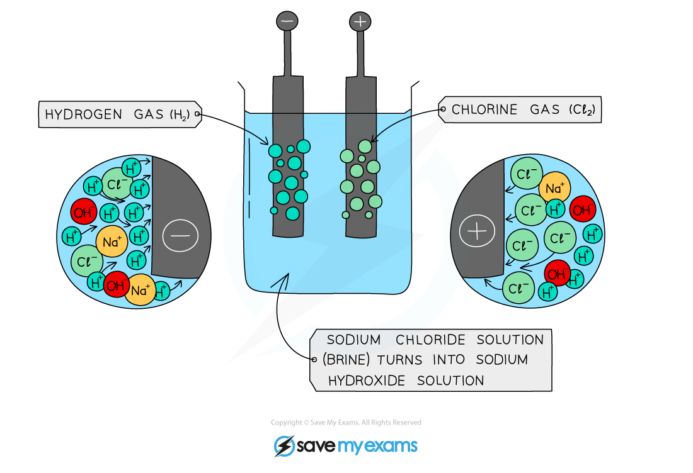
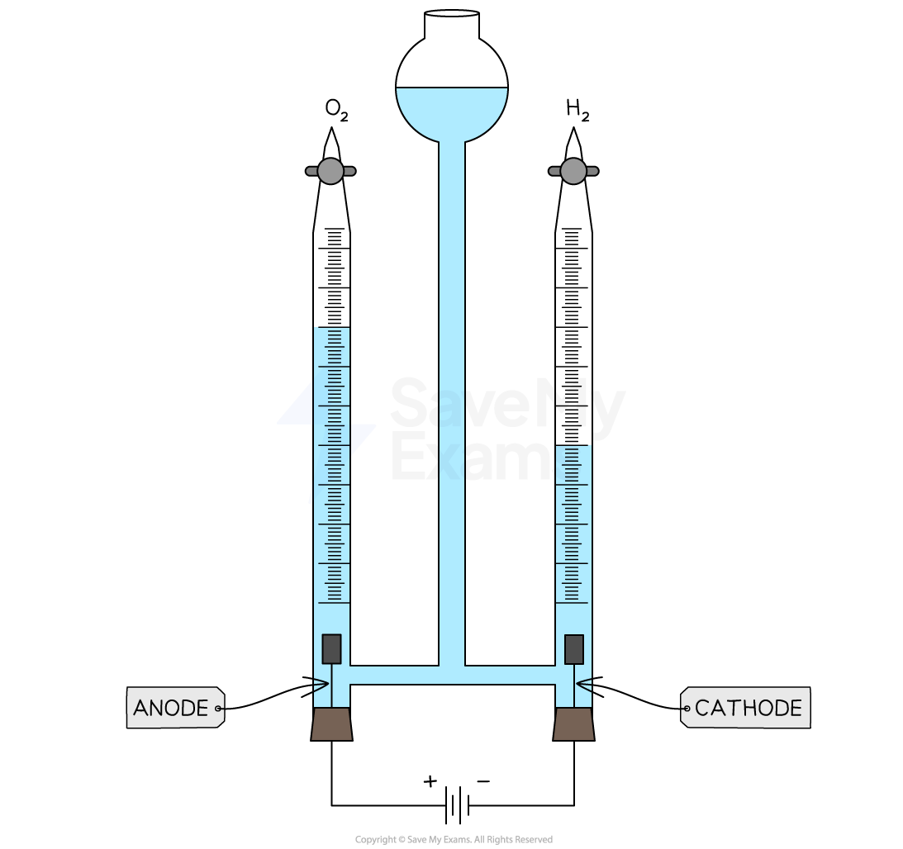

# Electrolysis of Aqueous Sodium Chloride & Dilute Sulfuric Acid

## Electrolysis of aqueous sodium chloride & dilute sulfuric acid

> **Spec point** — `spcpt_RMKmHc3g9tkTFS4h`

## Electrolysis of aqueous sodium chloride & dilute sulfuric acid

### Electrolysis of aqueous sodium chloride

- **Brine **is a concentrated solution of aqueous sodium chloride
- It can be electrolysed using inert electrodes made from platinum or carbon / graphite
- The ions in brine are:

  - Na+ and Cl– ions from the brine / aqueous sodium chloride
  - H+ and OH– ions from the water
- When electrolysed, it produces bubbles of gas at both electrodes

  - The gases chlorine and hydrogen are produced
  - Sodium hydroxide solution is the product remaining in the electrolysis chamber / container
- These substances all have important industrial uses:

  - Chlorine is used to make bleach
  - Hydrogen is used to make margarine
  - Sodium hydroxide is used to make soap and detergents

#### Product at the negative electrode:

- The H+ ions are discharged at the** cathode **as they are less reactive than sodium ions
- The H+ ions gain electrons to form **hydrogen **gas

#### Product at the positive electrode:

- The Cl– ions are discharged at the **anode **
- They lose electrons and **chlorine gas forms**
- The Na+ and OH– ions remain behind and form the NaOH solution

***Diagram showing the products of the electrolysis of aqueous sodium chloride***

### Electrolysis of dilute sulfuric acid

- Dilute sulfuric acid can be electrolysed using inert electrodes made from platinum or carbon / graphite
- The ions in dilute sulfuric acid are:

  - H+ and SO42– ions from the sulfuric acid
  - H+ and OH– ions from the water
- When electrolysed, it produces bubbles of gas at both electrodes

  - The gases oxygen and hydrogen are produced

***Electrolysing dilute sulfuric acid in a Hoffman voltameter shows that twice as much hydrogen is produced, compared to oxygen***

#### Product at the negative electrode:

- H+ ions are attracted to the **cathode**
- The H+ ions gain electrons to form **hydrogen **gas

#### Product at the positive electrode:

- OH- ions are attracted to the **anode**
- They lose electrons and form **oxygen gas** and water

> **Exam Hint**
> - When a gas is produced during electrolysis, you should be able to give the appropriate [gas test](https://www.savemyexams.com/igcse/science/cie/co-ordinated-sciences-double-award/23/chemistry/revision-notes/experimental-techniques-and-chemical-analysis/identification-of-ions-and-gases/identification-of-gases/):
> 
>   - Oxygen - if a glowing splint is dipped into a sample of the gas, then the splint will relight
>   - Hydrogen - if a lit splint is dipped into a sample of the gas, then a squeaky pop will be heard
>   - Chlorine - if damp litmus paper is dipped into a sample of the gas, it will turn red and then bleach to a white colour
