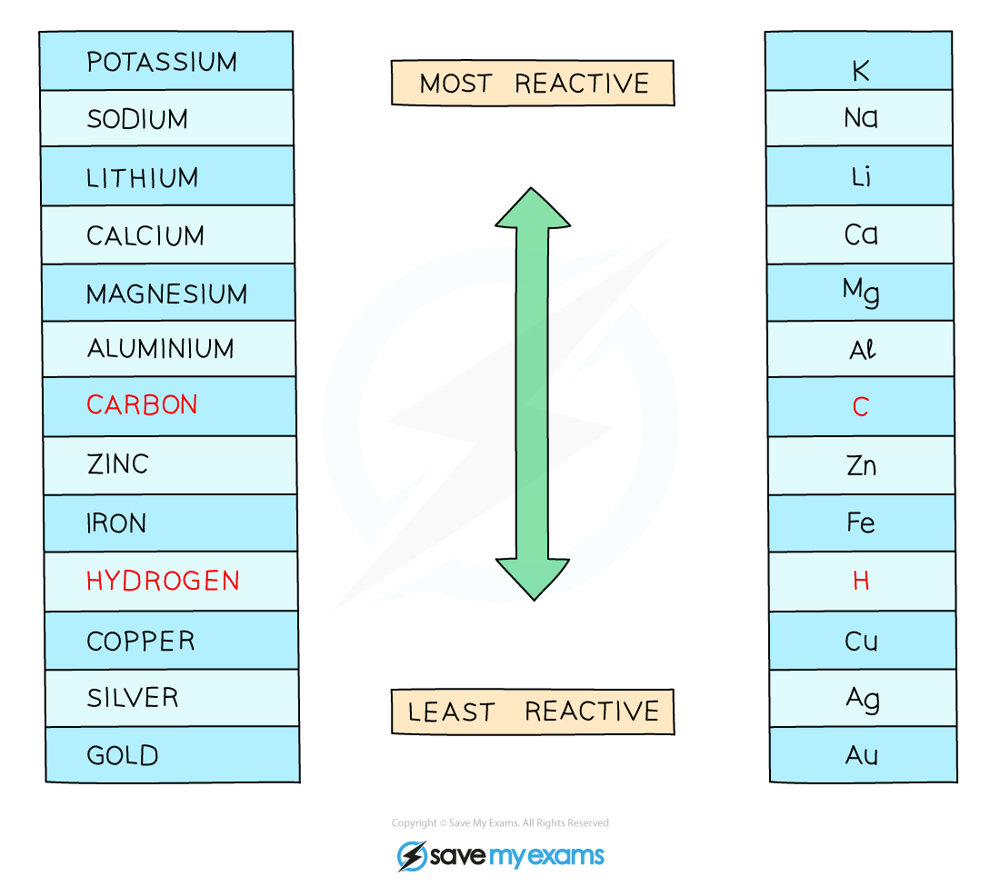
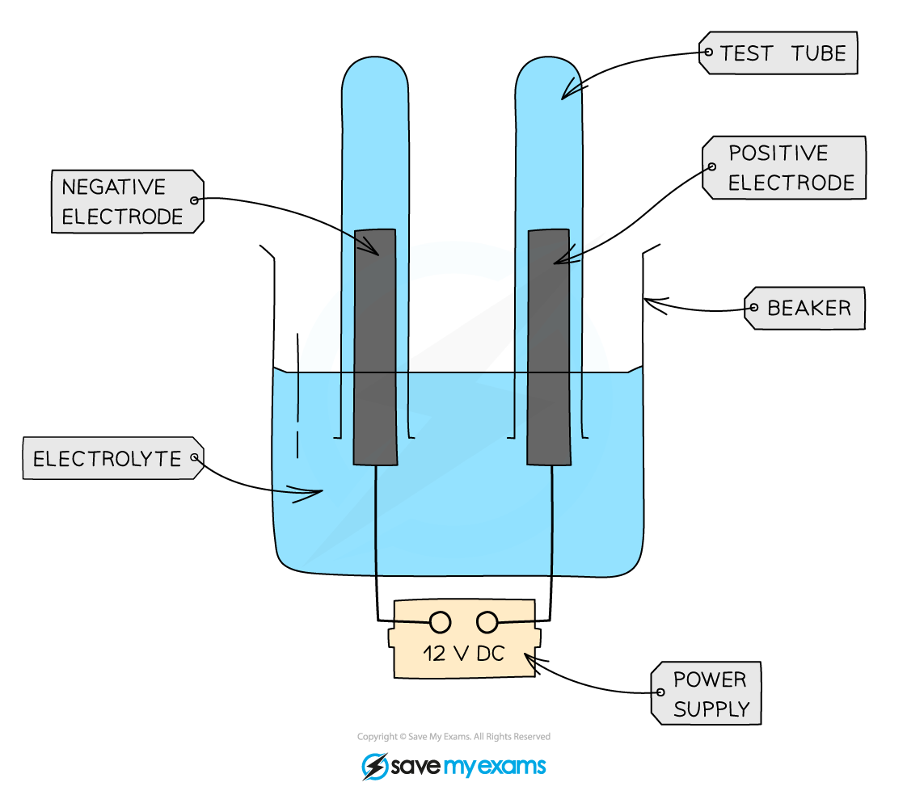
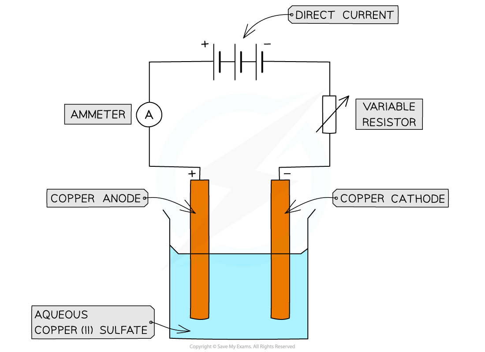

# Electrolysis of Aqueous Solutions

## Electrolysis of aqueous solutions

> **Spec point** — `spcpt_RsgF5qqcxZCyjZrN` · Predict the identity of the products at each electrode for the electrolysis of a halide compound in dilute or concentrated aqueous solution
Identify the products formed at the electrodes and describe the observations made during the electrolysis of aqueous copper(II) sulfate using inert carbon/ graphite electrodes and when using copper electrodes

## Electrolysis of aqueous solutions

#### Extended tier only

- Aqueous solutions always have water, H2O, present
- In the electrolysis of aqueous solutions, the water molecules dissociate producing H+ and OH– ions:

**H****2****O ⇌ H****+**** + OH****–**

- These ions are also involved in the process and their chemistry must be considered
- We now have an electrolyte that contains ions from the compound plus ions from the water
- Which ions get discharged and at which electrode depends on the **relative reactivity** of the elements involved
- Concentrated and dilute solutions of the **same** compound give **different** products
- For anions, the **more concentrated** ion will tend to get discharged over a more dilute ion

### Positive electrode - anode

- Negatively charged OH– ions and non-metal ions are attracted to the positive electrode
- If halide ions (Cl–, Br–, I–) are present, the halogen is produced at the anode

  - The halide ions lose electrons and forms the halogen (chlorine, bromine or iodine)
- If there are no halide ions but OH– ions are present, oxygen is produced at the anode

  - The hydroxide ions lose electrons and forms oxygen gas (and water)
- In both cases, the other negative ion remains in solution

#### How concentration affects products at the anode

- The concentration of the solution affects the ion being discharged:

  - If a **concentrated** halide solution is being electrolysed, the **halogen** forms at the anode
  - If a **dilute **halide solution is being electrolysed, **oxygen** forms at the anode
- For example:

  - For concentrated barium chloride solution :
  
    - Cl– ions are discharged more readily than the OH– ions
    - So, chlorine gas is produced at the anode
  - For dilute barium chloride solution:
  
    - Only OH– ions are discharged
    - So, oxygen is produced at the anode

### Negative electrode - cathode

- Positively charged H+ and metal ions are attracted to the negative electrode but only one will gain electrons
- Either hydrogen gas or metal will be produced
- If the metal is **above hydrogen** in the reactivity series:

  - The ions of the more reactive metal remain in solution
  - This causes the less reactive hydrogen ions, H+, to be discharged
  - So, hydrogen will be produced and bubbling will be seen at the cathode
- If the metal is **below hydrogen** in the reactivity series:

  - The less reactive metal ions are discharged
  - So, the **metal** is produced and this will be seen plating onto the cathode

***The reactivity series of metals including hydrogen and carbon***

### Electrolysis of aqueous copper sulfate

- Aqueous copper sulfate contains the following ions:

  - Cu2+ and SO42– from the copper sulfate
  - H+ and OH– from the water

#### Using graphite electrodes:

***Apparatus for the electrolysis of copper(II)sulfate using inert / passive graphite electrodes***

**Observations:**

- The cathode is coated with a **pink-brown layer** of copper metal
- Bubbles of a **colourless gas** (oxygen) are seen forming at the anode
- The **blue colour** of the copper(II) sulfate solution **fades** over time

**Product at the cathode:**

- Cu2+ and H+ will both be attracted to the cathode but the less reactive ion will be discharged

  - In this case, copper is less reactive than hydrogen
  - Copper ions are discharged at the cathode
  
    - They gain electrons and are reduced to form copper metal
  - The half equation for the reaction at the electrode is:

Cu2+ + 2e– → Cu

**Product at the anode:**

- SO42– and OH– are both attracted to the anode

  - OH– ions lose electrons more readily than SO42-
  - OH– lose electrons and are oxidised to form oxygen gas
  - The half equation for the reaction at the anode is

4OH– ⟶ O2 + 2H2O + 4e–

#### Using copper electrodes:

***Apparatus for the electrolysis of copper(II)sulfate using active copper electrodes***

**Observations at the anode and cathode:**

- The **blue colour** of the copper(II) sulfate solution **remains unchanged**
- The **cathode increases** in mass as it is coated with a layer of copper

  - This is because copper ions, Cu2+, are **reduced** at the cathode and form copper atoms
- The **anode** **decreases** in mass as it dissolves

  - This is because copper atoms are **oxidised** at the anode and form copper ions, Cu2+
- The gain in mass by the negative electrode is the **same** as the loss in mass by the positive electrode

  - Therefore, the copper deposited on the negative electrode must be the **same** copper ions that are lost from the positive electrode
- This implies that the concentration of the Cu2+ ions in the solution remains **constant**

#### Products formed for common aqueous solutions

| **Aqueous solution - ions present** | **Product at the anode** | **Product at the cathode** |
|---|---|---|
| **Concentrated sodium chloride, NaCl** | Chlorine gas | Hydrogen gas |
| **Dilute sodium chloride, NaCl** | Oxygen gas | Hydrogen gas |
| **Concentrated aqueous copper(II) sulfate, CuSO****4**** ** | Oxygen gas | Copper |
| **Dilute sulfuric acid, H****2****SO****4**** ** | Oxygen gas | Hydrogen gas |
